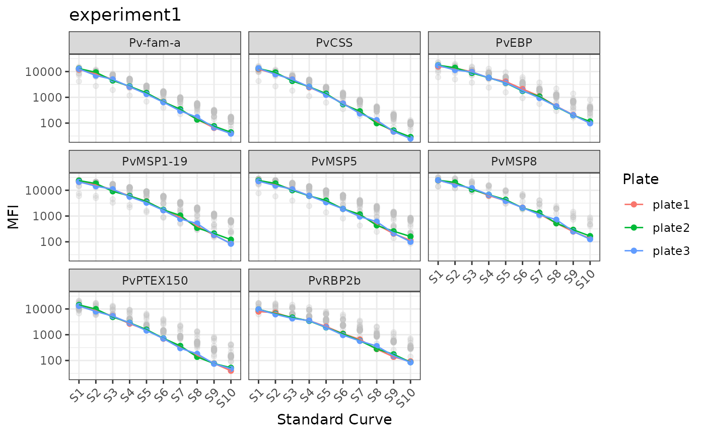
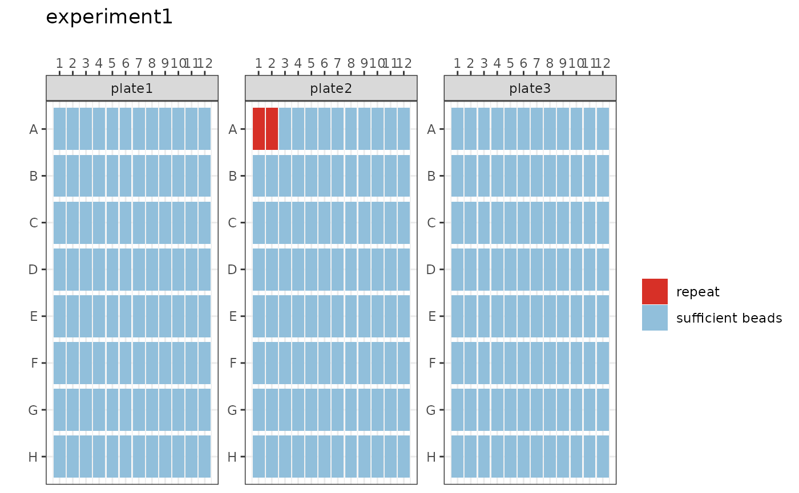
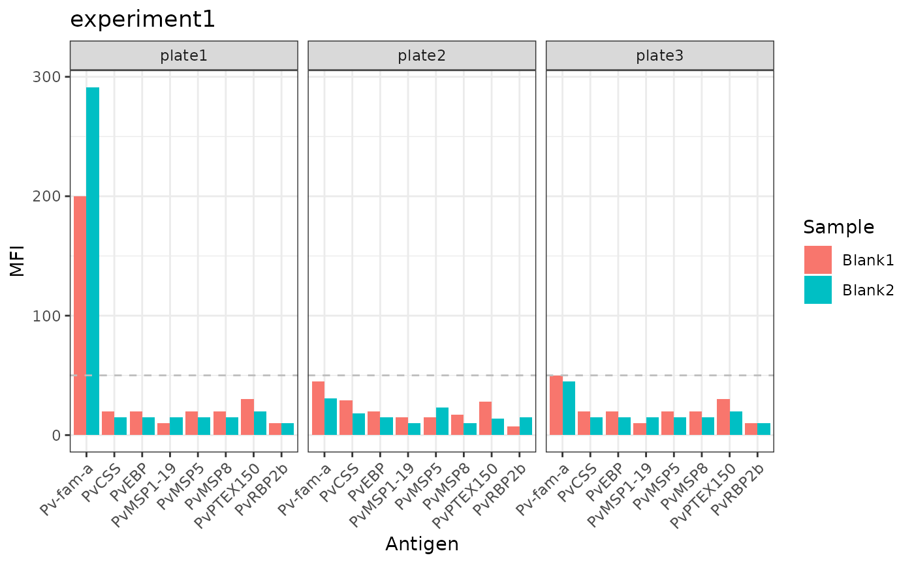
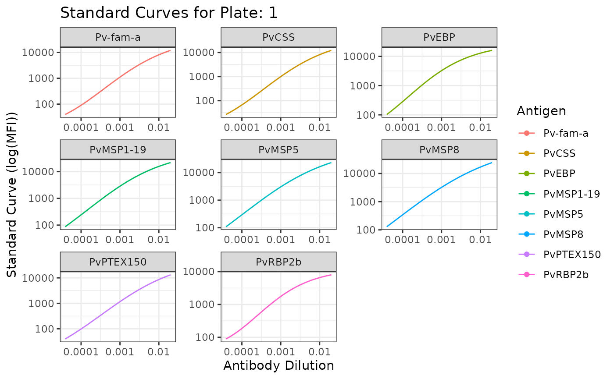
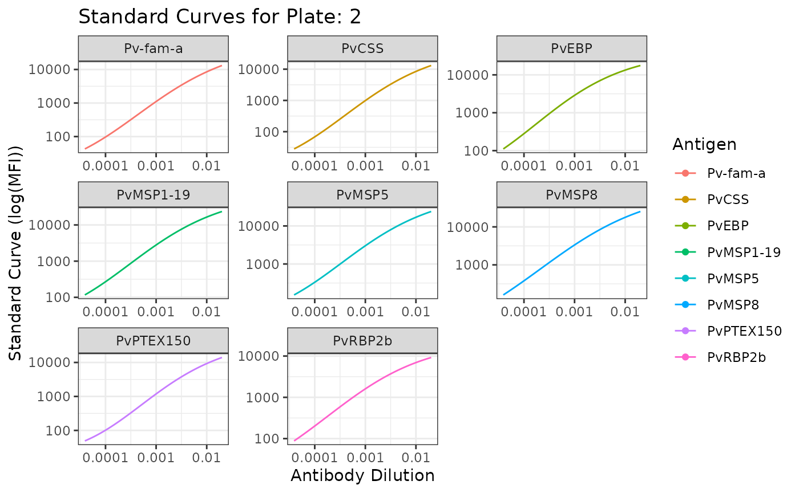
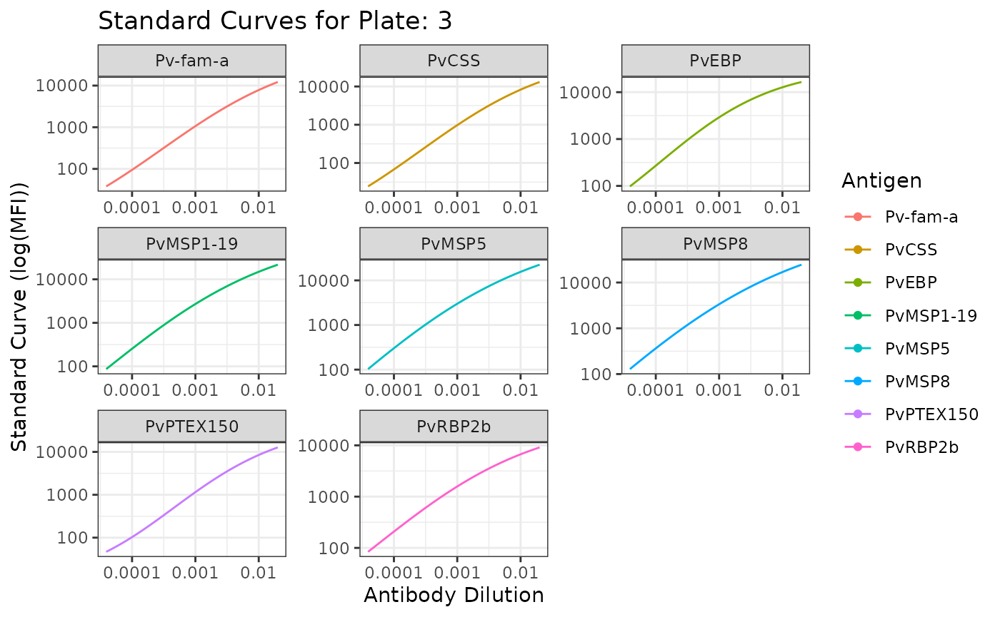

# Pathogen-agnostic Sero-analysis Tutorial

If you would like to run the
[SeroTrackR](https://github.com/dionnecargy/SeroTrackR) R package data
processing pipeline for work not relating to the fit-for-purpose tool
leveraging eight *Plasmodium vivax* serological exposure markers, then
this is the tutorial for you!

## Essential

Please ensure that you have read and prepared your raw Luminex files and
plate layout files as per the instructions in the
[setup](https://dionnecargy.github.io/SeroTrackR/articles/setup.md)
vignette.

## Step 1: Read in Raw Data

For this tutorial, we will be using the built-in files within
[SeroTrackR](https://github.com/dionnecargy/SeroTrackR) that are
extrapolated from *Plasmodium vivax* samples.

``` r

library(SeroTrackR)
library(tidyverse)

your_raw_data <- c(
  system.file("extdata", "example_MAGPIX_plate1.csv", package = "SeroTrackR"),
  system.file("extdata", "example_MAGPIX_plate2.csv", package = "SeroTrackR"), 
  system.file("extdata", "example_MAGPIX_plate3.csv", package = "SeroTrackR")
)
your_plate_layout <- system.file("extdata", "example_platelayout_1.xlsx", package = "SeroTrackR")
```

To run your OWN data, follow the code below and uncomment (i.e., remove
the hashtags):

``` r

your_raw_data <- c(
  "PATH/TO/YOUR/FILE/plate1.csv",
  "PATH/TO/YOUR/FILE/plate2.csv",
  "PATH/TO/YOUR/FILE/plate3.csv"
)
your_plate_layout <- "PATH/TO/YOUR/FILE/plate_layout.xlsx"
```

You can read any Luminex serology data file using the
[`readSeroData()`](https://dionnecargy.github.io/SeroTrackR/reference/readSeroData.md)
function.

The Luminex platform can be specified using the `platform` argument,
with either `bioplex`, `magpix` or `intelliflex`.

For the xPONENT software-based exported files (MAGPIX or INTELLIFLEX),
the version of the software should be specified as either **“4.2”** or
**“4.3”**, with the version **“4.2”** as the default.

``` r

sero_data <- readSeroData(
  raw_data = your_raw_data, 
  platform = "magpix",        # default 
  version = "4.2"             # default 
)
#> PASS: File example_magpix_plate1.csv successfully validated.
#> PASS: File example_magpix_plate2.csv successfully validated.
#> PASS: File example_magpix_plate3.csv successfully validated.
```

This exports a list of data frames:

1.  `data_raw`: The raw, unedited files: A check that the correct file/s
    were added.
2.  `results`: The processed serological data files: Antigen names
    compatible with the R package, clear columns for each antigen and
    their MFI results.
3.  `counts`: The bead counts detected from the Luminex instrument per
    antigen, per sample, for each plate.
4.  `blanks`: The MFI results for the blank wells.
5.  `stds`: The MFI results for the standard curve samples.
6.  `run`: The run information from the Luminex machine.

You can access each data frame, for example the `results` data frame,
like this:

``` r

sero_data$results
#>      Location     Sample     EBP   LF005   LF010   LF016    MSP8 RBP2b.P87
#> 1     1(1,A1)     Blank1    20.0   200.0    20.0    10.0    20.0      10.0
#> 2     2(1,A2)     Blank2    15.0   291.0    15.0    15.0    15.0      10.0
#> 3     3(1,A3)         S1 15710.5 11990.0 22583.0 21244.0 24306.0    7907.5
#> 4     4(1,A4)         S2 13545.0  8285.0 16947.5 16146.0 17172.0    7186.0
#> 5     5(1,A5)         S3  9767.0  4950.0 10865.0 10621.5 11358.0    4475.5
#> 6     6(1,A6)         S4  5648.5  2519.0  6060.0  5968.5  6237.0    3508.0
#> 7     7(1,A7)         S5  4104.5  1431.0  3711.5  3738.0  3883.5    2082.0
#> 8     8(1,A8)         S6  2105.0   676.5  1889.0  1667.0  2136.0    1102.0
#> 9     9(1,A9)         S7  1107.0   328.0  1106.0   890.0  1204.0     657.0
#> 10  10(1,A10)         S8   452.5   141.0   465.0   405.5   522.0     277.0
#> 11  11(1,A11)         S9   209.0    65.0   206.5   181.5   249.0     138.0
#> 12  12(1,A12)        S10   105.0    42.0   113.5    87.0   134.0      93.0
#> 13   13(1,B1) Unknown013  2712.0  1569.0   673.0   327.0   182.0    1068.0
#> 14   14(1,B2) Unknown014   134.0   378.0   117.0   197.0    58.0     465.5
#> 15   15(1,B3) Unknown015   182.0   209.0   208.0   374.0   221.5     463.0
#> 16   16(1,B4) Unknown016   152.0   229.5   101.0    89.0    48.0     591.0
#> 17   17(1,B5) Unknown017  1135.0   236.0   299.0   507.0   209.5     671.0
#> 18   18(1,B6) Unknown018   174.0   395.0   175.0    78.0    70.0     103.0
#> 19   19(1,B7) Unknown019   421.0  2081.5   529.0   149.0   962.0    1441.5
#> 20   20(1,B8) Unknown020    24.0    49.0    22.0    13.0    15.5      14.0
#> 21   21(1,B9) Unknown021    24.0    45.0    22.0    13.0    16.0      13.0
#> 22  22(1,B10) Unknown022 21464.0 11789.0  2508.5  8001.0  2342.0    1386.0
#> 23  23(1,B11) Unknown023   795.0  6135.5   407.0   273.0   535.5    1575.0
#> 24  24(1,B12) Unknown024  1574.0   348.5   892.0   288.0   306.0     590.0
#> 25   25(1,C1) Unknown025   146.0   408.5  1130.5    83.0   100.0     301.0
#> 26   26(1,C2) Unknown026  1330.5  3036.0   965.0   174.0    79.0    1090.0
#> 27   27(1,C3) Unknown027   358.0  4074.5   335.5   140.0   390.0    6704.0
#> 28   28(1,C4) Unknown028   481.0  1870.0   421.0   182.5  1777.5    2390.0
#> 29   29(1,C5) Unknown029   551.0  1282.0   331.5   165.0    77.0     244.0
#> 30   30(1,C6) Unknown030   943.0   584.5   235.0   135.0  3017.0    1034.0
#> 31   31(1,C7) Unknown031   532.5  1533.0   315.0   210.0  2575.5    2903.0
#> 32   32(1,C8) Unknown032   768.0 12605.0   409.0  7632.0  9860.0   13703.0
#> 33   33(1,C9) Unknown033   130.0   239.5    72.0    64.0    37.0     156.0
#> 34  34(1,C10) Unknown034    40.0    60.0    37.0    25.0    26.5      23.5
#> 35  35(1,C11) Unknown035   167.0   605.0   253.0   329.0  3973.0    1426.5
#> 36  36(1,C12) Unknown036  1879.0  4562.0   415.0 18287.0 11482.5   12031.0
#> 37   37(1,D1) Unknown037   256.0  1507.0   117.0   129.0   168.0     488.0
#> 38   38(1,D2) Unknown038    24.0    49.0    22.0    12.0    15.0      14.0
#> 39   39(1,D3) Unknown039   384.0  1708.0   326.0  1172.5   986.0    1041.0
#> 40   40(1,D4) Unknown040   210.0   512.0   221.0   191.0    89.0     203.0
#> 41   41(1,D5) Unknown041   351.5   312.0   165.5    88.0    66.0     205.0
#> 42   42(1,D6) Unknown042  1278.0  5810.0   275.0   230.5   137.0    2032.0
#> 43   43(1,D7) Unknown043   318.0   397.0   130.0   130.5    78.0     903.0
#> 44   44(1,D8) Unknown044   493.5  2980.5   401.0  5932.5  3536.0    4699.5
#> 45   45(1,D9) Unknown045  9686.0   873.0   333.0   166.0   791.0    1093.0
#> 46  46(1,D10) Unknown046   777.5   581.0   241.5   173.0  1479.5     899.0
#> 47  47(1,D11) Unknown047   455.0   416.5   126.0    67.0    48.0     400.0
#> 48  48(1,D12) Unknown048   202.0  1142.0   137.5   176.0   204.5    1090.0
#> 49   49(1,E1) Unknown049   333.5   623.5   368.0 10430.0  2340.0    4375.0
#> 50   50(1,E2) Unknown050   561.0  7984.0   441.0   128.0   141.0    1993.0
#> 51   51(1,E3) Unknown051   506.5   340.0   152.5   147.0    90.0     600.0
#> 52   52(1,E4) Unknown052   254.0   367.0   392.5    89.0   142.5     280.0
#> 53   53(1,E5) Unknown053   888.0  1955.0   438.0   173.0   507.0    1009.0
#> 54   54(1,E6) Unknown054   426.0  1877.0   186.0  9767.0 15945.0   10073.0
#> 55   55(1,E7) Unknown055  5733.0  1301.5  1920.5   220.5  4833.0    2340.0
#> 56   56(1,E8) Unknown056 19092.0 14422.0  1993.0 12836.5  7426.0   11930.0
#> 57   57(1,E9) Unknown057   596.0 15139.0   371.5   229.0   535.5   14032.0
#> 58  58(1,E10) Unknown058  1028.0  2646.0  1486.0   292.0  9357.0    8009.0
#> 59  59(1,E11) Unknown059   512.0  4735.0  3408.0   127.5   191.0    4401.0
#> 60  60(1,E12) Unknown060   883.0  1953.0   755.0   586.0   122.0     830.0
#> 61   61(1,F1) Unknown061   977.0  8719.0   509.0   187.0  1289.0   12930.0
#> 62   62(1,F2) Unknown062   791.0  1944.0   465.0   216.5 12307.0    5029.0
#> 63   63(1,F3) Unknown063   397.0   987.0   924.0   133.0    79.0     253.0
#> 64   64(1,F4) Unknown064  1111.0   613.0   357.0   196.0  8496.0    7914.0
#> 65   65(1,F5) Unknown065   956.0  2369.0   644.0   389.0  8762.0    9649.0
#> 66   66(1,F6) Unknown066  1307.0 20590.0  1335.0 10780.0 12736.0   25375.5
#> 67   67(1,F7) Unknown067   433.0   382.0   173.0   105.0    59.0     480.0
#> 68   68(1,F8) Unknown068   161.0   279.0  2524.5   105.5    55.0     307.0
#> 69   69(1,F9) Unknown069   439.0   732.5   397.0  2108.0  9692.0    8090.0
#> 70  70(1,F10) Unknown070  1837.0 11406.0   467.5 20011.0 19606.0   24476.5
#> 71  71(1,F11) Unknown071   244.0  1665.5   166.0   124.0   154.0     224.0
#> 72  72(1,F12) Unknown072   482.0  3990.5   388.0  3736.0  7436.0    7361.0
#> 73   73(1,G1) Unknown073   656.0  3103.0   505.0 14386.0  2343.0    5503.0
#> 74   74(1,G2) Unknown074   243.0   568.5   693.0   141.0    79.0     339.0
#> 75   75(1,G3) Unknown075  1409.5  1123.0   379.0   153.0   167.5    1013.0
#> 76   76(1,G4) Unknown076   467.5  6741.0   238.0   174.0   181.0    6160.0
#> 77   77(1,G5) Unknown077   329.0   630.0   196.0   119.0   278.0     787.0
#> 78   78(1,G6) Unknown078  1122.5 17810.0   677.0 12254.0 16011.0   18719.0
#> 79   79(1,G7) Unknown079 10853.0   817.5   255.0   189.0  2247.5    3322.0
#> 80   80(1,G8) Unknown080   743.5   820.0   313.5   289.0  9351.5    7171.0
#> 81   81(1,G9) Unknown081   723.0  1255.0   299.0   253.0    95.0     712.0
#> 82  82(1,G10) Unknown082   168.0   684.0   131.0   198.0   135.5     392.0
#> 83  83(1,G11) Unknown083   180.0   276.0   205.0  4646.5  2550.0    2664.5
#> 84  84(1,G12) Unknown084   249.5  4104.0   250.0    96.0    68.0    1020.0
#> 85   85(1,H1) Unknown085   479.0   190.0   105.0   131.0    66.0    1449.0
#> 86   86(1,H2) Unknown086   164.0   327.0   234.5    66.0    75.5     259.0
#> 87   87(1,H3) Unknown087   281.5  1794.0   413.0    75.0   469.5     802.0
#> 88   88(1,H4) Unknown088   269.0  1067.0   141.0  7595.0 14464.0    7592.0
#> 89   89(1,H5) Unknown089  3247.0   382.0   470.0    98.0  2319.5    2009.0
#> 90   90(1,H6) Unknown090 20593.0 14902.5  2021.0 10184.0  5805.5   14083.5
#> 91   91(1,H7) Unknown091   395.0  9914.0   211.0   131.5   325.0    3021.0
#> 92   92(1,H8) Unknown092   904.5  1871.0   793.0   172.0  6106.0    2093.0
#> 93   93(1,H9) Unknown093   323.0  2007.5  1950.0   106.0   191.0    2411.0
#> 94  94(1,H10) Unknown094   706.0  2087.0   791.0   169.0    66.0     990.0
#> 95  95(1,H11) Unknown095   323.0  4950.0   264.0   107.0   645.0    7092.0
#> 96  96(1,H12) Unknown096   367.0  1067.0   259.0   101.0  7423.0    1203.0
#> 97    1(1,A1)     Blank1    20.0    45.0    15.0    15.0    17.0       7.0
#> 98    2(1,A2)     Blank2    15.0    31.0    23.0    10.0    10.0      15.0
#> 99    3(1,A3)         S1 17664.0 13024.0 24023.5 23687.0 24512.0    9648.0
#> 100   4(1,A4)         S2 14051.0  9319.0 18419.0 18294.0 20151.5    6529.5
#> 101   5(1,A5)         S3  8807.0  4496.5  9995.0  9094.5 10652.5    4671.0
#> 102   6(1,A6)         S4  5744.0  2675.5  6065.0  6029.0  6723.0    3427.0
#> 103   7(1,A7)         S5  3631.5  1486.0  4004.0  3673.0  4293.5    1910.0
#> 104   8(1,A8)         S6  1751.5   664.0  1898.0  1746.0  2068.0    1082.0
#> 105   9(1,A9)         S7  1076.0   347.0  1165.0  1052.0  1346.0     586.0
#> 106 10(1,A10)         S8   433.0   137.0   432.0   346.0   522.0     283.0
#> 107 11(1,A11)         S9   200.5    76.0   257.0   211.0   293.0     174.0
#> 108 12(1,A12)        S10   116.0    44.0   161.0   121.5   167.0      86.0
#> 109  13(1,B1) Unknown097  2712.0  1569.0   673.0   327.0   182.0    2208.0
#> 110  14(1,B2) Unknown098   134.0   378.0   117.0   197.0    58.0     290.0
#> 111  15(1,B3) Unknown099   182.0   209.0   208.0   374.0   221.5     376.0
#> 112  16(1,B4) Unknown100   152.0   229.5   101.0    89.0    48.0     103.0
#> 113  17(1,B5) Unknown101  1135.0   236.0   299.0   507.0   209.5     650.0
#> 114  18(1,B6) Unknown102   174.0   395.0   175.0    78.0    70.0     293.5
#> 115  19(1,B7) Unknown103   421.0  2081.5   529.0   149.0   962.0    1632.5
#> 116  20(1,B8) Unknown104    24.0    49.0    22.0    13.0    15.5      14.0
#> 117  21(1,B9) Unknown105    24.0    45.0    22.0    13.0    16.0      13.0
#> 118 22(1,B10) Unknown106 21464.0 11789.0  2508.5  8001.0  2342.0    9995.5
#> 119 23(1,B11) Unknown107   795.0  6135.5   407.0   273.0   535.5    7092.0
#> 120 24(1,B12) Unknown108  1574.0   348.5   892.0   288.0   306.0     548.0
#> 121  25(1,C1) Unknown109   146.0   408.5  1130.5    83.0   100.0     443.0
#> 122  26(1,C2) Unknown110  1330.5  3036.0   965.0   174.0    79.0    1092.0
#> 123  27(1,C3) Unknown111   358.0  4074.5   335.5   140.0   390.0    7093.0
#> 124  28(1,C4) Unknown112   481.0  1870.0   421.0   182.5  1777.5    1832.0
#> 125  29(1,C5) Unknown113   551.0  1282.0   331.5   165.0    77.0     244.0
#> 126  30(1,C6) Unknown114   943.0   584.5   235.0   135.0  3017.0    5339.0
#> 127  31(1,C7) Unknown115   532.5  1533.0   315.0   210.0  2575.5    1029.0
#> 128  32(1,C8) Unknown116   768.0 12605.0   409.0  7632.0  9860.0    7201.0
#> 129  33(1,C9) Unknown117   130.0   239.5    72.0    64.0    37.0     156.0
#> 130 34(1,C10) Unknown118    40.0    60.0    37.0    25.0    26.5      23.5
#> 131 35(1,C11) Unknown119   167.0   605.0   253.0   329.0  3973.0    2812.0
#> 132 36(1,C12) Unknown120  1879.0  4562.0   415.0 18287.0 11482.5    6291.0
#> 133  37(1,D1) Unknown121   256.0  1507.0   117.0   129.0   168.0     315.0
#> 134  38(1,D2) Unknown122    24.0    49.0    22.0    12.0    15.0      14.0
#> 135  39(1,D3) Unknown123   384.0  1708.0   326.0  1172.5   986.0     902.0
#> 136  40(1,D4) Unknown124   210.0   512.0   221.0   191.0    89.0     398.0
#> 137  41(1,D5) Unknown125   351.5   312.0   165.5    88.0    66.0     174.0
#> 138  42(1,D6) Unknown126  1278.0  5810.0   275.0   230.5   137.0    1903.7
#> 139  43(1,D7) Unknown127   318.0   397.0   130.0   130.5    78.0     492.1
#> 140  44(1,D8) Unknown128   493.5  2980.5   401.0  5932.5  3536.0    4699.5
#> 141  45(1,D9) Unknown129  9686.0   873.0   333.0   166.0   791.0     653.0
#> 142 46(1,D10) Unknown130   777.5   581.0   241.5   173.0  1479.5     439.0
#> 143 47(1,D11) Unknown131   455.0   416.5   126.0    67.0    48.0     143.0
#> 144 48(1,D12) Unknown132   202.0  1142.0   137.5   176.0   204.5     210.0
#> 145  49(1,E1) Unknown133   333.5   623.5   368.0 10430.0  2340.0    4375.0
#> 146  50(1,E2) Unknown134   561.0  7984.0   441.0   128.0   141.0     431.0
#> 147  51(1,E3) Unknown135   506.5   340.0   152.5   147.0    90.0     299.0
#> 148  52(1,E4) Unknown136   254.0   367.0   392.5    89.0   142.5     323.5
#> 149  53(1,E5) Unknown137   888.0  1955.0   438.0   173.0   507.0     829.0
#> 150  54(1,E6) Unknown138   426.0  1877.0   186.0  9767.0 15945.0   10073.0
#> 151  55(1,E7) Unknown139  5733.0  1301.5  1920.5   220.5  4833.0    3718.0
#> 152  56(1,E8) Unknown140 19092.0 14422.0  1993.0 12836.5  7426.0   14663.0
#> 153  57(1,E9) Unknown141   596.0 15139.0   371.5   229.0   535.5    9105.0
#> 154 58(1,E10) Unknown142  1028.0  2646.0  1486.0   292.0  9357.0    7769.5
#> 155 59(1,E11) Unknown143   512.0  4735.0  3408.0   127.5   191.0    2401.0
#> 156 60(1,E12) Unknown144   883.0  1953.0   755.0   586.0   122.0     398.0
#> 157  61(1,F1) Unknown145   977.0  8719.0   509.0   187.0  1289.0    6039.5
#> 158  62(1,F2) Unknown146   791.0  1944.0   465.0   216.5 12307.0    3907.0
#> 159  63(1,F3) Unknown147   397.0   987.0   924.0   133.0    79.0     253.0
#> 160  64(1,F4) Unknown148  1111.0   613.0   357.0   196.0  8496.0     914.0
#> 161  65(1,F5) Unknown149   956.0  2369.0   644.0   389.0  8762.0    7649.0
#> 162  66(1,F6) Unknown150  1307.0 20590.0  1335.0 10780.0 12736.0    9375.5
#> 163  67(1,F7) Unknown151   433.0   382.0   173.0   105.0    59.0     599.0
#> 164  68(1,F8) Unknown152   161.0   279.0  2524.5   105.5    55.0     491.0
#> 165  69(1,F9) Unknown153   439.0   732.5   397.0  2108.0  9692.0    8115.0
#> 166 70(1,F10) Unknown154  1837.0 11406.0   467.5 20011.0 19606.0    9476.5
#> 167 71(1,F11) Unknown155   244.0  1665.5   166.0   124.0   154.0     224.0
#> 168 72(1,F12) Unknown156   482.0  3990.5   388.0  3736.0  7436.0    2361.0
#> 169  73(1,G1) Unknown157   656.0  3103.0   505.0 14386.0  2343.0     803.0
#> 170  74(1,G2) Unknown158   243.0   568.5   693.0   141.0    79.0     995.0
#> 171  75(1,G3) Unknown159  1409.5  1123.0   379.0   153.0   167.5     480.5
#> 172  76(1,G4) Unknown160   467.5  6741.0   238.0   174.0   181.0     904.5
#> 173  77(1,G5) Unknown161   329.0   630.0   196.0   119.0   278.0     321.0
#> 174  78(1,G6) Unknown162  1122.5 17810.0   677.0 12254.0 16011.0   18719.0
#> 175  79(1,G7) Unknown163 10853.0   817.5   255.0   189.0  2247.5     479.0
#> 176  80(1,G8) Unknown164   743.5   820.0   313.5   289.0  9351.5     771.0
#> 177  81(1,G9) Unknown165   723.0  1255.0   299.0   253.0    95.0     803.0
#> 178 82(1,G10) Unknown166   168.0   684.0   131.0   198.0   135.5     329.0
#> 179 83(1,G11) Unknown167   180.0   276.0   205.0  4646.5  2550.0    2664.5
#> 180 84(1,G12) Unknown168   249.5  4104.0   250.0    96.0    68.0     702.0
#> 181  85(1,H1) Unknown169   479.0   190.0   105.0   131.0    66.0     809.0
#> 182  86(1,H2) Unknown170   164.0   327.0   234.5    66.0    75.5     259.0
#> 183  87(1,H3) Unknown171   281.5  1794.0   413.0    75.0   469.5     388.0
#> 184  88(1,H4) Unknown172   269.0  1067.0   141.0  7595.0 14464.0    7592.0
#> 185  89(1,H5) Unknown173  3247.0   382.0   470.0    98.0  2319.5    1904.5
#> 186  90(1,H6) Unknown174 20593.0 14902.5  2021.0 10184.0  5805.5    9083.5
#> 187  91(1,H7) Unknown175   395.0  9914.0   211.0   131.5   325.0    6791.0
#> 188  92(1,H8) Unknown176   904.5  1871.0   793.0   172.0  6106.0    5444.0
#> 189  93(1,H9) Unknown177   323.0  2007.5  1950.0   106.0   191.0    1411.0
#> 190 94(1,H10) Unknown178   706.0  2087.0   791.0   169.0    66.0     899.0
#> 191 95(1,H11) Unknown179   323.0  4950.0   264.0   107.0   645.0    5201.0
#> 192 96(1,H12) Unknown180   367.0  1067.0   259.0   101.0  7423.0    2494.0
#> 193   1(1,A1)     Blank1    20.0    50.0    20.0    10.0    20.0      10.0
#> 194   2(1,A2)     Blank2    15.0    45.0    15.0    15.0    15.0      10.0
#> 195   3(1,A3)         S1 17357.0 12746.0 22462.0 21253.0 24716.5    9629.0
#> 196   4(1,A4)         S2 11465.0  7017.0 15284.0 14391.0 16327.0    6187.0
#> 197   5(1,A5)         S3  9607.0  4992.0 10884.0 10965.0 12073.0    4284.0
#> 198   6(1,A6)         S4  5730.5  2572.5  6139.0  5579.0  6660.0    3525.0
#> 199   7(1,A7)         S5  3695.0  1335.0  3426.0  3282.0  3843.5    1943.0
#> 200   8(1,A8)         S6  1838.0   644.5  1895.5  1668.0  2098.0     969.0
#> 201   9(1,A9)         S7   939.0   297.0   953.0   773.0  1130.0     573.0
#> 202 10(1,A10)         S8   446.5   169.5   604.0   511.5   724.0     363.0
#> 203 11(1,A11)         S9   204.0    67.5   214.0   185.0   254.0     152.5
#> 204 12(1,A12)        S10    98.0    39.0   100.0    84.0   126.0      85.0
#> 205  13(1,B1) Unknown181  2712.0  1569.0   673.0   327.0   182.0     593.0
#> 206  14(1,B2) Unknown182   134.0   378.0   117.0   197.0    58.0     128.0
#> 207  15(1,B3) Unknown183   182.0   209.0   208.0   374.0   221.5     348.0
#> 208  16(1,B4) Unknown184   152.0   229.5   101.0    89.0    48.0     180.0
#> 209  17(1,B5) Unknown185  1135.0   236.0   299.0   507.0   209.5     650.0
#> 210  18(1,B6) Unknown186   174.0   395.0   175.0    78.0    70.0     293.5
#> 211  19(1,B7) Unknown187   421.0  2081.5   529.0   149.0   962.0     532.5
#> 212  20(1,B8) Unknown188    24.0    49.0    22.0    13.0    15.5      14.0
#> 213  21(1,B9) Unknown189    24.0    45.0    22.0    13.0    16.0      13.0
#> 214 22(1,B10) Unknown190 21464.0 11789.0  2508.5  8001.0  2342.0    9995.5
#> 215 23(1,B11) Unknown191   795.0  6135.5   407.0   273.0   535.5   12560.0
#> 216 24(1,B12) Unknown192  1574.0   348.5   892.0   288.0   306.0    2060.0
#> 217  25(1,C1) Unknown193   146.0   408.5  1130.5    83.0   100.0     201.0
#> 218  26(1,C2) Unknown194  1330.5  3036.0   965.0   174.0    79.0     709.0
#> 219  27(1,C3) Unknown195   358.0  4074.5   335.5   140.0   390.0    5769.5
#> 220  28(1,C4) Unknown196   481.0  1870.0   421.0   182.5  1777.5    1845.0
#> 221  29(1,C5) Unknown197   551.0  1282.0   331.5   165.0    77.0     244.0
#> 222  30(1,C6) Unknown198   943.0   584.5   235.0   135.0  3017.0    5339.0
#> 223  31(1,C7) Unknown199   532.5  1533.0   315.0   210.0  2575.5    4592.5
#> 224  32(1,C8) Unknown200   768.0 12605.0   409.0  7632.0  9860.0    9340.5
#> 225  33(1,C9) Unknown201   130.0   239.5    72.0    64.0    37.0     156.0
#> 226 34(1,C10) Unknown202    40.0    60.0    37.0    25.0    26.5      23.5
#> 227 35(1,C11) Unknown203   167.0   605.0   253.0   329.0  3973.0    1412.0
#> 228 36(1,C12) Unknown204  1879.0  4562.0   415.0 18287.0 11482.5    5816.0
#> 229  37(1,D1) Unknown205   256.0  1507.0   117.0   129.0   168.0     315.0
#> 230  38(1,D2) Unknown206    24.0    49.0    22.0    12.0    15.0      14.0
#> 231  39(1,D3) Unknown207   384.0  1708.0   326.0  1172.5   986.0    1562.0
#> 232  40(1,D4) Unknown208   210.0   512.0   221.0   191.0    89.0     293.5
#> 233  41(1,D5) Unknown209   351.5   312.0   165.5    88.0    66.0     218.5
#> 234  42(1,D6) Unknown210  1278.0  5810.0   275.0   230.5   137.0     729.5
#> 235  43(1,D7) Unknown211   318.0   397.0   130.0   130.5    78.0     440.0
#> 236  44(1,D8) Unknown212   493.5  2980.5   401.0  5932.5  3536.0    4699.5
#> 237  45(1,D9) Unknown213  9686.0   873.0   333.0   166.0   791.0     621.0
#> 238 46(1,D10) Unknown214   777.5   581.0   241.5   173.0  1479.5    1037.5
#> 239 47(1,D11) Unknown215   455.0   416.5   126.0    67.0    48.0     270.0
#> 240 48(1,D12) Unknown216   202.0  1142.0   137.5   176.0   204.5     897.0
#> 241  49(1,E1) Unknown217   333.5   623.5   368.0 10430.0  2340.0    4375.0
#> 242  50(1,E2) Unknown218   561.0  7984.0   441.0   128.0   141.0    2119.5
#> 243  51(1,E3) Unknown219   506.5   340.0   152.5   147.0    90.0     399.0
#> 244  52(1,E4) Unknown220   254.0   367.0   392.5    89.0   142.5     323.5
#> 245  53(1,E5) Unknown221   888.0  1955.0   438.0   173.0   507.0    1584.0
#> 246  54(1,E6) Unknown222   426.0  1877.0   186.0  9767.0 15945.0   10073.0
#> 247  55(1,E7) Unknown223  5733.0  1301.5  1920.5   220.5  4833.0    3718.0
#> 248  56(1,E8) Unknown224 19092.0 14422.0  1993.0 12836.5  7426.0    8663.0
#> 249  57(1,E9) Unknown225   596.0 15139.0   371.5   229.0   535.5    8105.0
#> 250 58(1,E10) Unknown226  1028.0  2646.0  1486.0   292.0  9357.0    7769.5
#> 251 59(1,E11) Unknown227   512.0  4735.0  3408.0   127.5   191.0     901.0
#> 252 60(1,E12) Unknown228   883.0  1953.0   755.0   586.0   122.0     529.0
#> 253  61(1,F1) Unknown229   977.0  8719.0   509.0   187.0  1289.0    5039.5
#> 254  62(1,F2) Unknown230   791.0  1944.0   465.0   216.5 12307.0    8907.0
#> 255  63(1,F3) Unknown231   397.0   987.0   924.0   133.0    79.0     253.0
#> 256  64(1,F4) Unknown232  1111.0   613.0   357.0   196.0  8496.0    7914.0
#> 257  65(1,F5) Unknown233   956.0  2369.0   644.0   389.0  8762.0    4649.0
#> 258  66(1,F6) Unknown234  1307.0 20590.0  1335.0 10780.0 12736.0    7375.5
#> 259  67(1,F7) Unknown235   433.0   382.0   173.0   105.0    59.0     599.0
#> 260  68(1,F8) Unknown236   161.0   279.0  2524.5   105.5    55.0     491.0
#> 261  69(1,F9) Unknown237   439.0   732.5   397.0  2108.0  9692.0    6115.0
#> 262 70(1,F10) Unknown238  1837.0 11406.0   467.5 20011.0 19606.0    5476.5
#> 263 71(1,F11) Unknown239   244.0  1665.5   166.0   124.0   154.0     224.0
#> 264 72(1,F12) Unknown240   482.0  3990.5   388.0  3736.0  7436.0    3361.0
#> 265  73(1,G1) Unknown241   656.0  3103.0   505.0 14386.0  2343.0    2503.0
#> 266  74(1,G2) Unknown242   243.0   568.5   693.0   141.0    79.0    1295.0
#> 267  75(1,G3) Unknown243  1409.5  1123.0   379.0   153.0   167.5    1280.5
#> 268  76(1,G4) Unknown244   467.5  6741.0   238.0   174.0   181.0    1804.5
#> 269  77(1,G5) Unknown245   329.0   630.0   196.0   119.0   278.0     223.0
#> 270  78(1,G6) Unknown246  1122.5 17810.0   677.0 12254.0 16011.0    3142.0
#> 271  79(1,G7) Unknown247 10853.0   817.5   255.0   189.0  2247.5    1023.0
#> 272  80(1,G8) Unknown248   743.5   820.0   313.5   289.0  9351.5     873.0
#> 273  81(1,G9) Unknown249   723.0  1255.0   299.0   253.0    95.0     203.0
#> 274 82(1,G10) Unknown250   168.0   684.0   131.0   198.0   135.5     223.4
#> 275 83(1,G11) Unknown251   180.0   276.0   205.0  4646.5  2550.0     664.5
#> 276 84(1,G12) Unknown252   249.5  4104.0   250.0    96.0    68.0     563.0
#> 277  85(1,H1) Unknown253   479.0   190.0   105.0   131.0    66.0     406.0
#> 278  86(1,H2) Unknown254   164.0   327.0   234.5    66.0    75.5     259.0
#> 279  87(1,H3) Unknown255   281.5  1794.0   413.0    75.0   469.5     530.5
#> 280  88(1,H4) Unknown256   269.0  1067.0   141.0  7595.0 14464.0    7592.0
#> 281  89(1,H5) Unknown257  3247.0   382.0   470.0    98.0  2319.5    2304.5
#> 282  90(1,H6) Unknown258 20593.0 14902.5  2021.0 10184.0  5805.5   14083.5
#> 283  91(1,H7) Unknown259   395.0  9914.0   211.0   131.5   325.0    2791.0
#> 284  92(1,H8) Unknown260   904.5  1871.0   793.0   172.0  6106.0     744.0
#> 285  93(1,H9) Unknown261   323.0  2007.5  1950.0   106.0   191.0    2411.0
#> 286 94(1,H10) Unknown262   706.0  2087.0   791.0   169.0    66.0     412.0
#> 287 95(1,H11) Unknown263   323.0  4950.0   264.0   107.0   645.0    2381.0
#> 288 96(1,H12) Unknown264   367.0  1067.0   259.0   101.0  7423.0    1494.0
#>     PTEX150   PvCSS  Plate
#> 1      30.0    20.0 plate1
#> 2      20.0    15.0 plate1
#> 3   13207.0 12427.0 plate1
#> 4    8550.0  8034.0 plate1
#> 5    5329.0  4990.0 plate1
#> 6    2671.0  2446.5 plate1
#> 7    1548.0  1299.0 plate1
#> 8     698.5   581.0 plate1
#> 9     333.0   264.0 plate1
#> 10    156.0   111.0 plate1
#> 11     77.0    46.5 plate1
#> 12     40.0    28.0 plate1
#> 13    936.0   223.0 plate1
#> 14    122.0    93.0 plate1
#> 15    293.0   868.0 plate1
#> 16    109.0   110.0 plate1
#> 17   1665.5   266.0 plate1
#> 18    294.5    92.0 plate1
#> 19    241.0   282.0 plate1
#> 20     28.0    17.0 plate1
#> 21     29.0    17.0 plate1
#> 22   1992.0  2927.0 plate1
#> 23   8821.0   998.0 plate1
#> 24    315.0   366.0 plate1
#> 25    652.0   130.0 plate1
#> 26    179.0    92.0 plate1
#> 27   8814.0  5627.0 plate1
#> 28   2465.0   411.0 plate1
#> 29    579.0   229.0 plate1
#> 30   4928.0  7730.0 plate1
#> 31   2779.0  7300.0 plate1
#> 32   5612.0  6383.0 plate1
#> 33    204.0    49.0 plate1
#> 34     40.0    27.0 plate1
#> 35    803.0  1670.0 plate1
#> 36   4830.5  4217.0 plate1
#> 37    908.0    87.0 plate1
#> 38     29.0    17.0 plate1
#> 39    299.5   149.0 plate1
#> 40    410.0   174.5 plate1
#> 41    200.0   183.0 plate1
#> 42   1762.0  1241.0 plate1
#> 43   1513.5   325.0 plate1
#> 44    574.0  5389.0 plate1
#> 45    417.5   262.0 plate1
#> 46   1504.0   260.0 plate1
#> 47    183.0    61.0 plate1
#> 48    504.0   459.0 plate1
#> 49   1650.0  7801.5 plate1
#> 50   2147.0  1502.0 plate1
#> 51   2178.0   170.0 plate1
#> 52    298.0   138.0 plate1
#> 53    709.0  2040.0 plate1
#> 54   1585.5  1124.0 plate1
#> 55   5329.0  2369.0 plate1
#> 56   4826.0  3468.5 plate1
#> 57   7928.5  1414.5 plate1
#> 58   3736.0 14370.5 plate1
#> 59  11567.0  2923.5 plate1
#> 60    425.5   121.0 plate1
#> 61  13891.0  9531.0 plate1
#> 62   4157.0   760.0 plate1
#> 63   2317.5  1080.5 plate1
#> 64   5772.5 13202.0 plate1
#> 65   6437.0 21113.0 plate1
#> 66   5493.0  7696.0 plate1
#> 67    655.0   367.0 plate1
#> 68    681.5   472.5 plate1
#> 69   9513.0  7341.0 plate1
#> 70   5822.0  5127.5 plate1
#> 71    718.0   115.0 plate1
#> 72   4111.5  2819.0 plate1
#> 73    357.5  1215.0 plate1
#> 74   2080.0  1470.0 plate1
#> 75   1553.0  1738.0 plate1
#> 76   1660.5  1087.0 plate1
#> 77   2052.5  2221.0 plate1
#> 78   3551.0 10222.5 plate1
#> 79    590.0   258.0 plate1
#> 80   3062.0   676.5 plate1
#> 81    396.0   129.5 plate1
#> 82    292.0   254.5 plate1
#> 83    724.0  2707.0 plate1
#> 84    960.0   672.0 plate1
#> 85   1724.5   108.0 plate1
#> 86    260.0    89.0 plate1
#> 87    345.0   744.5 plate1
#> 88    804.5   467.0 plate1
#> 89   1521.0  1258.0 plate1
#> 90   4307.5  3073.0 plate1
#> 91   4608.0  1073.5 plate1
#> 92   1303.0  6595.5 plate1
#> 93   7377.5  1699.0 plate1
#> 94    261.0    65.0 plate1
#> 95   8856.0  5330.0 plate1
#> 96   1841.5   335.0 plate1
#> 97     28.0    29.0 plate2
#> 98     14.0    18.0 plate2
#> 99  14354.0 13146.5 plate2
#> 100  9922.0  9214.0 plate2
#> 101  4885.0  4300.0 plate2
#> 102  2917.5  2572.5 plate2
#> 103  1579.5  1393.0 plate2
#> 104   725.5   537.0 plate2
#> 105   370.0   290.0 plate2
#> 106   138.0    98.5 plate2
#> 107    76.0    52.0 plate2
#> 108    52.5    29.0 plate2
#> 109   936.0   223.0 plate2
#> 110   122.0    93.0 plate2
#> 111   293.0   868.0 plate2
#> 112   109.0   110.0 plate2
#> 113  1665.5   266.0 plate2
#> 114   294.5    92.0 plate2
#> 115   241.0   282.0 plate2
#> 116    28.0    17.0 plate2
#> 117    29.0    17.0 plate2
#> 118  1992.0  2927.0 plate2
#> 119  8821.0   998.0 plate2
#> 120   315.0   366.0 plate2
#> 121   652.0   130.0 plate2
#> 122   179.0    92.0 plate2
#> 123  8814.0  5627.0 plate2
#> 124  2465.0   411.0 plate2
#> 125   579.0   229.0 plate2
#> 126  4928.0  7730.0 plate2
#> 127  2779.0  7300.0 plate2
#> 128  5612.0  6383.0 plate2
#> 129   204.0    49.0 plate2
#> 130    40.0    27.0 plate2
#> 131   803.0  1670.0 plate2
#> 132  4830.5  4217.0 plate2
#> 133   908.0    87.0 plate2
#> 134    29.0    17.0 plate2
#> 135   299.5   149.0 plate2
#> 136   410.0   174.5 plate2
#> 137   200.0   183.0 plate2
#> 138  1762.0  1241.0 plate2
#> 139  1513.5   325.0 plate2
#> 140   574.0  5389.0 plate2
#> 141   417.5   262.0 plate2
#> 142  1504.0   260.0 plate2
#> 143   183.0    61.0 plate2
#> 144   504.0   459.0 plate2
#> 145  1650.0  7801.5 plate2
#> 146  2147.0  1502.0 plate2
#> 147  2178.0   170.0 plate2
#> 148   298.0   138.0 plate2
#> 149   709.0  2040.0 plate2
#> 150  1585.5  1124.0 plate2
#> 151  5329.0  2369.0 plate2
#> 152  4826.0  3468.5 plate2
#> 153  7928.5  1414.5 plate2
#> 154  3736.0 14370.5 plate2
#> 155 11567.0  2923.5 plate2
#> 156   425.5   121.0 plate2
#> 157 13891.0  9531.0 plate2
#> 158  4157.0   760.0 plate2
#> 159  2317.5  1080.5 plate2
#> 160  5772.5 13202.0 plate2
#> 161  6437.0 21113.0 plate2
#> 162  5493.0  7696.0 plate2
#> 163   655.0   367.0 plate2
#> 164   681.5   472.5 plate2
#> 165  9513.0  7341.0 plate2
#> 166  5822.0  5127.5 plate2
#> 167   718.0   115.0 plate2
#> 168  4111.5  2819.0 plate2
#> 169   357.5  1215.0 plate2
#> 170  2080.0  1470.0 plate2
#> 171  1553.0  1738.0 plate2
#> 172  1660.5  1087.0 plate2
#> 173  2052.5  2221.0 plate2
#> 174  3551.0 10222.5 plate2
#> 175   590.0   258.0 plate2
#> 176  3062.0   676.5 plate2
#> 177   396.0   129.5 plate2
#> 178   292.0   254.5 plate2
#> 179   724.0  2707.0 plate2
#> 180   960.0   672.0 plate2
#> 181  1724.5   108.0 plate2
#> 182   260.0    89.0 plate2
#> 183   345.0   744.5 plate2
#> 184   804.5   467.0 plate2
#> 185  1521.0  1258.0 plate2
#> 186  4307.5  3073.0 plate2
#> 187  4608.0  1073.5 plate2
#> 188  1303.0  6595.5 plate2
#> 189  7377.5  1699.0 plate2
#> 190   261.0    65.0 plate2
#> 191  8856.0  5330.0 plate2
#> 192  1841.5   335.0 plate2
#> 193    30.0    20.0 plate3
#> 194    20.0    15.0 plate3
#> 195 13067.0 13359.0 plate3
#> 196  8013.0  7865.5 plate3
#> 197  5278.0  4914.0 plate3
#> 198  2869.0  2554.0 plate3
#> 199  1449.5  1245.0 plate3
#> 200   714.0   576.5 plate3
#> 201   301.0   236.0 plate3
#> 202   181.0   130.0 plate3
#> 203    75.0    47.0 plate3
#> 204    48.0    25.0 plate3
#> 205   936.0   223.0 plate3
#> 206   122.0    93.0 plate3
#> 207   293.0   868.0 plate3
#> 208   109.0   110.0 plate3
#> 209  1665.5   266.0 plate3
#> 210   294.5    92.0 plate3
#> 211   241.0   282.0 plate3
#> 212    28.0    17.0 plate3
#> 213    29.0    17.0 plate3
#> 214  1992.0  2927.0 plate3
#> 215  8821.0   998.0 plate3
#> 216   315.0   366.0 plate3
#> 217   652.0   130.0 plate3
#> 218   179.0    92.0 plate3
#> 219  8814.0  5627.0 plate3
#> 220  2465.0   411.0 plate3
#> 221   579.0   229.0 plate3
#> 222  4928.0  7730.0 plate3
#> 223  2779.0  7300.0 plate3
#> 224  5612.0  6383.0 plate3
#> 225   204.0    49.0 plate3
#> 226    40.0    27.0 plate3
#> 227   803.0  1670.0 plate3
#> 228  4830.5  4217.0 plate3
#> 229   908.0    87.0 plate3
#> 230    29.0    17.0 plate3
#> 231   299.5   149.0 plate3
#> 232   410.0   174.5 plate3
#> 233   200.0   183.0 plate3
#> 234  1762.0  1241.0 plate3
#> 235  1513.5   325.0 plate3
#> 236   574.0  5389.0 plate3
#> 237   417.5   262.0 plate3
#> 238  1504.0   260.0 plate3
#> 239   183.0    61.0 plate3
#> 240   504.0   459.0 plate3
#> 241  1650.0  7801.5 plate3
#> 242  2147.0  1502.0 plate3
#> 243  2178.0   170.0 plate3
#> 244   298.0   138.0 plate3
#> 245   709.0  2040.0 plate3
#> 246  1585.5  1124.0 plate3
#> 247  5329.0  2369.0 plate3
#> 248  4826.0  3468.5 plate3
#> 249  7928.5  1414.5 plate3
#> 250  3736.0 14370.5 plate3
#> 251 11567.0  2923.5 plate3
#> 252   425.5   121.0 plate3
#> 253 13891.0  9531.0 plate3
#> 254  4157.0   760.0 plate3
#> 255  2317.5  1080.5 plate3
#> 256  5772.5 13202.0 plate3
#> 257  6437.0 21113.0 plate3
#> 258  5493.0  7696.0 plate3
#> 259   655.0   367.0 plate3
#> 260   681.5   472.5 plate3
#> 261  9513.0  7341.0 plate3
#> 262  5822.0  5127.5 plate3
#> 263   718.0   115.0 plate3
#> 264  4111.5  2819.0 plate3
#> 265   357.5  1215.0 plate3
#> 266  2080.0  1470.0 plate3
#> 267  1553.0  1738.0 plate3
#> 268  1660.5  1087.0 plate3
#> 269  2052.5  2221.0 plate3
#> 270  3551.0 10222.5 plate3
#> 271   590.0   258.0 plate3
#> 272  3062.0   676.5 plate3
#> 273   396.0   129.5 plate3
#> 274   292.0   254.5 plate3
#> 275   724.0  2707.0 plate3
#> 276   960.0   672.0 plate3
#> 277  1724.5   108.0 plate3
#> 278   260.0    89.0 plate3
#> 279   345.0   744.5 plate3
#> 280   804.5   467.0 plate3
#> 281  1521.0  1258.0 plate3
#> 282  4307.5  3073.0 plate3
#> 283  4608.0  1073.5 plate3
#> 284  1303.0  6595.5 plate3
#> 285  7377.5  1699.0 plate3
#> 286   261.0    65.0 plate3
#> 287  8856.0  5330.0 plate3
#> 288  1841.5   335.0 plate3
```

Next, you need to read in the plate layout! This file will allow us to
relabel the raw luminex data from “unknowns” to our study Sample ID’s.

``` r

plate_list <- readPlateLayout(
  plate_layout = your_plate_layout, 
  sero_data  = sero_data
)
#> Plate layouts correctly identified!
```

Great! Now our serological data has been processed and our plate layouts
are added into R-compatible data frames ready for analysis!

## Step 2: Quality control checks

Quality control checks can also be run on any serological data file that
has been processed using the
[`readSeroData()`](https://dionnecargy.github.io/SeroTrackR/reference/readSeroData.md)
and
[`readPlateLayout()`](https://dionnecargy.github.io/SeroTrackR/reference/readPlateLayout.md)
functions. The
[`runQC()`](https://dionnecargy.github.io/SeroTrackR/reference/runQC.md)
function will:

1.  Process bead count data (assigns a warning if bead counts are less
    than 15 or above 500 per antigen).
2.  Assign Sample ID’s to Luminex outputs.

``` r

qc_results  <- runQC(
  sero_data = sero_data,       # load in your serological data variable 
  plate_list = plate_list      # load your plate list variable 
)
```

This exports a list of data frames:

1.  `processCounts_output`: The bead counts per antigen, per sample, for
    each plate. Intermediary file for downstream processing. Warning = 0
    for pass and = 1 for fail.
2.  `getCounts_output`: The processed bead counts file for each sample,
    summarising whether a sample needs to be repeated. Intermediary file
    for downstream processing.
3.  `sampleid_output`: Aligning the Luminex anonymised data (SampleID)
    to the plate layout ID’s (Sample). Intermediary file for downstream
    processing.
4.  `getAntigenCounts_output`: The processed bead counts file per
    antigen per sample. Used for
    [`plotBeadCounts()`](https://dionnecargy.github.io/SeroTrackR/reference/plotBeadCounts.md).
5.  `getCountsQC_output`: The bead counts and QC results per antigen.
    **Key file**.

You can access each data frame, for example the `getCountsQC_output`
data frame, like this:

``` r

qc_results$getCountsQC_output
#> # A tibble: 288 × 20
#>    Location SampleID Plate  EBP_Count EBP_QC LF005_Count LF005_QC LF010_Count
#>    <chr>    <chr>    <chr>      <dbl> <chr>        <dbl> <chr>          <dbl>
#>  1 A1       Blank1   plate1       150 pass            88 pass             184
#>  2 A1       Blank1   plate2       142 pass            85 pass             218
#>  3 A1       Blank1   plate3       150 pass            95 pass             184
#>  4 A10      S8       plate1        50 pass            62 pass              52
#>  5 A10      S8       plate2        50 pass            51 pass              78
#>  6 A10      S8       plate3        52 pass            70 pass              51
#>  7 A11      S9       plate1        67 pass            60 pass              78
#>  8 A11      S9       plate2        60 pass            59 pass              63
#>  9 A11      S9       plate3        50 pass            68 pass              80
#> 10 A12      S10      plate1        65 pass            50 pass              80
#> # ℹ 278 more rows
#> # ℹ 12 more variables: LF010_QC <chr>, LF016_Count <dbl>, LF016_QC <chr>,
#> #   MSP8_Count <dbl>, MSP8_QC <chr>, PTEX150_Count <dbl>, PTEX150_QC <chr>,
#> #   PvCSS_Count <dbl>, PvCSS_QC <chr>, RBP2b.P87_Count <dbl>,
#> #   RBP2b.P87_QC <chr>, QC_total <chr>
```

You can also visualise QC results using the `sero_data` and `qc_results`
variables.

### Standard Curve Plot

The
[`plotStds()`](https://dionnecargy.github.io/SeroTrackR/reference/plotStds.md)
function plots the standard curve, generated from the antibody data from
the standards you indicated in your plate layout (e.g. S1-S10) and
Median Fluorescent Intensity (MFI) units are displayed in log10-adjusted
scale. In general, the standard curves should look relativel linear
(only when the y-axis is on log-adjusted scale).

For your standard curve, you will need to specify the
`location = "PNG"`.

*Note*: The argument was originally written to distinguish between PvSEM
assays that used different pooled positive control plasma from highly
immune adults, which the `location = "ETH"` argument requires a
different processing pipeline - here this is irrelevant!

In this plot, there are grey dots in the background. This only appears
because we *are* using the PvSEMs in the fit-for-purpose tool and it
signifies the standard curve range observed at WEHI. In your dataset,
you will not have these grey dots.

``` r

plotStds(sero_data, location = "PNG", experiment_name = "experiment1")
#> Warning: Removed 250 rows containing missing values or values outside the scale range
#> (`geom_point()`).
```



For more information on how to interrogate and visualise standard
curves, see the Explore Standard Curves page.

### Bead Counts QC Plot

The
[`plotCounts()`](https://dionnecargy.github.io/SeroTrackR/reference/plotCounts.md)
function provides a summary of the bead counts for each plate well are
displayed, with blue indicating there are sufficient beads (≥15) or red
when there are not enough. If any of the wells are red, they should be
double-checked manually and re-run on a new plate if required.

``` r

plotCounts(qc_results, experiment_name = "experiment1")
```



``` r

getRepeats(qc_results, plate_list)
#> # A tibble: 2 × 4
#>   Location SampleID Plate  QC   
#>   <chr>    <chr>    <chr>  <chr>
#> 1 A1       Blank1   plate2 fail 
#> 2 A2       Blank2   plate2 fail
```

The
[`getRepeats()`](https://dionnecargy.github.io/SeroTrackR/reference/getRepeats.md)
function will inform you whether there are “No repeats necessary” or
provide a list of samples to be re-run. In the example data, the beads
in plate 2 wells A1 and A2 will need to be repeated.

For more information on how to visualise these data, see the Bead Counts
page.

### Blanks QC Plot

The Median Fluorescent Intensity (MFI) units for each antigen is
displayed for your blank samples. In general, each blank sample should
have ≤50 MFI for each antigen, if they are higher they should be
cross-checked manually.

``` r

plotBlanks(sero_data, experiment_name = "experiment1")
```



In the example data, blank samples recorded higher MFI values for LF005
on plate 1 and should be checked to confirm this is expected from the
assay.

## Step 3: MFI to RAU conversion

The automated data processing allows you to convert your Median
Fluorescent Intensity (MFI) data into Relative Antibody Units (RAU) by
fitting a 5-parameter logistic function to the standard curve on a
per-antigen level using the
[`MFItoRAU()`](https://dionnecargy.github.io/SeroTrackR/reference/MFItoRAU.md)
function suite.

**Key input variables**:

- `sero_data`, `plate_list`, `qc_results`: Previously defined variables
  from the
  [`readSeroData()`](https://dionnecargy.github.io/SeroTrackR/reference/readSeroData.md),
  [`readPlateLayout()`](https://dionnecargy.github.io/SeroTrackR/reference/readPlateLayout.md)
  and
  [`runQC()`](https://dionnecargy.github.io/SeroTrackR/reference/runQC.md)
  functions.
- `std_point`: Standard Point Curve: 5 = 5-point curve, 10 = 10-point
  curve.

``` r

mfi_to_rau_output <- MFItoRAU(
  sero_data = sero_data, 
  plate_list = plate_list,
  qc_results = qc_results, 
  std_point = 10
)
```

The `mfi_to_rau_output` variable contains the processed MFI and RAU data
for each antigen per sample. There are three data frames output from
this variable:

1.  `[[1]]`: Contains correct SampleID’s, well number and letters, MFI
    and RAU values per antigen and QC results.
2.  `[[2]]`: Contains correct SampleID’s, MFI and RAU values per antigen
    and QC results. **Cleaner data frame!**
3.  `[[3]]`: Raw MFI to RAU conversion data per antigen.

``` r

mfi_to_rau_output[[2]]
#>     SampleID  Plate PvEBP_MFI PvEBP_Dilution Pv-fam-a_MFI Pv-fam-a_Dilution
#> 1     ABC013 plate1    2712.0   8.180787e-04       1569.0      1.398892e-03
#> 2     ABC014 plate1     134.0   5.054730e-05        378.0      3.777253e-04
#> 3     ABC015 plate1     182.0   6.725345e-05        209.0      2.220022e-04
#> 4     ABC016 plate1     152.0   5.694038e-05        229.5      2.416688e-04
#> 5     ABC017 plate1    1135.0   3.415896e-04        236.0      2.478454e-04
#> 6     ABC018 plate1     174.0   6.454036e-05        395.0      3.928052e-04
#> 7     ABC019 plate1     421.0   1.412795e-04       2081.5      1.860031e-03
#> 8     ABC020 plate1      24.0   1.953125e-05         49.0      5.078487e-05
#> 9     ABC021 plate1      24.0   1.953125e-05         45.0      4.573255e-05
#> 10    ABC022 plate1   21464.0   2.000000e-02      11789.0      1.940556e-02
#> 11    ABC023 plate1     795.0   2.470553e-04       6135.5      6.683568e-03
#> 12    ABC024 plate1    1574.0   4.661490e-04        348.5      3.513682e-04
#> 13    ABC025 plate1     146.0   5.482837e-05        408.5      4.047294e-04
#> 14    ABC026 plate1    1330.5   3.965377e-04       3036.0      2.789922e-03
#> 15    ABC027 plate1     358.0   1.226572e-04       4074.5      3.929581e-03
#> 16    ABC028 plate1     481.0   1.586821e-04       1870.0      1.666913e-03
#> 17    ABC029 plate1     551.0   1.786877e-04       1282.0      1.149715e-03
#> 18    ABC030 plate1     943.0   2.881453e-04        584.5      5.572389e-04
#> 19    ABC031 plate1     532.5   1.734262e-04       1533.0      1.367323e-03
#> 20    ABC032 plate1     768.0   2.395476e-04      12605.0      2.000000e-02
#> 21    ABC033 plate1     130.0   4.910211e-05        239.5      2.511603e-04
#> 22    ABC034 plate1      40.0   1.953125e-05         60.0      6.434456e-05
#> 23    ABC035 plate1     167.0   6.214524e-05        605.0      5.747565e-04
#> 24    ABC036 plate1    1879.0   5.557363e-04       4562.0      4.517493e-03
#> 25    ABC037 plate1     256.0   9.136912e-05       1507.0      1.344583e-03
#> 26    ABC038 plate1      24.0   1.953125e-05         49.0      5.078487e-05
#> 27    ABC039 plate1     384.0   1.303935e-04       1708.0      1.521726e-03
#> 28    ABC040 plate1     210.0   7.656802e-05        512.0      4.949522e-04
#> 29    ABC041 plate1     351.5   1.207105e-04        312.0      3.183701e-04
#> 30    ABC042 plate1    1278.0   3.817116e-04       5810.0      6.199059e-03
#> 31    ABC043 plate1     318.0   1.105878e-04        397.0      3.945745e-04
#> 32    ABC044 plate1     493.5   1.622752e-04       2980.5      2.732983e-03
#> 33    ABC045 plate1    9686.0   5.162829e-03        873.0      8.019143e-04
#> 34    ABC046 plate1     777.5   2.421900e-04        581.0      5.542445e-04
#> 35    ABC047 plate1     455.0   1.511746e-04        416.5      4.117757e-04
#> 36    ABC048 plate1     202.0   7.393344e-05       1142.0      1.029957e-03
#> 37    ABC049 plate1     333.5   1.152910e-04        623.5      5.905364e-04
#> 38    ABC050 plate1     561.0   1.815251e-04       7984.0      9.856969e-03
#> 39    ABC051 plate1     506.5   1.660018e-04        340.0      3.437247e-04
#> 40    ABC052 plate1     254.0   9.073652e-05        367.0      3.679267e-04
#> 41    ABC053 plate1     888.0   2.728790e-04       1955.0      1.744022e-03
#> 42    ABC054 plate1     426.0   1.427407e-04       1877.0      1.673238e-03
#> 43    ABC055 plate1    5733.0   2.097212e-03       1301.5      1.166478e-03
#> 44    ABC056 plate1   19092.0   2.000000e-02      14422.0      2.000000e-02
#> 45    ABC057 plate1     596.0   1.914227e-04      15139.0      2.000000e-02
#> 46    ABC058 plate1    1028.0   3.117639e-04       2646.0      2.397625e-03
#> 47    ABC059 plate1     512.0   1.675755e-04       4735.0      4.734968e-03
#> 48    ABC060 plate1     883.0   2.714913e-04       1953.0      1.742200e-03
#> 49    ABC061 plate1     977.0   2.975873e-04       8719.0      1.134672e-02
#> 50    ABC062 plate1     791.0   2.459435e-04       1944.0      1.734006e-03
#> 51    ABC063 plate1     397.0   1.342337e-04        987.0      8.983353e-04
#> 52    ABC064 plate1    1111.0   3.348877e-04        613.0      5.815834e-04
#> 53    ABC065 plate1     956.0   2.917548e-04       2369.0      2.129597e-03
#> 54    ABC066 plate1    1307.0   3.898941e-04      20590.0      2.000000e-02
#> 55    ABC067 plate1     433.0   1.447828e-04        382.0      3.812803e-04
#> 56    ABC068 plate1     161.0   6.007561e-05        279.0      2.880919e-04
#> 57    ABC069 plate1     439.0   1.465298e-04        732.5      6.831026e-04
#> 58    ABC070 plate1    1837.0   5.432211e-04      11406.0      1.820982e-02
#> 59    ABC071 plate1     244.0   8.755973e-05       1665.5      1.484005e-03
#> 60    ABC072 plate1     482.0   1.589699e-04       3990.5      3.831862e-03
#> 61    ABC073 plate1     656.0   2.082899e-04       3103.0      2.859165e-03
#> 62    ABC074 plate1     243.0   8.724075e-05        568.5      5.435408e-04
#> 63    ABC075 plate1    1409.5   4.189610e-04       1123.0      1.013776e-03
#> 64    ABC076 plate1     467.5   1.547899e-04       6741.0      7.640674e-03
#> 65    ABC077 plate1     329.0   1.139292e-04        630.0      5.960748e-04
#> 66    ABC078 plate1    1122.5   3.380981e-04      17810.0      2.000000e-02
#> 67    ABC079 plate1   10853.0   6.600261e-03        817.5      7.550070e-04
#> 68    ABC080 plate1     743.5   2.327280e-04        820.0      7.571202e-04
#> 69    ABC081 plate1     723.0   2.270153e-04       1255.0      1.126540e-03
#> 70    ABC082 plate1     168.0   6.248866e-05        684.0      6.419859e-04
#> 71    ABC083 plate1     180.0   6.657751e-05        276.0      2.853153e-04
#> 72    ABC084 plate1     249.5   8.930985e-05       4104.0      3.964144e-03
#> 73    ABC085 plate1     479.0   1.581063e-04        190.0      2.034920e-04
#> 74    ABC086 plate1     164.0   6.111240e-05        327.0      3.319878e-04
#> 75    ABC087 plate1     281.5   9.936042e-05       1794.0      1.598518e-03
#> 76    ABC088 plate1     269.0   9.545982e-05       1067.0      9.661665e-04
#> 77    ABC089 plate1    3247.0   1.003185e-03        382.0      3.812803e-04
#> 78    ABC090 plate1   20593.0   2.000000e-02      14902.5      2.000000e-02
#> 79    ABC091 plate1     395.0   1.336440e-04       9914.0      1.409849e-02
#> 80    ABC092 plate1     904.5   2.774584e-04       1871.0      1.667816e-03
#> 81    ABC093 plate1     323.0   1.121088e-04       2007.5      1.791983e-03
#> 82    ABC094 plate1     706.0   2.222727e-04       2087.0      1.865110e-03
#> 83    ABC095 plate1     323.0   1.121088e-04       4950.0      5.011970e-03
#> 84    ABC096 plate1     367.0   1.253440e-04       1067.0      9.661665e-04
#> 85    ABC097 plate2    2712.0   9.347004e-04       1569.0      1.401535e-03
#> 86    ABC098 plate2     134.0   4.779094e-05        378.0      3.692051e-04
#> 87    ABC099 plate2     182.0   6.539687e-05        209.0      2.129901e-04
#> 88    ABC100 plate2     152.0   5.447592e-05        229.5      2.325885e-04
#> 89    ABC101 plate2    1135.0   3.780030e-04        236.0      2.387539e-04
#> 90    ABC102 plate2     174.0   6.250894e-05        395.0      3.844227e-04
#> 91    ABC103 plate2     421.0   1.469068e-04       2081.5      1.861866e-03
#> 92    ABC104 plate2      24.0   1.953125e-05         49.0      4.632480e-05
#> 93    ABC105 plate2      24.0   1.953125e-05         45.0      4.162545e-05
#> 94    ABC106 plate2   21464.0   2.000000e-02      11789.0      1.660887e-02
#> 95    ABC107 plate2     795.0   2.679722e-04       6135.5      6.388250e-03
#> 96    ABC108 plate2    1574.0   5.238658e-04        348.5      3.426350e-04
#> 97    ABC109 plate2     146.0   5.225968e-05        408.5      3.964630e-04
#> 98    ABC110 plate2    1330.5   4.422909e-04       3036.0      2.774537e-03
#> 99    ABC111 plate2     358.0   1.260284e-04       4074.5      3.865186e-03
#> 100   ABC112 plate2     481.0   1.665719e-04       1870.0      1.669693e-03
#> 101   ABC113 plate2     551.0   1.893294e-04       1282.0      1.150813e-03
#> 102   ABC114 plate2     943.0   3.156720e-04        584.5      5.508409e-04
#> 103   ABC115 plate2     532.5   1.833302e-04       1533.0      1.369843e-03
#> 104   ABC116 plate2     768.0   2.592855e-04      12605.0      1.860637e-02
#> 105   ABC117 plate2     130.0   4.628998e-05        239.5      2.420647e-04
#> 106   ABC118 plate2      40.0   1.953125e-05         60.0      5.905168e-05
#> 107   ABC119 plate2     167.0   5.996803e-05        605.0      5.686014e-04
#> 108   ABC120 plate2    1879.0   6.288474e-04       4562.0      4.416526e-03
#> 109   ABC121 plate2     256.0   9.145098e-05       1507.0      1.347000e-03
#> 110   ABC122 plate2      24.0   1.953125e-05         49.0      4.632480e-05
#> 111   ABC123 plate2     384.0   1.346789e-04       1708.0      1.524637e-03
#> 112   ABC124 plate2     210.0   7.538367e-05        512.0      4.877254e-04
#> 113   ABC125 plate2     351.5   1.238572e-04        312.0      3.094289e-04
#> 114   ABC126 plate2    1278.0   4.249312e-04       5810.0      5.954866e-03
#> 115   ABC127 plate2     318.0   1.126061e-04        397.0      3.862088e-04
#> 116   ABC128 plate2     493.5   1.706483e-04       2980.5      2.719254e-03
#> 117   ABC129 plate2    9686.0   5.344554e-03        873.0      7.989892e-04
#> 118   ABC130 plate2     777.5   2.623417e-04        581.0      5.478053e-04
#> 119   ABC131 plate2     455.0   1.580720e-04        416.5      4.035808e-04
#> 120   ABC132 plate2     202.0   7.254826e-05       1142.0      1.029879e-03
#> 121   ABC133 plate2     333.5   1.178252e-04        623.5      5.846027e-04
#> 122   ABC134 plate2     561.0   1.925684e-04       7984.0      9.131204e-03
#> 123   ABC135 plate2     506.5   1.748814e-04        340.0      3.349370e-04
#> 124   ABC136 plate2     254.0   9.075987e-05        367.0      3.593229e-04
#> 125   ABC137 plate2     888.0   2.979222e-04       1955.0      1.746532e-03
#> 126   ABC138 plate2     426.0   1.485526e-04       1877.0      1.676002e-03
#> 127   ABC139 plate2    5733.0   2.359742e-03       1301.5      1.167719e-03
#> 128   ABC140 plate2   19092.0   2.000000e-02      14422.0      2.000000e-02
#> 129   ABC141 plate2     596.0   2.038870e-04      15139.0      2.000000e-02
#> 130   ABC142 plate2    1028.0   3.431857e-04       2646.0      2.392065e-03
#> 131   ABC143 plate2     512.0   1.766705e-04       4735.0      4.618629e-03
#> 132   ABC144 plate2     883.0   2.963102e-04       1953.0      1.744718e-03
#> 133   ABC145 plate2     977.0   3.266642e-04       8719.0      1.036784e-02
#> 134   ABC146 plate2     791.0   2.666852e-04       1944.0      1.736559e-03
#> 135   ABC147 plate2     397.0   1.389854e-04        987.0      8.966958e-04
#> 136   ABC148 plate2    1111.0   3.701734e-04        613.0      5.755238e-04
#> 137   ABC149 plate2     956.0   3.198730e-04       2369.0      2.128604e-03
#> 138   ABC150 plate2    1307.0   4.345111e-04      20590.0      2.000000e-02
#> 139   ABC151 plate2     433.0   1.508545e-04        382.0      3.727915e-04
#> 140   ABC152 plate2     161.0   5.777919e-05        279.0      2.790301e-04
#> 141   ABC153 plate2     439.0   1.528254e-04        732.5      6.784934e-04
#> 142   ABC154 plate2    1837.0   6.141894e-04      11406.0      1.572466e-02
#> 143   ABC155 plate2     244.0   8.729487e-05       1665.5      1.486870e-03
#> 144   ABC156 plate2     482.0   1.668983e-04       3990.5      3.772822e-03
#> 145   ABC157 plate2     656.0   2.232405e-04       3103.0      2.841663e-03
#> 146   ABC158 plate2     243.0   8.694748e-05        568.5      5.369553e-04
#> 147   ABC159 plate2    1409.5   4.685590e-04       1123.0      1.013520e-03
#> 148   ABC160 plate2     467.5   1.621622e-04       6741.0      7.232406e-03
#> 149   ABC161 plate2     329.0   1.163124e-04        630.0      5.902192e-04
#> 150   ABC162 plate2    1122.5   3.739236e-04      17810.0      2.000000e-02
#> 151   ABC163 plate2   10853.0   6.582471e-03        817.5      7.514258e-04
#> 152   ABC164 plate2     743.5   2.514039e-04        820.0      7.535688e-04
#> 153   ABC165 plate2     723.0   2.448087e-04       1255.0      1.127431e-03
#> 154   ABC166 plate2     168.0   6.033184e-05        684.0      6.367852e-04
#> 155   ABC167 plate2     180.0   6.467643e-05        276.0      2.762463e-04
#> 156   ABC168 plate2     249.5   8.920260e-05       4104.0      3.897804e-03
#> 157   ABC169 plate2     479.0   1.659191e-04        190.0      1.945944e-04
#> 158   ABC170 plate2     164.0   5.887490e-05        327.0      3.231237e-04
#> 159   ABC171 plate2     281.5   1.002116e-04       1794.0      1.601421e-03
#> 160   ABC172 plate2     269.0   9.592863e-05       1067.0      9.653637e-04
#> 161   ABC173 plate2    3247.0   1.148187e-03        382.0      3.727915e-04
#> 162   ABC174 plate2   20593.0   2.000000e-02      14902.5      2.000000e-02
#> 163   ABC175 plate2     395.0   1.383237e-04       9914.0      1.257805e-02
#> 164   ABC176 plate2     904.5   3.032435e-04       1871.0      1.670594e-03
#> 165   ABC177 plate2     323.0   1.142923e-04       2007.5      1.794253e-03
#> 166   ABC178 plate2     706.0   2.393386e-04       2087.0      1.866908e-03
#> 167   ABC179 plate2     323.0   1.142923e-04       4950.0      4.874650e-03
#> 168   ABC180 plate2     367.0   1.290288e-04       1067.0      9.653637e-04
#> 169   ABC181 plate3    2712.0   9.246654e-04       1569.0      1.482532e-03
#> 170   ABC182 plate3     134.0   5.272190e-05        378.0      3.717704e-04
#> 171   ABC183 plate3     182.0   6.995153e-05        209.0      2.131843e-04
#> 172   ABC184 plate3     152.0   5.927566e-05        229.5      2.327960e-04
#> 173   ABC185 plate3    1135.0   3.740838e-04        236.0      2.389849e-04
#> 174   ABC186 plate3     174.0   6.713144e-05        395.0      3.874570e-04
#> 175   ABC187 plate3     421.0   1.491797e-04       2081.5      1.993909e-03
#> 176   ABC188 plate3      24.0   1.953125e-05         49.0      5.127838e-05
#> 177   ABC189 plate3      24.0   1.953125e-05         45.0      4.686218e-05
#> 178   ABC190 plate3   21464.0   2.000000e-02      11789.0      1.887078e-02
#> 179   ABC191 plate3     795.0   2.667857e-04       6135.5      7.155986e-03
#> 180   ABC192 plate3    1574.0   5.170860e-04        348.5      3.444706e-04
#> 181   ABC193 plate3     146.0   5.710479e-05        408.5      3.998936e-04
#> 182   ABC194 plate3    1330.5   4.370007e-04       3036.0      3.021103e-03
#> 183   ABC195 plate3     358.0   1.289165e-04       4074.5      4.261927e-03
#> 184   ABC196 plate3     481.0   1.682641e-04       1870.0      1.779709e-03
#> 185   ABC197 plate3     551.0   1.903542e-04       1282.0      1.206933e-03
#> 186   ABC198 plate3     943.0   3.132435e-04        584.5      5.610635e-04
#> 187   ABC199 plate3     532.5   1.845301e-04       1533.0      1.447563e-03
#> 188   ABC200 plate3     768.0   2.583339e-04      12605.0      2.000000e-02
#> 189   ABC201 plate3     130.0   5.124787e-05        239.5      2.423120e-04
#> 190   ABC202 plate3      40.0   1.953125e-05         60.0      6.327273e-05
#> 191   ABC203 plate3     167.0   6.464855e-05        605.0      5.797837e-04
#> 192   ABC204 plate3    1879.0   6.205657e-04       4562.0      4.892409e-03
#> 193   ABC205 plate3     256.0   9.532897e-05       1507.0      1.422381e-03
#> 194   ABC206 plate3      24.0   1.953125e-05         49.0      5.127838e-05
#> 195   ABC207 plate3     384.0   1.373128e-04       1708.0      1.618682e-03
#> 196   ABC208 plate3     210.0   7.969069e-05        512.0      4.948162e-04
#> 197   ABC209 plate3     351.5   1.268089e-04        312.0      3.105228e-04
#> 198   ABC210 plate3    1278.0   4.199942e-04       5810.0      6.657715e-03
#> 199   ABC211 plate3     318.0   1.158851e-04        397.0      3.893006e-04
#> 200   ABC212 plate3     493.5   1.722203e-04       2980.5      2.958522e-03
#> 201   ABC213 plate3    9686.0   5.659447e-03        873.0      8.252154e-04
#> 202   ABC214 plate3     777.5   2.613072e-04        581.0      5.578672e-04
#> 203   ABC215 plate3     455.0   1.600149e-04        416.5      4.072557e-04
#> 204   ABC216 plate3     202.0   7.692741e-05       1142.0      1.074966e-03
#> 205   ABC217 plate3     333.5   1.209529e-04        623.5      5.966773e-04
#> 206   ABC218 plate3     561.0   1.934990e-04       7984.0      1.031159e-02
#> 207   ABC219 plate3     506.5   1.763290e-04        340.0      3.365833e-04
#> 208   ABC220 plate3     254.0   9.465689e-05        367.0      3.616034e-04
#> 209   ABC221 plate3     888.0   2.959459e-04       1955.0      1.865244e-03
#> 210   ABC222 plate3     426.0   1.507769e-04       1877.0      1.786725e-03
#> 211   ABC223 plate3    5733.0   2.388051e-03       1301.5      1.225436e-03
#> 212   ABC224 plate3   19092.0   2.000000e-02      14422.0      2.000000e-02
#> 213   ABC225 plate3     596.0   2.044898e-04      15139.0      2.000000e-02
#> 214   ABC226 plate3    1028.0   3.400800e-04       2646.0      2.588978e-03
#> 215   ABC227 plate3     512.0   1.780655e-04       4735.0      5.123892e-03
#> 216   ABC228 plate3     883.0   2.943757e-04       1953.0      1.863223e-03
#> 217   ABC229 plate3     977.0   3.239615e-04       8719.0      1.173304e-02
#> 218   ABC230 plate3     791.0   2.655333e-04       1944.0      1.854133e-03
#> 219   ABC231 plate3     397.0   1.414923e-04        987.0      9.305112e-04
#> 220   ABC232 plate3    1111.0   3.664329e-04        613.0      5.870890e-04
#> 221   ABC233 plate3     956.0   3.173391e-04       2369.0      2.292616e-03
#> 222   ABC234 plate3    1307.0   4.293776e-04      20590.0      2.000000e-02
#> 223   ABC235 plate3     433.0   1.530107e-04        382.0      3.754642e-04
#> 224   ABC236 plate3     161.0   6.250829e-05        279.0      2.796256e-04
#> 225   ABC237 plate3     439.0   1.549234e-04        732.5      6.962936e-04
#> 226   ABC238 plate3    1837.0   6.060894e-04      11406.0      1.786398e-02
#> 227   ABC239 plate3     244.0   9.128662e-05       1665.5      1.576859e-03
#> 228   ABC240 plate3     482.0   1.685808e-04       3990.5      4.156476e-03
#> 229   ABC241 plate3     656.0   2.232901e-04       3103.0      3.097140e-03
#> 230   ABC242 plate3     243.0   9.094867e-05        568.5      5.464508e-04
#> 231   ABC243 plate3    1409.5   4.627584e-04       1123.0      1.057170e-03
#> 232   ABC244 plate3     467.5   1.639844e-04       6741.0      8.127056e-03
#> 233   ABC245 plate3     329.0   1.194841e-04        630.0      6.026131e-04
#> 234   ABC246 plate3    1122.5   3.700972e-04      17810.0      2.000000e-02
#> 235   ABC247 plate3   10853.0   7.087335e-03        817.5      7.741939e-04
#> 236   ABC248 plate3     743.5   2.506677e-04        820.0      7.764892e-04
#> 237   ABC249 plate3     723.0   2.442543e-04       1255.0      1.181364e-03
#> 238   ABC250 plate3     168.0   6.500416e-05        684.0      6.519428e-04
#> 239   ABC251 plate3     180.0   6.924820e-05        276.0      2.768054e-04
#> 240   ABC252 plate3     249.5   9.314233e-05       4104.0      4.299180e-03
#> 241   ABC253 plate3     479.0   1.676305e-04        190.0      1.948658e-04
#> 242   ABC254 plate3     164.0   6.357985e-05        327.0      3.244995e-04
#> 243   ABC255 plate3     281.5   1.038449e-04       1794.0      1.703844e-03
#> 244   ABC256 plate3     269.0   9.968233e-05       1067.0      1.004867e-03
#> 245   ABC257 plate3    3247.0   1.139162e-03        382.0      3.754642e-04
#> 246   ABC258 plate3   20593.0   2.000000e-02      14902.5      2.000000e-02
#> 247   ABC259 plate3     395.0   1.408501e-04       9914.0      1.426864e-02
#> 248   ABC260 plate3     904.5   3.011304e-04       1871.0      1.780711e-03
#> 249   ABC261 plate3     323.0   1.175225e-04       2007.5      1.918442e-03
#> 250   ABC262 plate3     706.0   2.389361e-04       2087.0      1.999541e-03
#> 251   ABC263 plate3     323.0   1.175225e-04       4950.0      5.417367e-03
#> 252   ABC264 plate3     367.0   1.318289e-04       1067.0      1.004867e-03
#>     PvMSP5_MFI PvMSP5_Dilution PvMSP1-19_MFI PvMSP1-19_Dilution PvMSP8_MFI
#> 1        673.0    2.180101e-04         327.0       1.308527e-04      182.0
#> 2        117.0    4.190386e-05         197.0       8.312419e-05       58.0
#> 3        208.0    7.244314e-05         374.0       1.474929e-04      221.5
#> 4        101.0    3.632660e-05          89.0       3.992372e-05       48.0
#> 5        299.0    1.017725e-04         507.0       1.935301e-04      209.5
#> 6        175.0    6.155432e-05          78.0       3.518540e-05       70.0
#> 7        529.0    1.736302e-04         149.0       6.451277e-05      962.0
#> 8         22.0    1.953125e-05          13.0       1.953125e-05       15.5
#> 9         22.0    1.953125e-05          13.0       1.953125e-05       16.0
#> 10      2508.5    8.133671e-04        8001.0       3.420096e-03     2342.0
#> 11       407.0    1.357697e-04         273.0       1.113883e-04      535.5
#> 12       892.0    2.854947e-04         288.0       1.168380e-04      306.0
#> 13      1130.5    3.595666e-04          83.0       3.735029e-05      100.0
#> 14       965.0    3.080798e-04         174.0       7.429756e-05       79.0
#> 15       335.5    1.133358e-04         140.0       6.093388e-05      390.0
#> 16       421.0    1.401362e-04         182.5       7.757754e-05     1777.5
#> 17       331.5    1.120729e-04         165.0       7.079981e-05       77.0
#> 18       235.0    8.123737e-05         135.0       5.893124e-05     3017.0
#> 19       315.0    1.068524e-04         210.0       8.804918e-05     2575.5
#> 20       409.0    1.363939e-04        7632.0       3.206465e-03     9860.0
#> 21        72.0    2.597674e-05          64.0       2.901447e-05       37.0
#> 22        37.0    1.953125e-05          25.0       1.953125e-05       26.5
#> 23       253.0    8.705260e-05         329.0       1.315659e-04     3973.0
#> 24       415.0    1.382657e-04       18287.0       1.360047e-02    11482.5
#> 25       117.0    4.190386e-05         129.0       5.651372e-05      168.0
#> 26        22.0    1.953125e-05          12.0       1.953125e-05       15.0
#> 27       326.0    1.103347e-04        1172.5       4.158996e-04      986.0
#> 28       221.0    7.668890e-05         191.0       8.083616e-05       89.0
#> 29       165.5    5.838566e-05          88.0       3.949659e-05       66.0
#> 30       275.0    9.411572e-05         230.5       9.573302e-05      137.0
#> 31       130.0    4.637860e-05         130.5       5.711961e-05       78.0
#> 32       401.0    1.338960e-04        5932.5       2.311001e-03     3536.0
#> 33       333.0    1.125466e-04         166.0       7.118977e-05      791.0
#> 34       241.5    8.334137e-05         173.0       7.391022e-05     1479.5
#> 35       126.0    4.500675e-05          67.0       3.035130e-05       48.0
#> 36       137.5    4.893960e-05         176.0       7.507132e-05      204.5
#> 37       368.0    1.235638e-04       10430.0       5.023604e-03     2340.0
#> 38       441.0    1.463623e-04         128.0       5.610922e-05      141.0
#> 39       152.5    5.402110e-05         147.0       6.372024e-05       90.0
#> 40       392.5    1.312392e-04          89.0       3.992372e-05      142.5
#> 41       438.0    1.454292e-04         173.0       7.391022e-05      507.0
#> 42       186.0    6.520323e-05        9767.0       4.549590e-03    15945.0
#> 43      1920.5    6.134157e-04         220.5       9.199678e-05     4833.0
#> 44      1993.0    6.375198e-04       12836.5       7.011938e-03     7426.0
#> 45       371.5    1.246620e-04         229.0       9.517398e-05      535.5
#> 46      1486.0    4.719382e-04         292.0       1.182853e-04     9357.0
#> 47      3408.0    1.140437e-03         127.5       5.590680e-05      191.0
#> 48       755.0    2.432502e-04         586.0       2.203766e-04      122.0
#> 49       509.0    1.674476e-04         187.0       7.930527e-05     1289.0
#> 50       465.0    1.538175e-04         216.5       9.049599e-05    12307.0
#> 51       924.0    2.953870e-04         133.0       5.812718e-05       79.0
#> 52       357.0    1.201084e-04         196.0       8.274353e-05     8496.0
#> 53       644.0    2.090835e-04         389.0       1.527551e-04     8762.0
#> 54      1335.0    4.238751e-04       10780.0       5.285844e-03    12736.0
#> 55       173.0    6.088861e-05         105.0       4.666867e-05       59.0
#> 56      2524.5    8.189548e-04         105.5       4.687692e-05       55.0
#> 57       397.0    1.326462e-04        2108.0       7.339555e-04     9692.0
#> 58       467.5    1.545931e-04       20011.0       1.652282e-02    19606.0
#> 59       166.0    5.855285e-05         124.0       5.448656e-05      154.0
#> 60       388.0    1.298315e-04        3736.0       1.341487e-03     7436.0
#> 61       505.0    1.662103e-04       14386.0       8.550908e-03     2343.0
#> 62       693.0    2.241656e-04         141.0       6.133314e-05       79.0
#> 63       379.0    1.270133e-04         153.0       6.609326e-05      167.5
#> 64       238.0    8.220904e-05         174.0       7.429756e-05      181.0
#> 65       196.0    6.850317e-05         119.0       5.244739e-05      278.0
#> 66       677.0    2.192412e-04       12254.0       6.488938e-03    16011.0
#> 67       255.0    8.769663e-05         189.0       8.007128e-05     2247.5
#> 68       313.5    1.063770e-04         289.0       1.172000e-04     9351.5
#> 69       299.0    1.017725e-04         253.0       1.040633e-04       95.0
#> 70       131.0    4.672090e-05         198.0       8.350458e-05      135.5
#> 71       205.0    7.146010e-05        4646.5       1.720204e-03     2550.0
#> 72       250.0    8.608579e-05          96.0       4.289465e-05       68.0
#> 73       105.0    3.772877e-05         131.0       5.732135e-05       66.0
#> 74       234.5    8.107533e-05          66.0       2.990662e-05       75.5
#> 75       413.0    1.376419e-04          75.0       3.387706e-05      469.5
#> 76       141.0    5.012996e-05        7595.0       3.185443e-03    14464.0
#> 77       470.0    1.553686e-04          98.0       4.373763e-05     2319.5
#> 78      2021.0    6.468690e-04       10184.0       4.844318e-03     5805.5
#> 79       211.0    7.342494e-05         131.5       5.752297e-05      325.0
#> 80       793.0    2.549540e-04         172.0       7.352255e-05     6106.0
#> 81      1950.0    6.232056e-04         106.0       4.708502e-05      191.0
#> 82       791.0    2.543378e-04         169.0       7.235763e-05       66.0
#> 83       264.0    9.058988e-05         107.0       4.750080e-05      645.0
#> 84       259.0    8.898349e-05         101.0       4.499741e-05     7423.0
#> 85       673.0    2.127744e-04         327.0       1.217224e-04      182.0
#> 86       117.0    2.615641e-05         197.0       7.173945e-05       58.0
#> 87       208.0    5.799363e-05         374.0       1.392080e-04      221.5
#> 88       101.0    2.055399e-05          89.0       2.737925e-05       48.0
#> 89       299.0    8.919898e-05         507.0       1.876101e-04      209.5
#> 90       175.0    4.650692e-05          78.0       2.267703e-05       70.0
#> 91       529.0    1.657776e-04         149.0       5.242863e-05      962.0
#> 92        22.0    1.953125e-05          13.0       1.953125e-05       15.5
#> 93        22.0    1.953125e-05          13.0       1.953125e-05       16.0
#> 94      2508.5    8.210492e-04        8001.0       3.375056e-03     2342.0
#> 95       407.0    1.254779e-04         273.0       1.012944e-04      535.5
#> 96       892.0    2.836877e-04         288.0       1.070099e-04      306.0
#> 97      1130.5    3.607979e-04          83.0       2.481756e-05      100.0
#> 98       965.0    3.072761e-04         174.0       6.255899e-05       79.0
#> 99       335.5    1.015396e-04         140.0       4.873958e-05      390.0
#> 100      421.0    1.301336e-04         182.5       6.596652e-05     1777.5
#> 101      331.5    1.001915e-04         165.0       5.893117e-05       77.0
#> 102      235.0    6.732330e-05         135.0       4.667995e-05     3017.0
#> 103      315.0    9.461969e-05         210.0       7.687483e-05     2575.5
#> 104      409.0    1.261436e-04        7632.0       3.173762e-03     9860.0
#> 105       72.0    1.953125e-05          64.0       1.953125e-05       37.0
#> 106       37.0    1.953125e-05          25.0       1.953125e-05       26.5
#> 107      253.0    7.350883e-05         329.0       1.224716e-04     3973.0
#> 108      415.0    1.281395e-04       18287.0       1.206977e-02    11482.5
#> 109      117.0    2.615641e-05         129.0       4.419863e-05      168.0
#> 110       22.0    1.953125e-05          12.0       1.953125e-05       15.0
#> 111      326.0    9.833625e-05        1172.5       4.203461e-04      986.0
#> 112      221.0    6.249348e-05         191.0       6.935659e-05       89.0
#> 113      165.5    4.318421e-05          88.0       2.695289e-05       66.0
#> 114      275.0    8.103315e-05         230.5       8.490130e-05      137.0
#> 115      130.0    3.072362e-05         130.5       4.481997e-05       78.0
#> 116      401.0    1.234797e-04        5932.5       2.317383e-03     3536.0
#> 117      333.0    1.006972e-04         166.0       5.933530e-05      791.0
#> 118      241.5    6.956008e-05         173.0       6.215693e-05     1479.5
#> 119      126.0    2.931778e-05          67.0       1.953125e-05       48.0
#> 120      137.5    3.335967e-05         176.0       6.336237e-05      204.5
#> 121      368.0    1.124562e-04       10430.0       4.853710e-03     2340.0
#> 122      441.0    1.367690e-04         128.0       4.378402e-05      141.0
#> 123      152.5    3.862763e-05         147.0       5.161084e-05       90.0
#> 124      392.5    1.206458e-04          89.0       2.737925e-05      142.5
#> 125      438.0    1.357748e-04         173.0       6.215693e-05      507.0
#> 126      186.0    5.034575e-05        9767.0       4.422179e-03    15945.0
#> 127     1920.5    6.204025e-04         220.5       8.099649e-05     4833.0
#> 128     1993.0    6.447453e-04       12836.5       6.619404e-03     7426.0
#> 129      371.5    1.136282e-04         229.0       8.431682e-05      535.5
#> 130     1486.0    4.765145e-04         292.0       1.085284e-04     9357.0
#> 131     3408.0    1.144116e-03         127.5       4.357661e-05      191.0
#> 132      755.0    2.393743e-04         586.0       2.158222e-04      122.0
#> 133      509.0    1.592086e-04         187.0       6.776339e-05     1289.0
#> 134      465.0    1.447090e-04         216.5       7.942900e-05    12307.0
#> 135      924.0    2.940281e-04         133.0       4.585404e-05       79.0
#> 136      357.0    1.087684e-04         196.0       7.134288e-05     8496.0
#> 137      644.0    2.033444e-04         389.0       1.447399e-04     8762.0
#> 138     1335.0    4.271925e-04       10780.0       5.090587e-03    12736.0
#> 139      173.0    4.580795e-05         105.0       3.416415e-05       59.0
#> 140     2524.5    8.266176e-04         105.5       3.437498e-05       55.0
#> 141      397.0    1.221465e-04        2108.0       7.488838e-04     9692.0
#> 142      467.5    1.455347e-04       20011.0       1.433396e-02    19606.0
#> 143      166.0    4.335925e-05         124.0       4.212258e-05      154.0
#> 144      388.0    1.191440e-04        3736.0       1.363763e-03     7436.0
#> 145      505.0    1.578932e-04       14386.0       7.942658e-03     2343.0
#> 146      693.0    2.192702e-04         141.0       4.915062e-05       79.0
#> 147      379.0    1.161372e-04         153.0       5.406084e-05      167.5
#> 148      238.0    6.835610e-05         174.0       6.255899e-05      181.0
#> 149      196.0    5.382710e-05         119.0       4.003894e-05      278.0
#> 150      677.0    2.140740e-04       12254.0       6.161474e-03    16011.0
#> 151      255.0    7.419446e-05         189.0       6.856046e-05     2247.5
#> 152      313.5    9.411226e-05         289.0       1.073898e-04     9351.5
#> 153      299.0    8.919898e-05         253.0       9.361872e-05       95.0
#> 154      131.0    3.107511e-05         198.0       7.213580e-05      135.5
#> 155      205.0    5.695315e-05        4646.5       1.739925e-03     2550.0
#> 156      250.0    7.247977e-05          96.0       3.035648e-05       68.0
#> 157      105.0    2.195116e-05         131.0       4.502693e-05       66.0
#> 158      234.5    6.715109e-05          66.0       1.953125e-05       75.5
#> 159      413.0    1.274744e-04          75.0       2.139073e-05      469.5
#> 160      141.0    3.458955e-05        7595.0       3.153893e-03    14464.0
#> 161      470.0    1.463602e-04          98.0       3.120465e-05     2319.5
#> 162     2021.0    6.541748e-04       10184.0       4.691010e-03     5805.5
#> 163      211.0    5.903334e-05         131.5       4.523382e-05      325.0
#> 164      793.0    2.516770e-04         172.0       6.175460e-05     6106.0
#> 165     1950.0    6.302950e-04         106.0       3.458575e-05      191.0
#> 166      791.0    2.510298e-04         169.0       6.054611e-05       66.0
#> 167      264.0    7.727580e-05         107.0       3.500705e-05      645.0
#> 168      259.0    7.556475e-05         101.0       3.247477e-05     7423.0
#> 169      673.0    2.101813e-04         327.0       1.254895e-04      182.0
#> 170      117.0    4.365410e-05         197.0       8.003747e-05       58.0
#> 171      208.0    7.188539e-05         374.0       1.416272e-04      221.5
#> 172      101.0    3.850102e-05          89.0       4.005637e-05       48.0
#> 173      299.0    9.921821e-05         507.0       1.869560e-04      209.5
#> 174      175.0    6.180157e-05          78.0       3.572815e-05       70.0
#> 175      529.0    1.673472e-04         149.0       6.267964e-05      962.0
#> 176       22.0    1.953125e-05          13.0       1.953125e-05       15.5
#> 177       22.0    1.953125e-05          13.0       1.953125e-05       16.0
#> 178     2508.5    8.171613e-04        8001.0       3.834563e-03     2342.0
#> 179      407.0    1.312491e-04         273.0       1.067973e-04      535.5
#> 180      892.0    2.762490e-04         288.0       1.120100e-04      306.0
#> 181     1130.5    3.498596e-04          83.0       3.770492e-05      100.0
#> 182      965.0    2.985817e-04         174.0       7.177888e-05       79.0
#> 183      335.5    1.100705e-04         140.0       5.936603e-05      390.0
#> 184      421.0    1.353900e-04         182.5       7.484220e-05     1777.5
#> 185      331.5    1.088831e-04         165.0       6.851946e-05       77.0
#> 186      235.0    8.005294e-05         135.0       5.751516e-05     3017.0
#> 187      315.0    1.039804e-04         210.0       8.466621e-05     2575.5
#> 188      409.0    1.318407e-04        7632.0       3.590546e-03     9860.0
#> 189       72.0    2.889738e-05          64.0       3.009635e-05       37.0
#> 190       37.0    1.953125e-05          25.0       1.953125e-05       26.5
#> 191      253.0    8.546660e-05         329.0       1.261783e-04     3973.0
#> 192      415.0    1.336155e-04       18287.0       1.441353e-02    11482.5
#> 193      117.0    4.365410e-05         129.0       5.528398e-05      168.0
#> 194       22.0    1.953125e-05          12.0       1.953125e-05       15.0
#> 195      326.0    1.072497e-04        1172.5       4.161839e-04      986.0
#> 196      221.0    7.582577e-05         191.0       7.789210e-05       89.0
#> 197      165.5    5.887224e-05          88.0       3.966594e-05       66.0
#> 198      275.0    9.205634e-05         230.5       9.191703e-05      137.0
#> 199      130.0    4.778491e-05         130.5       5.584285e-05       78.0
#> 200      401.0    1.294741e-04        5932.5       2.561756e-03     3536.0
#> 201      333.0    1.093284e-04         166.0       6.888247e-05      791.0
#> 202      241.5    8.201044e-05         173.0       7.141756e-05     1479.5
#> 203      126.0    4.651864e-05          67.0       3.131643e-05       48.0
#> 204      137.5    5.014878e-05         176.0       7.250093e-05      204.5
#> 205      368.0    1.197061e-04       10430.0       5.640497e-03     2340.0
#> 206      441.0    1.413048e-04         128.0       5.491099e-05      141.0
#> 207      152.5    5.484022e-05         147.0       6.194519e-05       90.0
#> 208      392.5    1.269591e-04          89.0       4.005637e-05      142.5
#> 209      438.0    1.404176e-04         173.0       7.141756e-05      507.0
#> 210      186.0    6.517750e-05        9767.0       5.111783e-03    15945.0
#> 211     1920.5    6.085169e-04         220.5       8.838693e-05     4833.0
#> 212     1993.0    6.334779e-04       12836.5       7.807018e-03     7426.0
#> 213      371.5    1.207427e-04         229.0       9.138830e-05      535.5
#> 214     1486.0    4.633019e-04         292.0       1.133971e-04     9357.0
#> 215     3408.0    1.164477e-03         127.5       5.472437e-05      191.0
#> 216      755.0    2.347682e-04         586.0       2.138024e-04      122.0
#> 217      509.0    1.614233e-04         187.0       7.645845e-05     1289.0
#> 218      465.0    1.484028e-04         216.5       8.697129e-05    12307.0
#> 219      924.0    2.860181e-04         133.0       5.677270e-05       79.0
#> 220      357.0    1.164470e-04         196.0       7.968032e-05     8496.0
#> 221      644.0    2.015236e-04         389.0       1.467593e-04     8762.0
#> 222     1335.0    4.145469e-04       10780.0       5.931020e-03    12736.0
#> 223      173.0    6.118598e-05         105.0       4.623126e-05       59.0
#> 224     2524.5    8.230388e-04         105.5       4.642223e-05       55.0
#> 225      397.0    1.282907e-04        2108.0       7.615185e-04     9692.0
#> 226      467.5    1.491422e-04       20011.0       1.709640e-02    19606.0
#> 227      166.0    5.902676e-05         124.0       5.341565e-05      154.0
#> 228      388.0    1.256274e-04        3736.0       1.446723e-03     7436.0
#> 229      505.0    1.602390e-04       14386.0       9.426525e-03     2343.0
#> 230      693.0    2.161631e-04         141.0       5.973532e-05       79.0
#> 231      379.0    1.229634e-04         153.0       6.414544e-05      167.5
#> 232      238.0    8.095678e-05         174.0       7.177888e-05      181.0
#> 233      196.0    6.823326e-05         119.0       5.153859e-05      278.0
#> 234      677.0    2.113770e-04       12254.0       7.245289e-03    16011.0
#> 235      255.0    8.606680e-05         189.0       7.717562e-05     2247.5
#> 236      313.5    1.035343e-04         289.0       1.123569e-04     9351.5
#> 237      299.0    9.921821e-05         253.0       9.981735e-05       95.0
#> 238      131.0    4.810086e-05         198.0       8.039446e-05      135.5
#> 239      205.0    7.097377e-05        4646.5       1.881095e-03     2550.0
#> 240      250.0    8.456582e-05          96.0       4.277387e-05       68.0
#> 241      105.0    3.979733e-05         131.0       5.602898e-05       66.0
#> 242      234.5    7.990223e-05          66.0       3.091061e-05       75.5
#> 243      413.0    1.330239e-04          75.0       3.453394e-05      469.5
#> 244      141.0    5.124758e-05        7595.0       3.566496e-03    14464.0
#> 245      470.0    1.498818e-04          98.0       4.354557e-05     2319.5
#> 246     2021.0    6.431750e-04       10184.0       5.441058e-03     5805.5
#> 247      211.0    7.279611e-05         131.5       5.621503e-05      325.0
#> 248      793.0    2.462206e-04         172.0       7.105603e-05     6106.0
#> 249     1950.0    6.186478e-04         106.0       4.661308e-05      191.0
#> 250      791.0    2.456168e-04         169.0       6.997020e-05       66.0
#> 251      264.0    8.876481e-05         107.0       4.699446e-05      645.0
#> 252      259.0    8.726649e-05         101.0       4.469942e-05     7423.0
#>     PvMSP8_Dilution PvRBP2b_MFI PvRBP2b_Dilution PvPTEX150_MFI
#> 1      5.436126e-05      1068.0     5.768828e-04         936.0
#> 2      1.953125e-05       465.5     2.523266e-04         122.0
#> 3      6.569336e-05       463.0     2.510110e-04         293.0
#> 4      1.953125e-05       591.0     3.182728e-04         109.0
#> 5      6.226189e-05       671.0     3.604623e-04        1665.5
#> 6      2.128036e-05       103.0     4.863238e-05         294.5
#> 7      2.752517e-04      1441.5     7.979283e-04         241.0
#> 8      1.953125e-05        14.0     1.953125e-05          28.0
#> 9      1.953125e-05        13.0     1.953125e-05          29.0
#> 10     6.996377e-04      1386.0     7.637516e-04        1992.0
#> 11     1.541357e-04      1575.0     8.822623e-04        8821.0
#> 12     8.966439e-05       590.0     3.177468e-04         315.0
#> 13     3.034480e-05       301.0     1.646853e-04         652.0
#> 14     2.402206e-05      1090.0     5.893623e-04         179.0
#> 15     1.133016e-04      6704.0     1.065334e-02        8814.0
#> 16     5.191597e-04      2390.0     1.475279e-03        2465.0
#> 17     2.341461e-05       244.0     1.332656e-04         579.0
#> 18     9.289961e-04      1034.0     5.577140e-04        4928.0
#> 19     7.772751e-04      2903.0     1.935520e-03        2779.0
#> 20     4.221942e-03     13703.0     2.000000e-02        5612.0
#> 21     1.953125e-05       156.0     8.223147e-05         204.0
#> 22     1.953125e-05        23.5     1.953125e-05          40.0
#> 23     1.280320e-03      1426.5     7.886417e-04         803.0
#> 24     5.304395e-03     12031.0     2.000000e-02        4830.5
#> 25     5.031588e-05       488.0     2.641589e-04         908.0
#> 26     1.953125e-05        14.0     1.953125e-05          29.0
#> 27     2.821752e-04      1041.0     5.616490e-04         299.5
#> 28     2.704492e-05       203.0     1.099905e-04         410.0
#> 29     2.005477e-05       205.0     1.111431e-04         200.0
#> 30     4.128794e-05      2032.0     1.196595e-03        1762.0
#> 31     2.371846e-05       903.0     4.851029e-04        1513.5
#> 32     1.115788e-03      4699.5     4.414715e-03         574.0
#> 33     2.262954e-04      1093.0     5.910688e-04         417.5
#> 34     4.278469e-04       899.0     4.829147e-04        1504.0
#> 35     1.953125e-05       400.0     2.177512e-04         183.0
#> 36     6.082943e-05      1090.0     5.893623e-04         504.0
#> 37     6.989804e-04      4375.0     3.832029e-03        1650.0
#> 38     4.245904e-05      1993.0     1.168070e-03        2147.0
#> 39     2.734596e-05       600.0     3.230076e-04        2178.0
#> 40     4.289769e-05       280.0     1.532103e-04         298.0
#> 41     1.461340e-04      1009.0     5.437079e-04         709.0
#> 42     9.031437e-03     10073.0     2.000000e-02        1585.5
#> 43     1.624070e-03      2340.0     1.434433e-03        5329.0
#> 44     2.831247e-03     11930.0     2.000000e-02        4826.0
#> 45     1.541357e-04     14032.0     2.000000e-02        7928.5
#> 46     3.912473e-03      8009.0     2.000000e-02        3736.0
#> 47     5.695312e-05      4401.0     3.875962e-03       11567.0
#> 48     3.687718e-05       830.0     4.454100e-04         425.5
#> 49     3.708318e-04     12930.0     2.000000e-02       13891.0
#> 50     5.906439e-03      5029.0     5.091754e-03        4157.0
#> 51     2.402206e-05       253.0     1.382888e-04        2317.5
#> 52     3.409934e-03      7914.0     2.000000e-02        5772.5
#> 53     3.561597e-03      9649.0     2.000000e-02        6437.0
#> 54     6.234291e-03     25375.5     2.000000e-02        5493.0
#> 55     1.953125e-05       480.0     2.599535e-04         655.0
#> 56     1.953125e-05       307.0     1.679459e-04         681.5
#> 57     4.117250e-03      8090.0     2.000000e-02        9513.0
#> 58     1.307769e-02     24476.5     2.000000e-02        5822.0
#> 59     4.625185e-05       224.0     1.219992e-04         718.0
#> 60     2.836428e-03      7361.0     1.453821e-02        4111.5
#> 61     6.999664e-04      5503.0     6.250602e-03         357.5
#> 62     2.402206e-05       339.0     1.852216e-04        2080.0
#> 63     5.017107e-05      1013.0     5.459440e-04        1553.0
#> 64     5.407287e-05      6160.0     8.334989e-03        1660.5
#> 65     8.175132e-05       787.0     4.222525e-04        2052.5
#> 66     9.095810e-03     18719.0     2.000000e-02        3551.0
#> 67     6.687202e-04      3322.0     2.375970e-03         590.0
#> 68     3.909155e-03      7171.0     1.326100e-02        3062.0
#> 69     2.884793e-05       712.0     3.822021e-04         396.0
#> 70     4.084825e-05       392.0     2.135080e-04         292.0
#> 71     7.687098e-04      2664.5     1.711763e-03         724.0
#> 72     2.066814e-05      1020.0     5.498615e-04         960.0
#> 73     2.005477e-05      1449.0     8.025855e-04        1724.5
#> 74     2.295835e-05       259.0     1.416230e-04         260.0
#> 75     1.356111e-04       802.0     4.303132e-04         345.0
#> 76     7.661842e-03      7592.0     1.630160e-02         804.5
#> 77     6.922503e-04      2009.0     1.179732e-03        1521.0
#> 78     2.045868e-03     14083.5     2.000000e-02        4307.5
#> 79     9.502199e-05      3021.0     2.053128e-03        4608.0
#> 80     2.183552e-03      2093.0     1.241900e-03        1303.0
#> 81     5.695312e-05      2411.0     1.492632e-03        7377.5
#> 82     2.005477e-05       990.0     5.331120e-04         261.0
#> 83     1.849476e-04      7092.0     1.277032e-02        8856.0
#> 84     2.829694e-03      1203.0     6.544586e-04        1841.5
#> 85     4.471844e-05      2208.0     1.504302e-03         936.0
#> 86     1.953125e-05       290.0     1.478949e-04         122.0
#> 87     5.574893e-05       376.0     1.953424e-04         293.0
#> 88     1.953125e-05       103.0     4.703989e-05         109.0
#> 89     5.239897e-05       650.0     3.528650e-04        1665.5
#> 90     1.953125e-05       293.5     1.498103e-04         294.5
#> 91     2.624386e-04      1632.5     1.021595e-03         241.0
#> 92     1.953125e-05        14.0     1.953125e-05          28.0
#> 93     1.953125e-05        13.0     1.953125e-05          29.0
#> 94     6.723443e-04      9995.5     2.000000e-02        1992.0
#> 95     1.430674e-04      7092.0     1.047171e-02        8821.0
#> 96     7.929950e-05       548.0     2.929884e-04         315.0
#> 97     2.187509e-05       443.0     2.329130e-04         652.0
#> 98     1.953125e-05      1092.0     6.317895e-04         179.0
#> 99     1.026535e-04      7093.0     1.047499e-02        8814.0
#> 100    4.994248e-04      1832.0     1.180540e-03        2465.0
#> 101    1.953125e-05       244.0     1.228302e-04         579.0
#> 102    8.898742e-04      5339.0     5.895922e-03        4928.0
#> 103    7.462262e-04      1029.0     5.899739e-04        2779.0
#> 104    3.907811e-03      7201.0     1.083354e-02        5612.0
#> 105    1.953125e-05       156.0     7.536840e-05         204.0
#> 106    1.953125e-05        23.5     1.953125e-05          40.0
#> 107    1.219504e-03      2812.0     2.097206e-03         803.0
#> 108    4.884853e-03      6291.0     8.115546e-03        4830.5
#> 109    4.080767e-05       315.0     1.616044e-04         908.0
#> 110    1.953125e-05        14.0     1.953125e-05          29.0
#> 111    2.692280e-04       902.0     5.078209e-04         299.5
#> 112    1.953125e-05       398.0     2.076171e-04         410.0
#> 113    1.953125e-05       174.0     8.503170e-05         200.0
#> 114    3.215431e-05      1903.7     1.239786e-03        1762.0
#> 115    1.953125e-05       492.1     2.608163e-04        1513.5
#> 116    1.065592e-03      4699.5     4.687478e-03         574.0
#> 117    2.143192e-04       653.0     3.546499e-04         417.5
#> 118    4.112034e-04       439.0     2.306539e-04        1504.0
#> 119    1.953125e-05       143.0     6.840218e-05         183.0
#> 120    5.100283e-05       210.0     1.044242e-04         504.0
#> 121    6.717176e-04      4375.0     4.147071e-03        1650.0
#> 122    3.326983e-05       431.0     2.261421e-04        2147.0
#> 123    1.953125e-05       299.0     1.528229e-04        2178.0
#> 124    3.368827e-05       323.5     1.662806e-04         298.0
#> 125    1.351489e-04       829.0     4.618583e-04         709.0
#> 126    8.243857e-03     10073.0     2.000000e-02        1585.5
#> 127    1.538972e-03      3718.0     3.183030e-03        5329.0
#> 128    2.646452e-03     14663.0     2.000000e-02        4826.0
#> 129    1.430674e-04      9105.0     1.929399e-02        7928.5
#> 130    3.627904e-03      7769.5     1.290600e-02        3736.0
#> 131    4.723245e-05      2401.0     1.683549e-03       11567.0
#> 132    2.797640e-05       398.0     2.076171e-04         425.5
#> 133    3.558277e-04      6039.5     7.473924e-03       13891.0
#> 134    5.427460e-03      3907.0     3.443708e-03        4157.0
#> 135    1.953125e-05       253.0     1.277187e-04        2317.5
#> 136    3.172539e-03       914.0     5.154632e-04        5772.5
#> 137    3.310090e-03      7649.0     1.243923e-02        6437.0
#> 138    5.722830e-03      9375.5     2.000000e-02        5493.0
#> 139    1.953125e-05       599.0     3.227327e-04         655.0
#> 140    1.953125e-05       491.0     2.601876e-04         681.5
#> 141    3.813157e-03      8115.0     1.433439e-02        9513.0
#> 142    1.190868e-02      9476.5     2.000000e-02        5822.0
#> 143    3.689788e-05       224.0     1.119918e-04         718.0
#> 144    2.651172e-03      2361.0     1.645641e-03        4111.5
#> 145    6.726577e-04       803.0     4.457041e-04         357.5
#> 146    1.953125e-05       995.0     5.677024e-04        2080.0
#> 147    4.066801e-05       480.5     2.541947e-04        1553.0
#> 148    4.443909e-05       904.5     5.094110e-04        1660.5
#> 149    7.150338e-05       321.0     1.649044e-04        2052.5
#> 150    8.301953e-03     18719.0     2.000000e-02        3551.0
#> 151    6.428435e-04       479.0     2.533398e-04         590.0
#> 152    3.624901e-03       771.0     4.259753e-04        3062.0
#> 153    2.049556e-05       803.0     4.457041e-04         396.0
#> 154    3.173611e-05       329.0     1.693105e-04         292.0
#> 155    7.380885e-04      2664.5     1.943565e-03         724.0
#> 156    1.953125e-05       702.0     3.840001e-04         960.0
#> 157    1.953125e-05       809.0     4.494220e-04        1724.5
#> 158    1.953125e-05       259.0     1.309818e-04         260.0
#> 159    1.247332e-04       388.0     2.020304e-04         345.0
#> 160    7.008869e-03      7592.0     1.222380e-02         804.5
#> 161    6.652996e-04      1904.5     1.240454e-03        1521.0
#> 162    1.928004e-03      9083.5     1.917057e-02        4307.5
#> 163    8.458592e-05      6791.0     9.526322e-03        4608.0
#> 164    2.054438e-03      5444.0     6.114352e-03        1303.0
#> 165    4.723245e-05      1411.0     8.548922e-04        7377.5
#> 166    1.953125e-05       899.0     5.059142e-04         261.0
#> 167    1.735326e-04      5201.0     5.617820e-03        8856.0
#> 168    2.645037e-03      2494.0     1.773257e-03        1841.5
#> 169    5.322863e-05       593.0     3.088593e-04         936.0
#> 170    1.963089e-05       128.0     6.043084e-05         122.0
#> 171    6.348579e-05       348.0     1.722321e-04         293.0
#> 172    1.953125e-05       180.0     8.601213e-05         109.0
#> 173    6.037999e-05       650.0     3.425772e-04        1665.5
#> 174    2.307105e-05       293.5     1.436247e-04         294.5
#> 175    2.561985e-04       532.5     2.738767e-04         241.0
#> 176    1.953125e-05        14.0     1.953125e-05          28.0
#> 177    1.953125e-05        13.0     1.953125e-05          29.0
#> 178    6.612261e-04      9995.5     2.000000e-02        1992.0
#> 179    1.440090e-04     12560.0     2.000000e-02        8821.0
#> 180    8.520366e-05      2060.0     1.428137e-03         315.0
#> 181    3.141204e-05       201.0     9.648033e-05         652.0
#> 182    2.560681e-05       709.0     3.782602e-04         179.0
#> 183    1.066880e-04      5769.5     7.451954e-03        8814.0
#> 184    4.872466e-04      1845.0     1.229413e-03        2465.0
#> 185    2.504616e-05       244.0     1.181812e-04         579.0
#> 186    8.848556e-04      5339.0     6.437161e-03        4928.0
#> 187    7.366483e-04      4592.5     4.907881e-03        2779.0
#> 188    4.194799e-03      9340.5     2.000000e-02        5612.0
#> 189    1.953125e-05       156.0     7.414759e-05         204.0
#> 190    1.953125e-05        23.5     1.953125e-05          40.0
#> 191    1.231248e-03      1412.0     8.668623e-04         803.0
#> 192    5.290907e-03      5816.0     7.567894e-03        4830.5
#> 193    4.956524e-05       315.0     1.548349e-04         908.0
#> 194    1.953125e-05        14.0     1.953125e-05          29.0
#> 195    2.626720e-04      1562.0     9.869116e-04         299.5
#> 196    2.838841e-05       293.5     1.436247e-04         410.0
#> 197    2.193258e-05       218.5     1.052681e-04         200.0
#> 198    4.137908e-05       729.5     3.908459e-04        1762.0
#> 199    2.532668e-05       440.0     2.219777e-04        1513.5
#> 200    1.068546e-03      4699.5     5.110429e-03         574.0
#> 201    2.105999e-04       621.0     3.253301e-04         417.5
#> 202    4.000996e-04      1037.5     5.917604e-04        1504.0
#> 203    1.953125e-05       270.0     1.314825e-04         183.0
#> 204    5.908350e-05       897.0     4.973376e-04         504.0
#> 205    6.605889e-04      4375.0     4.512229e-03        1650.0
#> 206    4.244223e-05      2119.5     1.485413e-03        2147.0
#> 207    2.866475e-05       399.0     1.995802e-04        2178.0
#> 208    4.284032e-05       323.5     1.592938e-04         298.0
#> 209    1.366745e-04      1584.0     1.005006e-03         709.0
#> 210    9.042053e-03     10073.0     2.000000e-02        1585.5
#> 211    1.573258e-03      3718.0     3.439588e-03        5329.0
#> 212    2.787098e-03      8663.0     1.768024e-02        4826.0
#> 213    1.440090e-04      8105.0     1.514557e-02        7928.5
#> 214    3.881299e-03      7769.5     1.377018e-02        3736.0
#> 215    5.557496e-05       901.0     4.999610e-04       11567.0
#> 216    3.737002e-05       529.0     2.718782e-04         425.5
#> 217    3.460523e-04      5039.5     5.790257e-03       13891.0
#> 218    5.899709e-03      8907.0     1.889422e-02        4157.0
#> 219    2.560681e-05       253.0     1.227699e-04        2317.5
#> 220    3.372384e-03      7914.0     1.434963e-02        5772.5
#> 221    3.525931e-03      4649.0     5.014172e-03        6437.0
#> 222    6.230872e-03      7375.5     1.228437e-02        5493.0
#> 223    1.992057e-05       599.0     3.123738e-04         655.0
#> 224    1.953125e-05       491.0     2.503564e-04         681.5
#> 225    4.088741e-03      6115.0     8.344521e-03        9513.0
#> 226    1.305364e-02      5476.5     6.750059e-03        5822.0
#> 227    4.588253e-05       224.0     1.080424e-04         718.0
#> 228    2.792332e-03      3361.0     2.927842e-03        4111.5
#> 229    6.615448e-04      2503.0     1.879237e-03         357.5
#> 230    2.560681e-05      1295.0     7.771891e-04        2080.0
#> 231    4.943407e-05      1280.5     7.663144e-04        1553.0
#> 232    5.296753e-05      1804.5     1.193399e-03        1660.5
#> 233    7.802827e-05       223.0     1.075375e-04        2052.5
#> 234    9.106408e-03      3142.0     2.636750e-03        3551.0
#> 235    6.312801e-04      1023.0     5.817978e-04         590.0
#> 236    3.877938e-03       873.0     4.816763e-04        3062.0
#> 237    3.004192e-05       203.0     9.748166e-05         396.0
#> 238    4.097980e-05       223.4     1.077394e-04         292.0
#> 239    7.283124e-04       664.5     3.512728e-04         724.0
#> 240    2.250277e-05       563.0     2.914093e-04         960.0
#> 241    2.193258e-05       406.0     2.033781e-04        1724.5
#> 242    2.462465e-05       259.0     1.258381e-04         260.0
#> 243    1.270448e-04       530.5     2.727344e-04         345.0
#> 244    7.669049e-03      7592.0     1.308416e-02         804.5
#> 245    6.540660e-04      2304.5     1.669986e-03        1521.0
#> 246    1.995689e-03     14083.5     2.000000e-02        4307.5
#> 247    9.006629e-05      2791.0     2.204322e-03        4608.0
#> 248    2.134060e-03       744.0     3.998065e-04        1303.0
#> 249    5.557496e-05      2411.0     1.780787e-03        7377.5
#> 250    2.193258e-05       412.0     2.066419e-04         261.0
#> 251    1.723465e-04      2381.0     1.749234e-03        8856.0
#> 252    2.785528e-03      1494.0     9.317742e-04        1841.5
#>     PvPTEX150_Dilution PvCSS_MFI PvCSS_Dilution Location.2 QC_total
#> 1         8.125518e-04     223.0   2.840622e-04         B1     pass
#> 2         1.229641e-04      93.0   1.352767e-04         B2     pass
#> 3         2.781080e-04     868.0   8.858151e-04         B3     pass
#> 4         1.103274e-04     110.0   1.566207e-04         B4     pass
#> 5         1.423548e-03     266.0   3.286186e-04         B5     pass
#> 6         2.794112e-04      92.0   1.339934e-04         B6     pass
#> 7         2.324699e-04     282.0   3.448441e-04         B7     pass
#> 8         2.573140e-05      17.0   2.177083e-05         B8     pass
#> 9         2.685705e-05      17.0   2.177083e-05         B9     pass
#> 10        1.707654e-03    2927.0   2.807363e-03        B10     pass
#> 11        1.036462e-02     998.0   1.001010e-03        B11     pass
#> 12        2.971578e-04     366.0   4.276466e-04        B12     pass
#> 13        5.792453e-04     130.0   1.807594e-04         C1     pass
#> 14        1.765503e-04      92.0   1.339934e-04         C2     pass
#> 15        1.035231e-02    5627.0   6.010749e-03         C3     pass
#> 16        2.134190e-03     411.0   4.707330e-04         C4     pass
#> 17        5.190382e-04     229.0   2.903725e-04         C5     pass
#> 18        4.709078e-03    7730.0   9.302524e-03         C6     pass
#> 19        2.428097e-03    7300.0   8.560974e-03         C7     pass
#> 20        5.546911e-03    6383.0   7.100956e-03         C8     pass
#> 21        1.993368e-04      49.0   7.475725e-05         C9     pass
#> 22        3.909900e-05      27.0   3.964103e-05        C10     pass
#> 23        7.033092e-04    1670.0   1.601436e-03        C11     pass
#> 24        4.594375e-03    4217.0   4.216735e-03        C12     pass
#> 25        7.895344e-04      87.0   1.275254e-04         D1     pass
#> 26        2.685705e-05      17.0   2.177083e-05         D2     pass
#> 27        2.837505e-04     149.0   2.029087e-04         D3     pass
#> 28        3.781355e-04     174.5   2.316738e-04         D4     pass
#> 29        1.957147e-04     183.0   2.410546e-04         D5     pass
#> 30        1.506708e-03    1241.0   1.216364e-03         D6     pass
#> 31        1.293840e-03     325.0   3.876774e-04         D7     pass
#> 32        5.149045e-04    5389.0   5.687047e-03         D8     pass
#> 33        3.844581e-04     262.0   3.245348e-04         D9     pass
#> 34        1.285783e-03     260.0   3.224885e-04        D10     pass
#> 35        1.802209e-04      61.0   9.224589e-05        D11     pass
#> 36        4.568504e-04     459.0   5.159663e-04        D12     pass
#> 37        1.410251e-03    7801.5   9.429573e-03         E1     pass
#> 38        1.845385e-03    1502.0   1.449559e-03         E2     pass
#> 39        1.873164e-03     170.0   2.266681e-04         E3     pass
#> 40        2.824495e-04     138.0   1.901692e-04         E4     pass
#> 41        6.261221e-04    2040.0   1.942468e-03         E5     pass
#> 42        1.355092e-03    1124.0   1.112570e-03         E6     pass
#> 43        5.193109e-03    2369.0   2.254758e-03         E7     pass
#> 44        4.589108e-03    3468.5   3.374921e-03         E8     pass
#> 45        8.862949e-03    1414.5   1.371056e-03         E9     pass
#> 46        3.382534e-03   14370.5   2.000000e-02        E10     pass
#> 47        1.593694e-02    2923.5   2.803799e-03        E11     pass
#> 48        3.911929e-04     121.0   1.700127e-04        E12     pass
#> 49        2.000000e-02    9531.0   1.286183e-02         F1     pass
#> 50        3.832651e-03     760.0   7.897098e-04         F2     pass
#> 51        1.999161e-03    1080.5   1.074043e-03         F3     pass
#> 52        5.752183e-03   13202.0   2.000000e-02         F4     pass
#> 53        6.638934e-03   21113.0   2.000000e-02         F5     pass
#> 54        5.396885e-03    7696.0   9.242490e-03         F6     pass
#> 55        5.817148e-04     367.0   4.286124e-04         F7     pass
#> 56        6.035168e-04     472.5   5.285742e-04         F8     pass
#> 57        1.162628e-02    7341.0   8.630047e-03         F9     pass
#> 58        5.816176e-03    5127.5   5.341568e-03        F10     pass
#> 59        6.335167e-04     115.0   1.627451e-04        F11     pass
#> 60        3.783065e-03    2819.0   2.697979e-03        F12     pass
#> 61        3.336121e-04    1215.0   1.193270e-03         G1     pass
#> 62        1.785613e-03    1470.0   1.420806e-03         G2     pass
#> 63        1.327402e-03    1738.0   1.663395e-03         G3     pass
#> 64        1.419257e-03    1087.0   1.079799e-03         G4     pass
#> 65        1.761185e-03    2221.0   2.113128e-03         G5     pass
#> 66        3.190772e-03   10222.5   1.444970e-02         G6     pass
#> 67        5.281271e-04     258.0   3.204393e-04         G7     pass
#> 68        2.700859e-03     676.5   7.149061e-04         G8     pass
#> 69        3.663098e-04     129.5   1.801670e-04         G9     pass
#> 70        2.772388e-04     254.5   3.168461e-04        G10     pass
#> 71        6.384458e-04    2707.0   2.585810e-03        G11     pass
#> 72        8.322936e-04     672.0   7.108576e-04        G12     pass
#> 73        1.474314e-03     108.0   1.541527e-04         H1     pass
#> 74        2.492564e-04      89.0   1.301231e-04         H2     pass
#> 75        3.229332e-04     744.5   7.758646e-04         H3     pass
#> 76        7.045405e-04     467.0   5.234432e-04         H4     pass
#> 77        1.300205e-03    1258.0   1.231474e-03         H5     pass
#> 78        3.998326e-03    3073.0   2.957195e-03         H6     pass
#> 79        4.336879e-03    1073.5   1.067846e-03         H7     pass
#> 80        1.116560e-03    6595.5   7.425292e-03         H8     pass
#> 81        8.001676e-03    1699.0   1.627823e-03         H9     pass
#> 82        2.501361e-04      65.0   9.788248e-05        H10     pass
#> 83        1.042633e-02    5330.0   5.608180e-03        H11     pass
#> 84        1.575718e-03     335.0   3.974971e-04        H12     pass
#> 85        8.058459e-04     223.0   2.838481e-04         B1     pass
#> 86        1.221079e-04      93.0   1.330963e-04         B2     pass
#> 87        2.850991e-04     868.0   8.935656e-04         B3     pass
#> 88        1.082687e-04     110.0   1.546588e-04         B4     pass
#> 89        1.372806e-03     266.0   3.290945e-04         B5     pass
#> 90        2.864294e-04      92.0   1.318011e-04         B6     pass
#> 91        2.381812e-04     282.0   3.455740e-04         B7     pass
#> 92        1.953125e-05      17.0   1.974788e-05         B8     pass
#> 93        1.953125e-05      17.0   1.974788e-05         B9     pass
#> 94        1.631565e-03    2927.0   2.795957e-03        B10     pass
#> 95        9.259142e-03     998.0   1.009632e-03        B11     pass
#> 96        3.044965e-04     366.0   4.296708e-04        B12     pass
#> 97        5.830819e-04     130.0   1.790814e-04         C1     pass
#> 98        1.796480e-04      92.0   1.318011e-04         C2     pass
#> 99        9.248305e-03    5627.0   5.830722e-03         C3     pass
#> 100       2.016440e-03     411.0   4.734167e-04         C4     pass
#> 101       5.246783e-04     229.0   2.902551e-04         C5     pass
#> 102       4.296857e-03    7730.0   8.811856e-03         C6     pass
#> 103       2.279766e-03    7300.0   8.150739e-03         C7     pass
#> 104       5.032249e-03    6383.0   6.831760e-03         C8     pass
#> 105       2.036581e-04      49.0   7.223414e-05         C9     pass
#> 106       2.745315e-05      27.0   3.728702e-05        C10     pass
#> 107       7.021571e-04    1670.0   1.610361e-03        C11     pass
#> 108       4.196056e-03    4217.0   4.149832e-03        C12     pass
#> 109       7.840776e-04      87.0   1.252753e-04         D1     pass
#> 110       1.953125e-05      17.0   1.974788e-05         D2     pass
#> 111       2.908552e-04     149.0   2.015171e-04         D3     pass
#> 112       3.859434e-04     174.5   2.306814e-04         D4     pass
#> 113       1.998572e-04     183.0   2.401975e-04         D5     pass
#> 114       1.448788e-03    1241.0   1.225918e-03         D6     pass
#> 115       1.253835e-03     325.0   3.890792e-04         D7     pass
#> 116       5.206515e-04    5389.0   5.530644e-03         D8     pass
#> 117       3.922423e-04     262.0   3.249468e-04         D9     pass
#> 118       1.246424e-03     260.0   3.228686e-04        D10     pass
#> 119       1.835319e-04      61.0   8.976484e-05        D11     pass
#> 120       4.638415e-04     459.0   5.193242e-04        D12     pass
#> 121       1.360636e-03    7801.5   8.924559e-03         E1     pass
#> 122       1.756256e-03    1502.0   1.459084e-03         E2     pass
#> 123       1.781354e-03     170.0   2.256044e-04         E3     pass
#> 124       2.895288e-04     138.0   1.886102e-04         E4     pass
#> 125       6.282596e-04    2040.0   1.948402e-03         E5     pass
#> 126       1.310090e-03    1124.0   1.121789e-03         E6     pass
#> 127       4.721868e-03    2369.0   2.256007e-03         E7     pass
#> 128       4.191427e-03    3468.5   3.345015e-03         E8     pass
#> 129       7.939468e-03    1414.5   1.380712e-03         E9     pass
#> 130       3.127957e-03   14370.5   2.000000e-02        E10     pass
#> 131       1.419439e-02    2923.5   2.792492e-03        E11     pass
#> 132       3.989433e-04     121.0   1.682040e-04        E12     pass
#> 133       1.967727e-02    9531.0   1.191144e-02         F1     pass
#> 134       3.525497e-03     760.0   7.965421e-04         F2     pass
#> 135       1.894990e-03    1080.5   1.083084e-03         F3     pass
#> 136       5.212251e-03   13202.0   2.000000e-02         F4     pass
#> 137       5.989471e-03   21113.0   2.000000e-02         F5     pass
#> 138       4.900659e-03    7696.0   8.758545e-03         F6     pass
#> 139       5.854680e-04     367.0   4.306515e-04         F7     pass
#> 140       6.065038e-04     472.5   5.321160e-04         F8     pass
#> 141       1.037080e-02    7341.0   8.212562e-03         F9     pass
#> 142       5.268357e-03    5127.5   5.208868e-03        F10     pass
#> 143       6.353646e-04     115.0   1.608519e-04        F11     pass
#> 144       3.481759e-03    2819.0   2.689508e-03        F12     pass
#> 145       3.413502e-04    1215.0   1.202769e-03         G1     pass
#> 146       1.702197e-03    1470.0   1.430393e-03         G2     pass
#> 147       1.284676e-03    1738.0   1.671944e-03         G3     pass
#> 148       1.368879e-03    1087.0   1.088868e-03         G4     pass
#> 149       1.680080e-03    2221.0   2.116728e-03         G5     pass
#> 150       2.958198e-03   10222.5   1.325870e-02         G6     pass
#> 151       5.335244e-04     258.0   3.207875e-04         G7     pass
#> 152       2.523100e-03     676.5   7.209084e-04         G8     pass
#> 153       3.741404e-04     129.5   1.784816e-04         G9     pass
#> 154       2.842116e-04     254.5   3.171382e-04        G10     pass
#> 155       6.400974e-04    2707.0   2.580131e-03        G11     pass
#> 156       8.244851e-04     672.0   7.168122e-04        G12     pass
#> 157       1.419216e-03     108.0   1.521638e-04         H1     pass
#> 158       2.555171e-04      89.0   1.278957e-04         H2     pass
#> 159       3.305883e-04     744.5   7.825507e-04         H3     pass
#> 160       7.033314e-04     467.0   5.269104e-04         H4     pass
#> 161       1.259687e-03    1258.0   1.241059e-03         H5     pass
#> 162       3.671545e-03    3073.0   2.941433e-03         H6     pass
#> 163       3.969622e-03    1073.5   1.076855e-03         H7     pass
#> 164       1.090178e-03    6595.5   7.126833e-03         H8     pass
#> 165       7.183892e-03    1699.0   1.636597e-03         H9     pass
#> 166       2.564230e-04      65.0   9.542686e-05        H10     pass
#> 167       9.313446e-03    5330.0   5.457327e-03        H11     pass
#> 168       1.511683e-03     335.0   3.990524e-04        H12     pass
#> 169       8.214155e-04     223.0   2.776873e-04         B1     pass
#> 170       1.195209e-04      93.0   1.316270e-04         B2     pass
#> 171       2.803887e-04     868.0   9.002537e-04         B3     pass
#> 172       1.062658e-04     110.0   1.521145e-04         B4     pass
#> 173       1.432246e-03     266.0   3.225301e-04         B5     pass
#> 174       2.817279e-04      92.0   1.304018e-04         B6     pass
#> 175       2.333808e-04     282.0   3.389487e-04         B7     pass
#> 176       1.953125e-05      17.0   2.715888e-05         B8     pass
#> 177       1.953125e-05      17.0   2.715888e-05         B9     pass
#> 178       1.715706e-03    2927.0   2.908299e-03        B10     pass
#> 179       1.064502e-02     998.0   1.021359e-03        B11     pass
#> 180       2.999486e-04     366.0   4.233442e-04        B12     pass
#> 181       5.866897e-04     130.0   1.755095e-04         C1     pass
#> 182       1.754502e-04      92.0   1.304018e-04         C2     pass
#> 183       1.063183e-02    5627.0   6.091068e-03         C3     pass
#> 184       2.141501e-03     411.0   4.675927e-04         C4     pass
#> 185       5.258383e-04     229.0   2.840147e-04         C5     pass
#> 186       4.736367e-03    7730.0   9.144823e-03         C6     pass
#> 187       2.435313e-03    7300.0   8.474140e-03         C7     pass
#> 188       5.592785e-03    6383.0   7.124960e-03         C8     pass
#> 189       1.991050e-04      49.0   7.482238e-05         C9     pass
#> 190       3.132745e-05      27.0   4.299915e-05        C10     pass
#> 191       7.116871e-04    1670.0   1.653317e-03        C11     pass
#> 192       4.619616e-03    4217.0   4.336311e-03        C12     pass
#> 193       7.983172e-04      87.0   1.242385e-04         D1     pass
#> 194       1.953125e-05      17.0   2.715888e-05         D2     pass
#> 195       2.861858e-04     149.0   1.971602e-04         D3     pass
#> 196       3.827555e-04     174.5   2.255062e-04         D4     pass
#> 197       1.953496e-04     183.0   2.348005e-04         D5     pass
#> 198       1.515222e-03    1241.0   1.248101e-03         D6     pass
#> 199       1.302793e-03     325.0   3.824892e-04         D7     pass
#> 200       5.216549e-04    5389.0   5.779485e-03         D8     pass
#> 201       3.892005e-04     262.0   3.184046e-04         D9     pass
#> 202       1.294750e-03     260.0   3.163386e-04        D10     pass
#> 203       1.792655e-04      61.0   9.101184e-05        D11     pass
#> 204       4.628193e-04     459.0   5.142431e-04        D12     pass
#> 205       1.418978e-03    7801.5   9.258789e-03         E1     pass
#> 206       1.853143e-03    1502.0   1.493623e-03         E2     pass
#> 207       1.880868e-03     170.0   2.205564e-04         E3     pass
#> 208       2.848494e-04     138.0   1.846874e-04         E4     pass
#> 209       6.339754e-04    2040.0   2.010850e-03         E5     pass
#> 210       1.363931e-03    1124.0   1.138790e-03         E6     pass
#> 211       5.230349e-03    2369.0   2.336583e-03         E7     pass
#> 212       4.614258e-03    3468.5   3.488677e-03         E8     pass
#> 213       9.046820e-03    1414.5   1.411000e-03         E9     pass
#> 214       3.393143e-03   14370.5   2.000000e-02        E10     pass
#> 215       1.675679e-02    2923.5   2.904632e-03        E11     pass
#> 216       3.960628e-04     121.0   1.650664e-04        E12     pass
#> 217       2.000000e-02    9531.0   1.224113e-02         F1     pass
#> 218       3.847241e-03     760.0   7.994231e-04         F2     pass
#> 219       2.006645e-03    1080.5   1.098225e-03         F3     pass
#> 220       5.803597e-03   13202.0   2.000000e-02         F4     pass
#> 221       6.718813e-03   21113.0   2.000000e-02         F5     pass
#> 222       5.438957e-03    7696.0   9.090877e-03         F6     pass
#> 223       5.891826e-04     367.0   4.243337e-04         F7     pass
#> 224       6.111822e-04     472.5   5.272777e-04         F8     pass
#> 225       1.200401e-02    7341.0   8.537015e-03         F9     pass
#> 226       5.869398e-03    5127.5   5.444541e-03        F10     pass
#> 227       6.414279e-04     115.0   1.580288e-04        F11     pass
#> 228       3.797135e-03    2819.0   2.795637e-03        F12     pass
#> 229       3.372898e-04    1215.0   1.223779e-03         G1     pass
#> 230       1.793495e-03    1470.0   1.463366e-03         G2     pass
#> 231       1.336295e-03    1738.0   1.718394e-03         G3     pass
#> 232       1.427964e-03    1087.0   1.104285e-03         G4     pass
#> 233       1.769119e-03    2221.0   2.189075e-03         G5     pass
#> 234       3.200177e-03   10222.5   1.356325e-02         G6     pass
#> 235       5.350338e-04     258.0   3.142704e-04         G7     pass
#> 236       2.708415e-03     676.5   7.211338e-04         G8     pass
#> 237       3.706934e-04     129.5   1.749327e-04         G9     pass
#> 238       2.794954e-04     254.5   3.106456e-04        G10     pass
#> 239       6.463946e-04    2707.0   2.679843e-03        G11     pass
#> 240       8.412185e-04     672.0   7.169026e-04        G12     pass
#> 241       1.482901e-03     108.0   1.497354e-04         H1     pass
#> 242       2.506969e-04      89.0   1.267114e-04         H2     pass
#> 243       3.263625e-04     744.5   7.849182e-04         H3     pass
#> 244       7.129254e-04     467.0   5.219714e-04         H4     pass
#> 245       1.309147e-03    1258.0   1.264015e-03         H5     pass
#> 246       4.014805e-03    3073.0   3.062203e-03         H6     pass
#> 247       4.357952e-03    1073.5   1.091700e-03         H7     pass
#> 248       1.125737e-03    6595.5   7.428082e-03         H8     pass
#> 249       8.139737e-03    1699.0   1.681038e-03         H9     pass
#> 250       2.516035e-04      65.0   9.627226e-05        H10     pass
#> 251       1.071115e-02    5330.0   5.703244e-03        H11     pass
#> 252       1.584073e-03     335.0   3.925077e-04        H12     pass
```

The results from this log-log conversion should look relatively linear
for each antigen and can be plotted using the
[`plotModel()`](https://dionnecargy.github.io/SeroTrackR/reference/plotModel.md)
function suite.

``` r

plotModel(mfi_to_rau_output, sero_data)
#> $`1`
```



    #> 
    #> $`2`



    #> 
    #> $`3`



For more information on how to visualise MFI and RAU data, see the MFI
and RAU plots page.

## Alternative Pipeline Function

A separate function called
[`runPvSeroPipeline()`](https://dionnecargy.github.io/SeroTrackR/reference/runPvSeroPipeline.md)
was introduced to simplify writing all of these functions. For the
pathogen-agnostic case, please ensure that `classify = "No"` so that the
PvSEM classification algorithm is not applied.

``` r

no_classification_final_analysis <- runPvSeroPipeline(
  raw_data = your_raw_data, 
  plate_layout = your_plate_layout, 
  platform = "magpix", 
  location = "ETH", 
  experiment_name = "experiment1", 
  classify = "No", ########################## key if you do NOT want any classification performed i.e., you do not have PvSEM antigens 
  algorithm_type = "antibody_model", 
  sens_spec = "balanced"
)
```

You can then access the datasets and visualisations using the following
functions:

``` r

# MFI and RAU data
no_classification_final_analysis[[1]] 

# QC plots
#### Standard Curve Plot
no_classification_final_analysis[[2]]

#### Bead Counts QC Plot
no_classification_final_analysis[[3]] # Plot
no_classification_final_analysis[[4]] # Samples to repeat 

#### Blanks QC Plot
no_classification_final_analysis[[5]]

#### Model Output Plot
no_classification_final_analysis[[6]]
```

## Final Code

``` r

library(SeroTrackR)
library(tidyverse)

your_raw_data <- c(
  system.file("extdata", "example_MAGPIX_plate1.csv", package = "SeroTrackR"),
  system.file("extdata", "example_MAGPIX_plate2.csv", package = "SeroTrackR"), 
  system.file("extdata", "example_MAGPIX_plate3.csv", package = "SeroTrackR")
)
your_plate_layout <- system.file("extdata", "example_platelayout_1.xlsx", package = "SeroTrackR")

# read serology data
sero_data <- readSeroData(raw_data = your_raw_data, platform = "magpix", version = "4.2")

# read plate data
plate_list <- readPlateLayout(plate_layout = your_plate_layout, sero_data  = sero_data)

# run quality control checks 
qc_results  <- runQC(sero_data = sero_data, plate_list = plate_list)

# visualise quality control
plotStds(sero_data, location = "PNG", experiment_name = "experiment1")

# bead counts plot
plotCounts(qc_results, experiment_name = "experiment1")

# get repeats
getRepeats(qc_results, plate_list)

# blank well plot
plotBlanks(sero_data, experiment_name = "experiment1")

# perform MFI to RAU conversion 
mfi_to_rau_output <- MFItoRAU(
  sero_data = sero_data, 
  plate_list = plate_list,
  qc_results = qc_results, 
  std_point = 10
)

# visualise MFI to RAU conversion 
plotModel(mfi_to_rau_output, sero_data)
```
