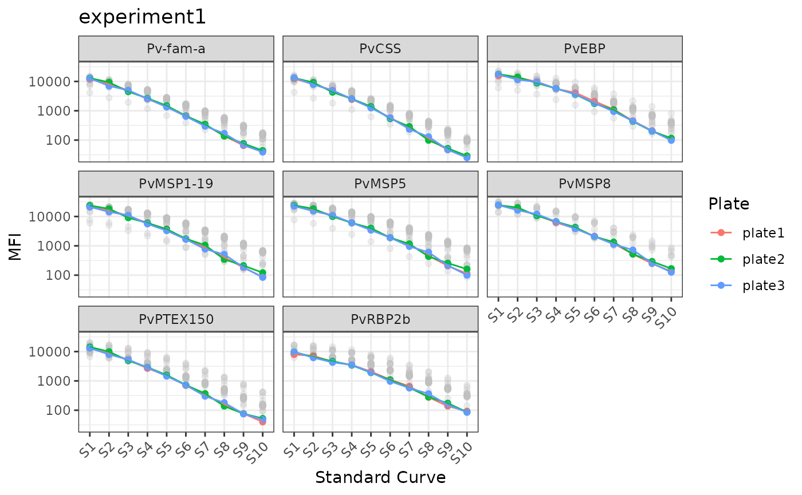
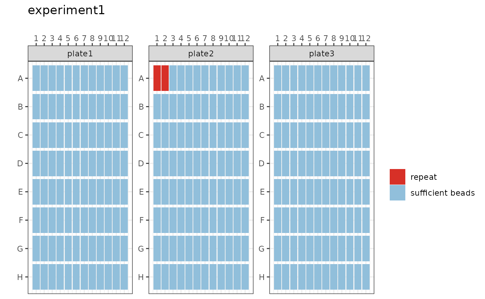
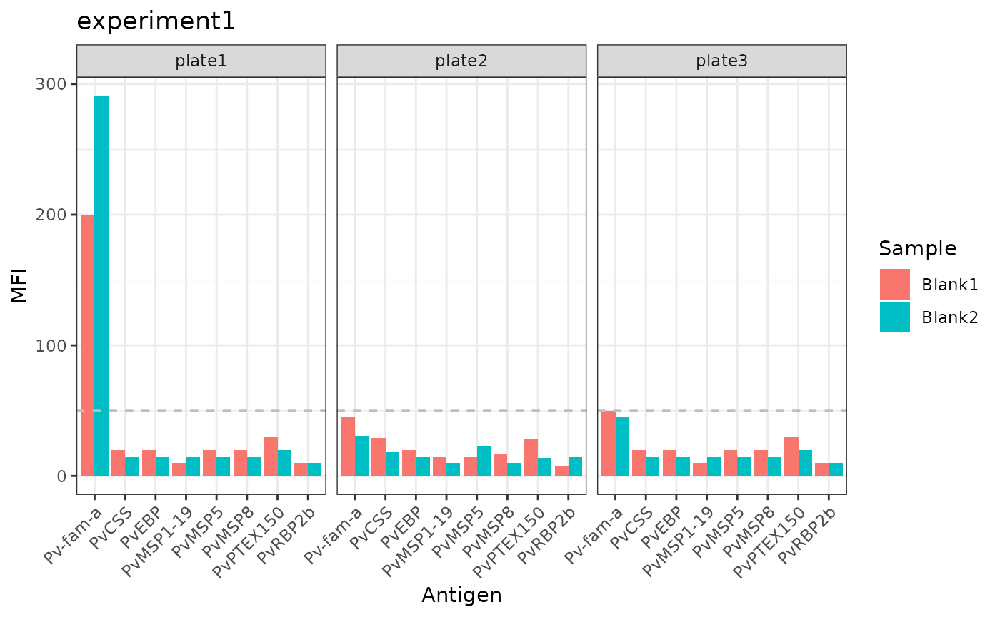
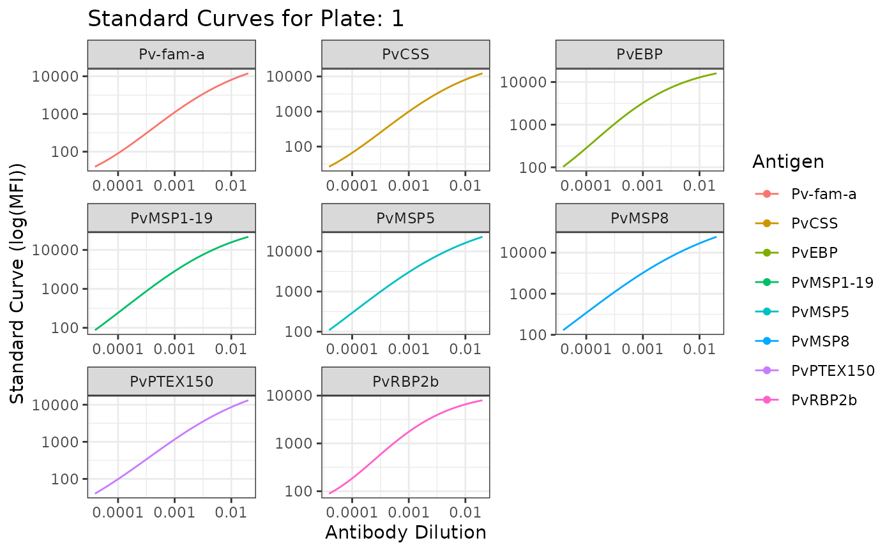
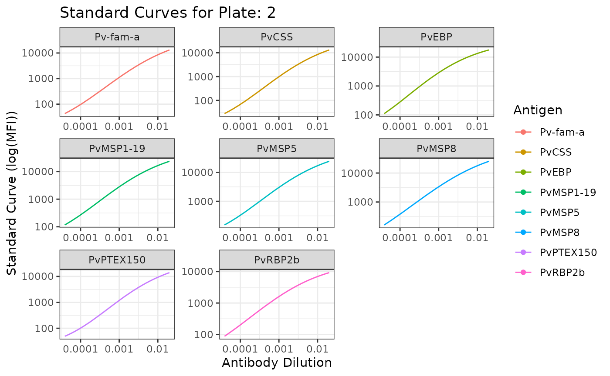
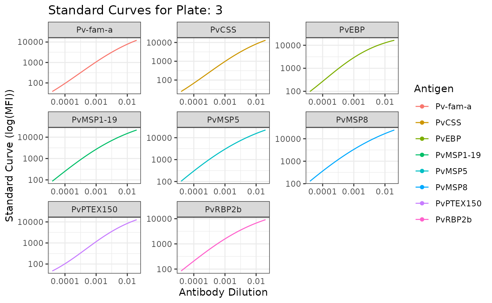

# Pathogen-agnostic Sero-analysis Tutorial

If you would like to run the
[SeroTrackR](https://github.com/dionnecargy/SeroTrackR) R package data
processing pipeline for work not relating to the fit-for-purpose tool
leveraging eight *Plasmodium vivax* serological exposure markers, then
this is the tutorial for you!

## Essential

Please ensure that you have read and prepared your raw Luminex files and
plate layout files as per the instructions in the
[setup](https://dionnecargy.github.io/SeroTrackR/articles/setup.md)
vignette.

## Step 1: Read in Raw Data

For this tutorial, we will be using the built-in files within
[SeroTrackR](https://github.com/dionnecargy/SeroTrackR) that are
extrapolated from *Plasmodium vivax* samples.

``` r

library(SeroTrackR)
library(tidyverse)

your_raw_data <- c(
  system.file("extdata", "example_MAGPIX_plate1.csv", package = "SeroTrackR"),
  system.file("extdata", "example_MAGPIX_plate2.csv", package = "SeroTrackR"), 
  system.file("extdata", "example_MAGPIX_plate3.csv", package = "SeroTrackR")
)
your_plate_layout <- system.file("extdata", "example_platelayout_1.xlsx", package = "SeroTrackR")
```

To run your OWN data, follow the code below and uncomment (i.e., remove
the hashtags):

``` r

your_raw_data <- c(
  "PATH/TO/YOUR/FILE/plate1.csv",
  "PATH/TO/YOUR/FILE/plate2.csv",
  "PATH/TO/YOUR/FILE/plate3.csv"
)
your_plate_layout <- "PATH/TO/YOUR/FILE/plate_layout.xlsx"
```

You can read any Luminex serology data file using the
[`readSeroData()`](https://dionnecargy.github.io/SeroTrackR/reference/readSeroData.md)
function.

The Luminex platform can be specified using the `platform` argument,
with either `bioplex`, `magpix` or `intelliflex`.

For the xPONENT software-based exported files (MAGPIX or INTELLIFLEX),
the version of the software should be specified as either **“4.2”** or
**“4.3”**, with the version **“4.2”** as the default.

``` r

sero_data <- readSeroData(
  raw_data = your_raw_data, 
  platform = "magpix",        # default 
  version = "4.2"             # default 
)
#> PASS: File example_magpix_plate1.csv successfully validated.
#> PASS: File example_magpix_plate2.csv successfully validated.
#> PASS: File example_magpix_plate3.csv successfully validated.
```

This exports a list of data frames:

1.  `data_raw`: The raw, unedited files: A check that the correct file/s
    were added.
2.  `results`: The processed serological data files: Antigen names
    compatible with the R package, clear columns for each antigen and
    their MFI results.
3.  `counts`: The bead counts detected from the Luminex instrument per
    antigen, per sample, for each plate.
4.  `blanks`: The MFI results for the blank wells.
5.  `stds`: The MFI results for the standard curve samples.
6.  `run`: The run information from the Luminex machine.

You can access each data frame, for example the `results` data frame,
like this:

``` r

sero_data$results
#>      Location     Sample     EBP   LF005   LF010   LF016    MSP8 RBP2b.P87
#> 1     1(1,A1)     Blank1    20.0   200.0    20.0    10.0    20.0      10.0
#> 2     2(1,A2)     Blank2    15.0   291.0    15.0    15.0    15.0      10.0
#> 3     3(1,A3)         S1 15710.5 11990.0 22583.0 21244.0 24306.0    7907.5
#> 4     4(1,A4)         S2 13545.0  8285.0 16947.5 16146.0 17172.0    7186.0
#> 5     5(1,A5)         S3  9767.0  4950.0 10865.0 10621.5 11358.0    4475.5
#> 6     6(1,A6)         S4  5648.5  2519.0  6060.0  5968.5  6237.0    3508.0
#> 7     7(1,A7)         S5  4104.5  1431.0  3711.5  3738.0  3883.5    2082.0
#> 8     8(1,A8)         S6  2105.0   676.5  1889.0  1667.0  2136.0    1102.0
#> 9     9(1,A9)         S7  1107.0   328.0  1106.0   890.0  1204.0     657.0
#> 10  10(1,A10)         S8   452.5   141.0   465.0   405.5   522.0     277.0
#> 11  11(1,A11)         S9   209.0    65.0   206.5   181.5   249.0     138.0
#> 12  12(1,A12)        S10   105.0    42.0   113.5    87.0   134.0      93.0
#> 13   13(1,B1) Unknown013  2712.0  1569.0   673.0   327.0   182.0    1068.0
#> 14   14(1,B2) Unknown014   134.0   378.0   117.0   197.0    58.0     465.5
#> 15   15(1,B3) Unknown015   182.0   209.0   208.0   374.0   221.5     463.0
#> 16   16(1,B4) Unknown016   152.0   229.5   101.0    89.0    48.0     591.0
#> 17   17(1,B5) Unknown017  1135.0   236.0   299.0   507.0   209.5     671.0
#> 18   18(1,B6) Unknown018   174.0   395.0   175.0    78.0    70.0     103.0
#> 19   19(1,B7) Unknown019   421.0  2081.5   529.0   149.0   962.0    1441.5
#> 20   20(1,B8) Unknown020    24.0    49.0    22.0    13.0    15.5      14.0
#> 21   21(1,B9) Unknown021    24.0    45.0    22.0    13.0    16.0      13.0
#> 22  22(1,B10) Unknown022 21464.0 11789.0  2508.5  8001.0  2342.0    1386.0
#> 23  23(1,B11) Unknown023   795.0  6135.5   407.0   273.0   535.5    1575.0
#> 24  24(1,B12) Unknown024  1574.0   348.5   892.0   288.0   306.0     590.0
#> 25   25(1,C1) Unknown025   146.0   408.5  1130.5    83.0   100.0     301.0
#> 26   26(1,C2) Unknown026  1330.5  3036.0   965.0   174.0    79.0    1090.0
#> 27   27(1,C3) Unknown027   358.0  4074.5   335.5   140.0   390.0    6704.0
#> 28   28(1,C4) Unknown028   481.0  1870.0   421.0   182.5  1777.5    2390.0
#> 29   29(1,C5) Unknown029   551.0  1282.0   331.5   165.0    77.0     244.0
#> 30   30(1,C6) Unknown030   943.0   584.5   235.0   135.0  3017.0    1034.0
#> 31   31(1,C7) Unknown031   532.5  1533.0   315.0   210.0  2575.5    2903.0
#> 32   32(1,C8) Unknown032   768.0 12605.0   409.0  7632.0  9860.0   13703.0
#> 33   33(1,C9) Unknown033   130.0   239.5    72.0    64.0    37.0     156.0
#> 34  34(1,C10) Unknown034    40.0    60.0    37.0    25.0    26.5      23.5
#> 35  35(1,C11) Unknown035   167.0   605.0   253.0   329.0  3973.0    1426.5
#> 36  36(1,C12) Unknown036  1879.0  4562.0   415.0 18287.0 11482.5   12031.0
#> 37   37(1,D1) Unknown037   256.0  1507.0   117.0   129.0   168.0     488.0
#> 38   38(1,D2) Unknown038    24.0    49.0    22.0    12.0    15.0      14.0
#> 39   39(1,D3) Unknown039   384.0  1708.0   326.0  1172.5   986.0    1041.0
#> 40   40(1,D4) Unknown040   210.0   512.0   221.0   191.0    89.0     203.0
#> 41   41(1,D5) Unknown041   351.5   312.0   165.5    88.0    66.0     205.0
#> 42   42(1,D6) Unknown042  1278.0  5810.0   275.0   230.5   137.0    2032.0
#> 43   43(1,D7) Unknown043   318.0   397.0   130.0   130.5    78.0     903.0
#> 44   44(1,D8) Unknown044   493.5  2980.5   401.0  5932.5  3536.0    4699.5
#> 45   45(1,D9) Unknown045  9686.0   873.0   333.0   166.0   791.0    1093.0
#> 46  46(1,D10) Unknown046   777.5   581.0   241.5   173.0  1479.5     899.0
#> 47  47(1,D11) Unknown047   455.0   416.5   126.0    67.0    48.0     400.0
#> 48  48(1,D12) Unknown048   202.0  1142.0   137.5   176.0   204.5    1090.0
#> 49   49(1,E1) Unknown049   333.5   623.5   368.0 10430.0  2340.0    4375.0
#> 50   50(1,E2) Unknown050   561.0  7984.0   441.0   128.0   141.0    1993.0
#> 51   51(1,E3) Unknown051   506.5   340.0   152.5   147.0    90.0     600.0
#> 52   52(1,E4) Unknown052   254.0   367.0   392.5    89.0   142.5     280.0
#> 53   53(1,E5) Unknown053   888.0  1955.0   438.0   173.0   507.0    1009.0
#> 54   54(1,E6) Unknown054   426.0  1877.0   186.0  9767.0 15945.0   10073.0
#> 55   55(1,E7) Unknown055  5733.0  1301.5  1920.5   220.5  4833.0    2340.0
#> 56   56(1,E8) Unknown056 19092.0 14422.0  1993.0 12836.5  7426.0   11930.0
#> 57   57(1,E9) Unknown057   596.0 15139.0   371.5   229.0   535.5   14032.0
#> 58  58(1,E10) Unknown058  1028.0  2646.0  1486.0   292.0  9357.0    8009.0
#> 59  59(1,E11) Unknown059   512.0  4735.0  3408.0   127.5   191.0    4401.0
#> 60  60(1,E12) Unknown060   883.0  1953.0   755.0   586.0   122.0     830.0
#> 61   61(1,F1) Unknown061   977.0  8719.0   509.0   187.0  1289.0   12930.0
#> 62   62(1,F2) Unknown062   791.0  1944.0   465.0   216.5 12307.0    5029.0
#> 63   63(1,F3) Unknown063   397.0   987.0   924.0   133.0    79.0     253.0
#> 64   64(1,F4) Unknown064  1111.0   613.0   357.0   196.0  8496.0    7914.0
#> 65   65(1,F5) Unknown065   956.0  2369.0   644.0   389.0  8762.0    9649.0
#> 66   66(1,F6) Unknown066  1307.0 20590.0  1335.0 10780.0 12736.0   25375.5
#> 67   67(1,F7) Unknown067   433.0   382.0   173.0   105.0    59.0     480.0
#> 68   68(1,F8) Unknown068   161.0   279.0  2524.5   105.5    55.0     307.0
#> 69   69(1,F9) Unknown069   439.0   732.5   397.0  2108.0  9692.0    8090.0
#> 70  70(1,F10) Unknown070  1837.0 11406.0   467.5 20011.0 19606.0   24476.5
#> 71  71(1,F11) Unknown071   244.0  1665.5   166.0   124.0   154.0     224.0
#> 72  72(1,F12) Unknown072   482.0  3990.5   388.0  3736.0  7436.0    7361.0
#> 73   73(1,G1) Unknown073   656.0  3103.0   505.0 14386.0  2343.0    5503.0
#> 74   74(1,G2) Unknown074   243.0   568.5   693.0   141.0    79.0     339.0
#> 75   75(1,G3) Unknown075  1409.5  1123.0   379.0   153.0   167.5    1013.0
#> 76   76(1,G4) Unknown076   467.5  6741.0   238.0   174.0   181.0    6160.0
#> 77   77(1,G5) Unknown077   329.0   630.0   196.0   119.0   278.0     787.0
#> 78   78(1,G6) Unknown078  1122.5 17810.0   677.0 12254.0 16011.0   18719.0
#> 79   79(1,G7) Unknown079 10853.0   817.5   255.0   189.0  2247.5    3322.0
#> 80   80(1,G8) Unknown080   743.5   820.0   313.5   289.0  9351.5    7171.0
#> 81   81(1,G9) Unknown081   723.0  1255.0   299.0   253.0    95.0     712.0
#> 82  82(1,G10) Unknown082   168.0   684.0   131.0   198.0   135.5     392.0
#> 83  83(1,G11) Unknown083   180.0   276.0   205.0  4646.5  2550.0    2664.5
#> 84  84(1,G12) Unknown084   249.5  4104.0   250.0    96.0    68.0    1020.0
#> 85   85(1,H1) Unknown085   479.0   190.0   105.0   131.0    66.0    1449.0
#> 86   86(1,H2) Unknown086   164.0   327.0   234.5    66.0    75.5     259.0
#> 87   87(1,H3) Unknown087   281.5  1794.0   413.0    75.0   469.5     802.0
#> 88   88(1,H4) Unknown088   269.0  1067.0   141.0  7595.0 14464.0    7592.0
#> 89   89(1,H5) Unknown089  3247.0   382.0   470.0    98.0  2319.5    2009.0
#> 90   90(1,H6) Unknown090 20593.0 14902.5  2021.0 10184.0  5805.5   14083.5
#> 91   91(1,H7) Unknown091   395.0  9914.0   211.0   131.5   325.0    3021.0
#> 92   92(1,H8) Unknown092   904.5  1871.0   793.0   172.0  6106.0    2093.0
#> 93   93(1,H9) Unknown093   323.0  2007.5  1950.0   106.0   191.0    2411.0
#> 94  94(1,H10) Unknown094   706.0  2087.0   791.0   169.0    66.0     990.0
#> 95  95(1,H11) Unknown095   323.0  4950.0   264.0   107.0   645.0    7092.0
#> 96  96(1,H12) Unknown096   367.0  1067.0   259.0   101.0  7423.0    1203.0
#> 97    1(1,A1)     Blank1    20.0    45.0    15.0    15.0    17.0       7.0
#> 98    2(1,A2)     Blank2    15.0    31.0    23.0    10.0    10.0      15.0
#> 99    3(1,A3)         S1 17664.0 13024.0 24023.5 23687.0 24512.0    9648.0
#> 100   4(1,A4)         S2 14051.0  9319.0 18419.0 18294.0 20151.5    6529.5
#> 101   5(1,A5)         S3  8807.0  4496.5  9995.0  9094.5 10652.5    4671.0
#> 102   6(1,A6)         S4  5744.0  2675.5  6065.0  6029.0  6723.0    3427.0
#> 103   7(1,A7)         S5  3631.5  1486.0  4004.0  3673.0  4293.5    1910.0
#> 104   8(1,A8)         S6  1751.5   664.0  1898.0  1746.0  2068.0    1082.0
#> 105   9(1,A9)         S7  1076.0   347.0  1165.0  1052.0  1346.0     586.0
#> 106 10(1,A10)         S8   433.0   137.0   432.0   346.0   522.0     283.0
#> 107 11(1,A11)         S9   200.5    76.0   257.0   211.0   293.0     174.0
#> 108 12(1,A12)        S10   116.0    44.0   161.0   121.5   167.0      86.0
#> 109  13(1,B1) Unknown097  2712.0  1569.0   673.0   327.0   182.0    2208.0
#> 110  14(1,B2) Unknown098   134.0   378.0   117.0   197.0    58.0     290.0
#> 111  15(1,B3) Unknown099   182.0   209.0   208.0   374.0   221.5     376.0
#> 112  16(1,B4) Unknown100   152.0   229.5   101.0    89.0    48.0     103.0
#> 113  17(1,B5) Unknown101  1135.0   236.0   299.0   507.0   209.5     650.0
#> 114  18(1,B6) Unknown102   174.0   395.0   175.0    78.0    70.0     293.5
#> 115  19(1,B7) Unknown103   421.0  2081.5   529.0   149.0   962.0    1632.5
#> 116  20(1,B8) Unknown104    24.0    49.0    22.0    13.0    15.5      14.0
#> 117  21(1,B9) Unknown105    24.0    45.0    22.0    13.0    16.0      13.0
#> 118 22(1,B10) Unknown106 21464.0 11789.0  2508.5  8001.0  2342.0    9995.5
#> 119 23(1,B11) Unknown107   795.0  6135.5   407.0   273.0   535.5    7092.0
#> 120 24(1,B12) Unknown108  1574.0   348.5   892.0   288.0   306.0     548.0
#> 121  25(1,C1) Unknown109   146.0   408.5  1130.5    83.0   100.0     443.0
#> 122  26(1,C2) Unknown110  1330.5  3036.0   965.0   174.0    79.0    1092.0
#> 123  27(1,C3) Unknown111   358.0  4074.5   335.5   140.0   390.0    7093.0
#> 124  28(1,C4) Unknown112   481.0  1870.0   421.0   182.5  1777.5    1832.0
#> 125  29(1,C5) Unknown113   551.0  1282.0   331.5   165.0    77.0     244.0
#> 126  30(1,C6) Unknown114   943.0   584.5   235.0   135.0  3017.0    5339.0
#> 127  31(1,C7) Unknown115   532.5  1533.0   315.0   210.0  2575.5    1029.0
#> 128  32(1,C8) Unknown116   768.0 12605.0   409.0  7632.0  9860.0    7201.0
#> 129  33(1,C9) Unknown117   130.0   239.5    72.0    64.0    37.0     156.0
#> 130 34(1,C10) Unknown118    40.0    60.0    37.0    25.0    26.5      23.5
#> 131 35(1,C11) Unknown119   167.0   605.0   253.0   329.0  3973.0    2812.0
#> 132 36(1,C12) Unknown120  1879.0  4562.0   415.0 18287.0 11482.5    6291.0
#> 133  37(1,D1) Unknown121   256.0  1507.0   117.0   129.0   168.0     315.0
#> 134  38(1,D2) Unknown122    24.0    49.0    22.0    12.0    15.0      14.0
#> 135  39(1,D3) Unknown123   384.0  1708.0   326.0  1172.5   986.0     902.0
#> 136  40(1,D4) Unknown124   210.0   512.0   221.0   191.0    89.0     398.0
#> 137  41(1,D5) Unknown125   351.5   312.0   165.5    88.0    66.0     174.0
#> 138  42(1,D6) Unknown126  1278.0  5810.0   275.0   230.5   137.0    1903.7
#> 139  43(1,D7) Unknown127   318.0   397.0   130.0   130.5    78.0     492.1
#> 140  44(1,D8) Unknown128   493.5  2980.5   401.0  5932.5  3536.0    4699.5
#> 141  45(1,D9) Unknown129  9686.0   873.0   333.0   166.0   791.0     653.0
#> 142 46(1,D10) Unknown130   777.5   581.0   241.5   173.0  1479.5     439.0
#> 143 47(1,D11) Unknown131   455.0   416.5   126.0    67.0    48.0     143.0
#> 144 48(1,D12) Unknown132   202.0  1142.0   137.5   176.0   204.5     210.0
#> 145  49(1,E1) Unknown133   333.5   623.5   368.0 10430.0  2340.0    4375.0
#> 146  50(1,E2) Unknown134   561.0  7984.0   441.0   128.0   141.0     431.0
#> 147  51(1,E3) Unknown135   506.5   340.0   152.5   147.0    90.0     299.0
#> 148  52(1,E4) Unknown136   254.0   367.0   392.5    89.0   142.5     323.5
#> 149  53(1,E5) Unknown137   888.0  1955.0   438.0   173.0   507.0     829.0
#> 150  54(1,E6) Unknown138   426.0  1877.0   186.0  9767.0 15945.0   10073.0
#> 151  55(1,E7) Unknown139  5733.0  1301.5  1920.5   220.5  4833.0    3718.0
#> 152  56(1,E8) Unknown140 19092.0 14422.0  1993.0 12836.5  7426.0   14663.0
#> 153  57(1,E9) Unknown141   596.0 15139.0   371.5   229.0   535.5    9105.0
#> 154 58(1,E10) Unknown142  1028.0  2646.0  1486.0   292.0  9357.0    7769.5
#> 155 59(1,E11) Unknown143   512.0  4735.0  3408.0   127.5   191.0    2401.0
#> 156 60(1,E12) Unknown144   883.0  1953.0   755.0   586.0   122.0     398.0
#> 157  61(1,F1) Unknown145   977.0  8719.0   509.0   187.0  1289.0    6039.5
#> 158  62(1,F2) Unknown146   791.0  1944.0   465.0   216.5 12307.0    3907.0
#> 159  63(1,F3) Unknown147   397.0   987.0   924.0   133.0    79.0     253.0
#> 160  64(1,F4) Unknown148  1111.0   613.0   357.0   196.0  8496.0     914.0
#> 161  65(1,F5) Unknown149   956.0  2369.0   644.0   389.0  8762.0    7649.0
#> 162  66(1,F6) Unknown150  1307.0 20590.0  1335.0 10780.0 12736.0    9375.5
#> 163  67(1,F7) Unknown151   433.0   382.0   173.0   105.0    59.0     599.0
#> 164  68(1,F8) Unknown152   161.0   279.0  2524.5   105.5    55.0     491.0
#> 165  69(1,F9) Unknown153   439.0   732.5   397.0  2108.0  9692.0    8115.0
#> 166 70(1,F10) Unknown154  1837.0 11406.0   467.5 20011.0 19606.0    9476.5
#> 167 71(1,F11) Unknown155   244.0  1665.5   166.0   124.0   154.0     224.0
#> 168 72(1,F12) Unknown156   482.0  3990.5   388.0  3736.0  7436.0    2361.0
#> 169  73(1,G1) Unknown157   656.0  3103.0   505.0 14386.0  2343.0     803.0
#> 170  74(1,G2) Unknown158   243.0   568.5   693.0   141.0    79.0     995.0
#> 171  75(1,G3) Unknown159  1409.5  1123.0   379.0   153.0   167.5     480.5
#> 172  76(1,G4) Unknown160   467.5  6741.0   238.0   174.0   181.0     904.5
#> 173  77(1,G5) Unknown161   329.0   630.0   196.0   119.0   278.0     321.0
#> 174  78(1,G6) Unknown162  1122.5 17810.0   677.0 12254.0 16011.0   18719.0
#> 175  79(1,G7) Unknown163 10853.0   817.5   255.0   189.0  2247.5     479.0
#> 176  80(1,G8) Unknown164   743.5   820.0   313.5   289.0  9351.5     771.0
#> 177  81(1,G9) Unknown165   723.0  1255.0   299.0   253.0    95.0     803.0
#> 178 82(1,G10) Unknown166   168.0   684.0   131.0   198.0   135.5     329.0
#> 179 83(1,G11) Unknown167   180.0   276.0   205.0  4646.5  2550.0    2664.5
#> 180 84(1,G12) Unknown168   249.5  4104.0   250.0    96.0    68.0     702.0
#> 181  85(1,H1) Unknown169   479.0   190.0   105.0   131.0    66.0     809.0
#> 182  86(1,H2) Unknown170   164.0   327.0   234.5    66.0    75.5     259.0
#> 183  87(1,H3) Unknown171   281.5  1794.0   413.0    75.0   469.5     388.0
#> 184  88(1,H4) Unknown172   269.0  1067.0   141.0  7595.0 14464.0    7592.0
#> 185  89(1,H5) Unknown173  3247.0   382.0   470.0    98.0  2319.5    1904.5
#> 186  90(1,H6) Unknown174 20593.0 14902.5  2021.0 10184.0  5805.5    9083.5
#> 187  91(1,H7) Unknown175   395.0  9914.0   211.0   131.5   325.0    6791.0
#> 188  92(1,H8) Unknown176   904.5  1871.0   793.0   172.0  6106.0    5444.0
#> 189  93(1,H9) Unknown177   323.0  2007.5  1950.0   106.0   191.0    1411.0
#> 190 94(1,H10) Unknown178   706.0  2087.0   791.0   169.0    66.0     899.0
#> 191 95(1,H11) Unknown179   323.0  4950.0   264.0   107.0   645.0    5201.0
#> 192 96(1,H12) Unknown180   367.0  1067.0   259.0   101.0  7423.0    2494.0
#> 193   1(1,A1)     Blank1    20.0    50.0    20.0    10.0    20.0      10.0
#> 194   2(1,A2)     Blank2    15.0    45.0    15.0    15.0    15.0      10.0
#> 195   3(1,A3)         S1 17357.0 12746.0 22462.0 21253.0 24716.5    9629.0
#> 196   4(1,A4)         S2 11465.0  7017.0 15284.0 14391.0 16327.0    6187.0
#> 197   5(1,A5)         S3  9607.0  4992.0 10884.0 10965.0 12073.0    4284.0
#> 198   6(1,A6)         S4  5730.5  2572.5  6139.0  5579.0  6660.0    3525.0
#> 199   7(1,A7)         S5  3695.0  1335.0  3426.0  3282.0  3843.5    1943.0
#> 200   8(1,A8)         S6  1838.0   644.5  1895.5  1668.0  2098.0     969.0
#> 201   9(1,A9)         S7   939.0   297.0   953.0   773.0  1130.0     573.0
#> 202 10(1,A10)         S8   446.5   169.5   604.0   511.5   724.0     363.0
#> 203 11(1,A11)         S9   204.0    67.5   214.0   185.0   254.0     152.5
#> 204 12(1,A12)        S10    98.0    39.0   100.0    84.0   126.0      85.0
#> 205  13(1,B1) Unknown181  2712.0  1569.0   673.0   327.0   182.0     593.0
#> 206  14(1,B2) Unknown182   134.0   378.0   117.0   197.0    58.0     128.0
#> 207  15(1,B3) Unknown183   182.0   209.0   208.0   374.0   221.5     348.0
#> 208  16(1,B4) Unknown184   152.0   229.5   101.0    89.0    48.0     180.0
#> 209  17(1,B5) Unknown185  1135.0   236.0   299.0   507.0   209.5     650.0
#> 210  18(1,B6) Unknown186   174.0   395.0   175.0    78.0    70.0     293.5
#> 211  19(1,B7) Unknown187   421.0  2081.5   529.0   149.0   962.0     532.5
#> 212  20(1,B8) Unknown188    24.0    49.0    22.0    13.0    15.5      14.0
#> 213  21(1,B9) Unknown189    24.0    45.0    22.0    13.0    16.0      13.0
#> 214 22(1,B10) Unknown190 21464.0 11789.0  2508.5  8001.0  2342.0    9995.5
#> 215 23(1,B11) Unknown191   795.0  6135.5   407.0   273.0   535.5   12560.0
#> 216 24(1,B12) Unknown192  1574.0   348.5   892.0   288.0   306.0    2060.0
#> 217  25(1,C1) Unknown193   146.0   408.5  1130.5    83.0   100.0     201.0
#> 218  26(1,C2) Unknown194  1330.5  3036.0   965.0   174.0    79.0     709.0
#> 219  27(1,C3) Unknown195   358.0  4074.5   335.5   140.0   390.0    5769.5
#> 220  28(1,C4) Unknown196   481.0  1870.0   421.0   182.5  1777.5    1845.0
#> 221  29(1,C5) Unknown197   551.0  1282.0   331.5   165.0    77.0     244.0
#> 222  30(1,C6) Unknown198   943.0   584.5   235.0   135.0  3017.0    5339.0
#> 223  31(1,C7) Unknown199   532.5  1533.0   315.0   210.0  2575.5    4592.5
#> 224  32(1,C8) Unknown200   768.0 12605.0   409.0  7632.0  9860.0    9340.5
#> 225  33(1,C9) Unknown201   130.0   239.5    72.0    64.0    37.0     156.0
#> 226 34(1,C10) Unknown202    40.0    60.0    37.0    25.0    26.5      23.5
#> 227 35(1,C11) Unknown203   167.0   605.0   253.0   329.0  3973.0    1412.0
#> 228 36(1,C12) Unknown204  1879.0  4562.0   415.0 18287.0 11482.5    5816.0
#> 229  37(1,D1) Unknown205   256.0  1507.0   117.0   129.0   168.0     315.0
#> 230  38(1,D2) Unknown206    24.0    49.0    22.0    12.0    15.0      14.0
#> 231  39(1,D3) Unknown207   384.0  1708.0   326.0  1172.5   986.0    1562.0
#> 232  40(1,D4) Unknown208   210.0   512.0   221.0   191.0    89.0     293.5
#> 233  41(1,D5) Unknown209   351.5   312.0   165.5    88.0    66.0     218.5
#> 234  42(1,D6) Unknown210  1278.0  5810.0   275.0   230.5   137.0     729.5
#> 235  43(1,D7) Unknown211   318.0   397.0   130.0   130.5    78.0     440.0
#> 236  44(1,D8) Unknown212   493.5  2980.5   401.0  5932.5  3536.0    4699.5
#> 237  45(1,D9) Unknown213  9686.0   873.0   333.0   166.0   791.0     621.0
#> 238 46(1,D10) Unknown214   777.5   581.0   241.5   173.0  1479.5    1037.5
#> 239 47(1,D11) Unknown215   455.0   416.5   126.0    67.0    48.0     270.0
#> 240 48(1,D12) Unknown216   202.0  1142.0   137.5   176.0   204.5     897.0
#> 241  49(1,E1) Unknown217   333.5   623.5   368.0 10430.0  2340.0    4375.0
#> 242  50(1,E2) Unknown218   561.0  7984.0   441.0   128.0   141.0    2119.5
#> 243  51(1,E3) Unknown219   506.5   340.0   152.5   147.0    90.0     399.0
#> 244  52(1,E4) Unknown220   254.0   367.0   392.5    89.0   142.5     323.5
#> 245  53(1,E5) Unknown221   888.0  1955.0   438.0   173.0   507.0    1584.0
#> 246  54(1,E6) Unknown222   426.0  1877.0   186.0  9767.0 15945.0   10073.0
#> 247  55(1,E7) Unknown223  5733.0  1301.5  1920.5   220.5  4833.0    3718.0
#> 248  56(1,E8) Unknown224 19092.0 14422.0  1993.0 12836.5  7426.0    8663.0
#> 249  57(1,E9) Unknown225   596.0 15139.0   371.5   229.0   535.5    8105.0
#> 250 58(1,E10) Unknown226  1028.0  2646.0  1486.0   292.0  9357.0    7769.5
#> 251 59(1,E11) Unknown227   512.0  4735.0  3408.0   127.5   191.0     901.0
#> 252 60(1,E12) Unknown228   883.0  1953.0   755.0   586.0   122.0     529.0
#> 253  61(1,F1) Unknown229   977.0  8719.0   509.0   187.0  1289.0    5039.5
#> 254  62(1,F2) Unknown230   791.0  1944.0   465.0   216.5 12307.0    8907.0
#> 255  63(1,F3) Unknown231   397.0   987.0   924.0   133.0    79.0     253.0
#> 256  64(1,F4) Unknown232  1111.0   613.0   357.0   196.0  8496.0    7914.0
#> 257  65(1,F5) Unknown233   956.0  2369.0   644.0   389.0  8762.0    4649.0
#> 258  66(1,F6) Unknown234  1307.0 20590.0  1335.0 10780.0 12736.0    7375.5
#> 259  67(1,F7) Unknown235   433.0   382.0   173.0   105.0    59.0     599.0
#> 260  68(1,F8) Unknown236   161.0   279.0  2524.5   105.5    55.0     491.0
#> 261  69(1,F9) Unknown237   439.0   732.5   397.0  2108.0  9692.0    6115.0
#> 262 70(1,F10) Unknown238  1837.0 11406.0   467.5 20011.0 19606.0    5476.5
#> 263 71(1,F11) Unknown239   244.0  1665.5   166.0   124.0   154.0     224.0
#> 264 72(1,F12) Unknown240   482.0  3990.5   388.0  3736.0  7436.0    3361.0
#> 265  73(1,G1) Unknown241   656.0  3103.0   505.0 14386.0  2343.0    2503.0
#> 266  74(1,G2) Unknown242   243.0   568.5   693.0   141.0    79.0    1295.0
#> 267  75(1,G3) Unknown243  1409.5  1123.0   379.0   153.0   167.5    1280.5
#> 268  76(1,G4) Unknown244   467.5  6741.0   238.0   174.0   181.0    1804.5
#> 269  77(1,G5) Unknown245   329.0   630.0   196.0   119.0   278.0     223.0
#> 270  78(1,G6) Unknown246  1122.5 17810.0   677.0 12254.0 16011.0    3142.0
#> 271  79(1,G7) Unknown247 10853.0   817.5   255.0   189.0  2247.5    1023.0
#> 272  80(1,G8) Unknown248   743.5   820.0   313.5   289.0  9351.5     873.0
#> 273  81(1,G9) Unknown249   723.0  1255.0   299.0   253.0    95.0     203.0
#> 274 82(1,G10) Unknown250   168.0   684.0   131.0   198.0   135.5     223.4
#> 275 83(1,G11) Unknown251   180.0   276.0   205.0  4646.5  2550.0     664.5
#> 276 84(1,G12) Unknown252   249.5  4104.0   250.0    96.0    68.0     563.0
#> 277  85(1,H1) Unknown253   479.0   190.0   105.0   131.0    66.0     406.0
#> 278  86(1,H2) Unknown254   164.0   327.0   234.5    66.0    75.5     259.0
#> 279  87(1,H3) Unknown255   281.5  1794.0   413.0    75.0   469.5     530.5
#> 280  88(1,H4) Unknown256   269.0  1067.0   141.0  7595.0 14464.0    7592.0
#> 281  89(1,H5) Unknown257  3247.0   382.0   470.0    98.0  2319.5    2304.5
#> 282  90(1,H6) Unknown258 20593.0 14902.5  2021.0 10184.0  5805.5   14083.5
#> 283  91(1,H7) Unknown259   395.0  9914.0   211.0   131.5   325.0    2791.0
#> 284  92(1,H8) Unknown260   904.5  1871.0   793.0   172.0  6106.0     744.0
#> 285  93(1,H9) Unknown261   323.0  2007.5  1950.0   106.0   191.0    2411.0
#> 286 94(1,H10) Unknown262   706.0  2087.0   791.0   169.0    66.0     412.0
#> 287 95(1,H11) Unknown263   323.0  4950.0   264.0   107.0   645.0    2381.0
#> 288 96(1,H12) Unknown264   367.0  1067.0   259.0   101.0  7423.0    1494.0
#>     PTEX150   PvCSS  Plate
#> 1      30.0    20.0 plate1
#> 2      20.0    15.0 plate1
#> 3   13207.0 12427.0 plate1
#> 4    8550.0  8034.0 plate1
#> 5    5329.0  4990.0 plate1
#> 6    2671.0  2446.5 plate1
#> 7    1548.0  1299.0 plate1
#> 8     698.5   581.0 plate1
#> 9     333.0   264.0 plate1
#> 10    156.0   111.0 plate1
#> 11     77.0    46.5 plate1
#> 12     40.0    28.0 plate1
#> 13    936.0   223.0 plate1
#> 14    122.0    93.0 plate1
#> 15    293.0   868.0 plate1
#> 16    109.0   110.0 plate1
#> 17   1665.5   266.0 plate1
#> 18    294.5    92.0 plate1
#> 19    241.0   282.0 plate1
#> 20     28.0    17.0 plate1
#> 21     29.0    17.0 plate1
#> 22   1992.0  2927.0 plate1
#> 23   8821.0   998.0 plate1
#> 24    315.0   366.0 plate1
#> 25    652.0   130.0 plate1
#> 26    179.0    92.0 plate1
#> 27   8814.0  5627.0 plate1
#> 28   2465.0   411.0 plate1
#> 29    579.0   229.0 plate1
#> 30   4928.0  7730.0 plate1
#> 31   2779.0  7300.0 plate1
#> 32   5612.0  6383.0 plate1
#> 33    204.0    49.0 plate1
#> 34     40.0    27.0 plate1
#> 35    803.0  1670.0 plate1
#> 36   4830.5  4217.0 plate1
#> 37    908.0    87.0 plate1
#> 38     29.0    17.0 plate1
#> 39    299.5   149.0 plate1
#> 40    410.0   174.5 plate1
#> 41    200.0   183.0 plate1
#> 42   1762.0  1241.0 plate1
#> 43   1513.5   325.0 plate1
#> 44    574.0  5389.0 plate1
#> 45    417.5   262.0 plate1
#> 46   1504.0   260.0 plate1
#> 47    183.0    61.0 plate1
#> 48    504.0   459.0 plate1
#> 49   1650.0  7801.5 plate1
#> 50   2147.0  1502.0 plate1
#> 51   2178.0   170.0 plate1
#> 52    298.0   138.0 plate1
#> 53    709.0  2040.0 plate1
#> 54   1585.5  1124.0 plate1
#> 55   5329.0  2369.0 plate1
#> 56   4826.0  3468.5 plate1
#> 57   7928.5  1414.5 plate1
#> 58   3736.0 14370.5 plate1
#> 59  11567.0  2923.5 plate1
#> 60    425.5   121.0 plate1
#> 61  13891.0  9531.0 plate1
#> 62   4157.0   760.0 plate1
#> 63   2317.5  1080.5 plate1
#> 64   5772.5 13202.0 plate1
#> 65   6437.0 21113.0 plate1
#> 66   5493.0  7696.0 plate1
#> 67    655.0   367.0 plate1
#> 68    681.5   472.5 plate1
#> 69   9513.0  7341.0 plate1
#> 70   5822.0  5127.5 plate1
#> 71    718.0   115.0 plate1
#> 72   4111.5  2819.0 plate1
#> 73    357.5  1215.0 plate1
#> 74   2080.0  1470.0 plate1
#> 75   1553.0  1738.0 plate1
#> 76   1660.5  1087.0 plate1
#> 77   2052.5  2221.0 plate1
#> 78   3551.0 10222.5 plate1
#> 79    590.0   258.0 plate1
#> 80   3062.0   676.5 plate1
#> 81    396.0   129.5 plate1
#> 82    292.0   254.5 plate1
#> 83    724.0  2707.0 plate1
#> 84    960.0   672.0 plate1
#> 85   1724.5   108.0 plate1
#> 86    260.0    89.0 plate1
#> 87    345.0   744.5 plate1
#> 88    804.5   467.0 plate1
#> 89   1521.0  1258.0 plate1
#> 90   4307.5  3073.0 plate1
#> 91   4608.0  1073.5 plate1
#> 92   1303.0  6595.5 plate1
#> 93   7377.5  1699.0 plate1
#> 94    261.0    65.0 plate1
#> 95   8856.0  5330.0 plate1
#> 96   1841.5   335.0 plate1
#> 97     28.0    29.0 plate2
#> 98     14.0    18.0 plate2
#> 99  14354.0 13146.5 plate2
#> 100  9922.0  9214.0 plate2
#> 101  4885.0  4300.0 plate2
#> 102  2917.5  2572.5 plate2
#> 103  1579.5  1393.0 plate2
#> 104   725.5   537.0 plate2
#> 105   370.0   290.0 plate2
#> 106   138.0    98.5 plate2
#> 107    76.0    52.0 plate2
#> 108    52.5    29.0 plate2
#> 109   936.0   223.0 plate2
#> 110   122.0    93.0 plate2
#> 111   293.0   868.0 plate2
#> 112   109.0   110.0 plate2
#> 113  1665.5   266.0 plate2
#> 114   294.5    92.0 plate2
#> 115   241.0   282.0 plate2
#> 116    28.0    17.0 plate2
#> 117    29.0    17.0 plate2
#> 118  1992.0  2927.0 plate2
#> 119  8821.0   998.0 plate2
#> 120   315.0   366.0 plate2
#> 121   652.0   130.0 plate2
#> 122   179.0    92.0 plate2
#> 123  8814.0  5627.0 plate2
#> 124  2465.0   411.0 plate2
#> 125   579.0   229.0 plate2
#> 126  4928.0  7730.0 plate2
#> 127  2779.0  7300.0 plate2
#> 128  5612.0  6383.0 plate2
#> 129   204.0    49.0 plate2
#> 130    40.0    27.0 plate2
#> 131   803.0  1670.0 plate2
#> 132  4830.5  4217.0 plate2
#> 133   908.0    87.0 plate2
#> 134    29.0    17.0 plate2
#> 135   299.5   149.0 plate2
#> 136   410.0   174.5 plate2
#> 137   200.0   183.0 plate2
#> 138  1762.0  1241.0 plate2
#> 139  1513.5   325.0 plate2
#> 140   574.0  5389.0 plate2
#> 141   417.5   262.0 plate2
#> 142  1504.0   260.0 plate2
#> 143   183.0    61.0 plate2
#> 144   504.0   459.0 plate2
#> 145  1650.0  7801.5 plate2
#> 146  2147.0  1502.0 plate2
#> 147  2178.0   170.0 plate2
#> 148   298.0   138.0 plate2
#> 149   709.0  2040.0 plate2
#> 150  1585.5  1124.0 plate2
#> 151  5329.0  2369.0 plate2
#> 152  4826.0  3468.5 plate2
#> 153  7928.5  1414.5 plate2
#> 154  3736.0 14370.5 plate2
#> 155 11567.0  2923.5 plate2
#> 156   425.5   121.0 plate2
#> 157 13891.0  9531.0 plate2
#> 158  4157.0   760.0 plate2
#> 159  2317.5  1080.5 plate2
#> 160  5772.5 13202.0 plate2
#> 161  6437.0 21113.0 plate2
#> 162  5493.0  7696.0 plate2
#> 163   655.0   367.0 plate2
#> 164   681.5   472.5 plate2
#> 165  9513.0  7341.0 plate2
#> 166  5822.0  5127.5 plate2
#> 167   718.0   115.0 plate2
#> 168  4111.5  2819.0 plate2
#> 169   357.5  1215.0 plate2
#> 170  2080.0  1470.0 plate2
#> 171  1553.0  1738.0 plate2
#> 172  1660.5  1087.0 plate2
#> 173  2052.5  2221.0 plate2
#> 174  3551.0 10222.5 plate2
#> 175   590.0   258.0 plate2
#> 176  3062.0   676.5 plate2
#> 177   396.0   129.5 plate2
#> 178   292.0   254.5 plate2
#> 179   724.0  2707.0 plate2
#> 180   960.0   672.0 plate2
#> 181  1724.5   108.0 plate2
#> 182   260.0    89.0 plate2
#> 183   345.0   744.5 plate2
#> 184   804.5   467.0 plate2
#> 185  1521.0  1258.0 plate2
#> 186  4307.5  3073.0 plate2
#> 187  4608.0  1073.5 plate2
#> 188  1303.0  6595.5 plate2
#> 189  7377.5  1699.0 plate2
#> 190   261.0    65.0 plate2
#> 191  8856.0  5330.0 plate2
#> 192  1841.5   335.0 plate2
#> 193    30.0    20.0 plate3
#> 194    20.0    15.0 plate3
#> 195 13067.0 13359.0 plate3
#> 196  8013.0  7865.5 plate3
#> 197  5278.0  4914.0 plate3
#> 198  2869.0  2554.0 plate3
#> 199  1449.5  1245.0 plate3
#> 200   714.0   576.5 plate3
#> 201   301.0   236.0 plate3
#> 202   181.0   130.0 plate3
#> 203    75.0    47.0 plate3
#> 204    48.0    25.0 plate3
#> 205   936.0   223.0 plate3
#> 206   122.0    93.0 plate3
#> 207   293.0   868.0 plate3
#> 208   109.0   110.0 plate3
#> 209  1665.5   266.0 plate3
#> 210   294.5    92.0 plate3
#> 211   241.0   282.0 plate3
#> 212    28.0    17.0 plate3
#> 213    29.0    17.0 plate3
#> 214  1992.0  2927.0 plate3
#> 215  8821.0   998.0 plate3
#> 216   315.0   366.0 plate3
#> 217   652.0   130.0 plate3
#> 218   179.0    92.0 plate3
#> 219  8814.0  5627.0 plate3
#> 220  2465.0   411.0 plate3
#> 221   579.0   229.0 plate3
#> 222  4928.0  7730.0 plate3
#> 223  2779.0  7300.0 plate3
#> 224  5612.0  6383.0 plate3
#> 225   204.0    49.0 plate3
#> 226    40.0    27.0 plate3
#> 227   803.0  1670.0 plate3
#> 228  4830.5  4217.0 plate3
#> 229   908.0    87.0 plate3
#> 230    29.0    17.0 plate3
#> 231   299.5   149.0 plate3
#> 232   410.0   174.5 plate3
#> 233   200.0   183.0 plate3
#> 234  1762.0  1241.0 plate3
#> 235  1513.5   325.0 plate3
#> 236   574.0  5389.0 plate3
#> 237   417.5   262.0 plate3
#> 238  1504.0   260.0 plate3
#> 239   183.0    61.0 plate3
#> 240   504.0   459.0 plate3
#> 241  1650.0  7801.5 plate3
#> 242  2147.0  1502.0 plate3
#> 243  2178.0   170.0 plate3
#> 244   298.0   138.0 plate3
#> 245   709.0  2040.0 plate3
#> 246  1585.5  1124.0 plate3
#> 247  5329.0  2369.0 plate3
#> 248  4826.0  3468.5 plate3
#> 249  7928.5  1414.5 plate3
#> 250  3736.0 14370.5 plate3
#> 251 11567.0  2923.5 plate3
#> 252   425.5   121.0 plate3
#> 253 13891.0  9531.0 plate3
#> 254  4157.0   760.0 plate3
#> 255  2317.5  1080.5 plate3
#> 256  5772.5 13202.0 plate3
#> 257  6437.0 21113.0 plate3
#> 258  5493.0  7696.0 plate3
#> 259   655.0   367.0 plate3
#> 260   681.5   472.5 plate3
#> 261  9513.0  7341.0 plate3
#> 262  5822.0  5127.5 plate3
#> 263   718.0   115.0 plate3
#> 264  4111.5  2819.0 plate3
#> 265   357.5  1215.0 plate3
#> 266  2080.0  1470.0 plate3
#> 267  1553.0  1738.0 plate3
#> 268  1660.5  1087.0 plate3
#> 269  2052.5  2221.0 plate3
#> 270  3551.0 10222.5 plate3
#> 271   590.0   258.0 plate3
#> 272  3062.0   676.5 plate3
#> 273   396.0   129.5 plate3
#> 274   292.0   254.5 plate3
#> 275   724.0  2707.0 plate3
#> 276   960.0   672.0 plate3
#> 277  1724.5   108.0 plate3
#> 278   260.0    89.0 plate3
#> 279   345.0   744.5 plate3
#> 280   804.5   467.0 plate3
#> 281  1521.0  1258.0 plate3
#> 282  4307.5  3073.0 plate3
#> 283  4608.0  1073.5 plate3
#> 284  1303.0  6595.5 plate3
#> 285  7377.5  1699.0 plate3
#> 286   261.0    65.0 plate3
#> 287  8856.0  5330.0 plate3
#> 288  1841.5   335.0 plate3
```

Next, you need to read in the plate layout! This file will allow us to
relabel the raw luminex data from “unknowns” to our study Sample ID’s.

``` r

plate_list <- readPlateLayout(
  plate_layout = your_plate_layout, 
  sero_data  = sero_data
)
#> Plate layouts correctly identified!
```

Great! Now our serological data has been processed and our plate layouts
are added into R-compatible data frames ready for analysis!

## Step 2: Quality control checks

Quality control checks can also be run on any serological data file that
has been processed using the
[`readSeroData()`](https://dionnecargy.github.io/SeroTrackR/reference/readSeroData.md)
and
[`readPlateLayout()`](https://dionnecargy.github.io/SeroTrackR/reference/readPlateLayout.md)
functions. The
[`runQC()`](https://dionnecargy.github.io/SeroTrackR/reference/runQC.md)
function will:

1.  Process bead count data (assigns a warning if bead counts are less
    than 15 or above 500 per antigen).
2.  Assign Sample ID’s to Luminex outputs.

``` r

qc_results  <- runQC(
  sero_data = sero_data,       # load in your serological data variable 
  plate_list = plate_list      # load your plate list variable 
)
```

This exports a list of data frames:

1.  `processCounts_output`: The bead counts per antigen, per sample, for
    each plate. Intermediary file for downstream processing. Warning = 0
    for pass and = 1 for fail.
2.  `getCounts_output`: The processed bead counts file for each sample,
    summarising whether a sample needs to be repeated. Intermediary file
    for downstream processing.
3.  `sampleid_output`: Aligning the Luminex anonymised data (SampleID)
    to the plate layout ID’s (Sample). Intermediary file for downstream
    processing.
4.  `getAntigenCounts_output`: The processed bead counts file per
    antigen per sample. Used for
    [`plotBeadCounts()`](https://dionnecargy.github.io/SeroTrackR/reference/plotBeadCounts.md).
5.  `getCountsQC_output`: The bead counts and QC results per antigen.
    **Key file**.

You can access each data frame, for example the `getCountsQC_output`
data frame, like this:

``` r

qc_results$getCountsQC_output
```

    #> # A tibble: 6 × 20
    #>   Location SampleID Plate  EBP_Count EBP_QC LF005_Count LF005_QC LF010_Count
    #>   <chr>    <chr>    <chr>      <dbl> <chr>        <dbl> <chr>          <dbl>
    #> 1 A1       Blank1   plate1       150 pass            88 pass             184
    #> 2 A1       Blank1   plate2       142 pass            85 pass             218
    #> 3 A1       Blank1   plate3       150 pass            95 pass             184
    #> 4 A10      S8       plate1        50 pass            62 pass              52
    #> 5 A10      S8       plate2        50 pass            51 pass              78
    #> 6 A10      S8       plate3        52 pass            70 pass              51
    #> # ℹ 12 more variables: LF010_QC <chr>, LF016_Count <dbl>, LF016_QC <chr>,
    #> #   MSP8_Count <dbl>, MSP8_QC <chr>, PTEX150_Count <dbl>, PTEX150_QC <chr>,
    #> #   PvCSS_Count <dbl>, PvCSS_QC <chr>, RBP2b.P87_Count <dbl>,
    #> #   RBP2b.P87_QC <chr>, QC_total <chr>

You can also visualise QC results using the `sero_data` and `qc_results`
variables.

### Standard Curve Plot

The
[`plotStds()`](https://dionnecargy.github.io/SeroTrackR/reference/plotStds.md)
function plots the standard curve, generated from the antibody data from
the standards you indicated in your plate layout (e.g. S1-S10) and
Median Fluorescent Intensity (MFI) units are displayed in log10-adjusted
scale. In general, the standard curves should look relativel linear
(only when the y-axis is on log-adjusted scale).

For your standard curve, you will need to specify the
`location = "PNG"`.

*Note*: The argument was originally written to distinguish between PvSEM
assays that used different pooled positive control plasma from highly
immune adults, which the `location = "ETH"` argument requires a
different processing pipeline - here this is irrelevant!

In this plot, there are grey dots in the background. This only appears
because we *are* using the PvSEMs in the fit-for-purpose tool and it
signifies the standard curve range observed at WEHI. In your dataset,
you will not have these grey dots.

``` r

plotStds(sero_data, location = "PNG", experiment_name = "experiment1")
#> Warning: Removed 250 rows containing missing values or values outside the scale range
#> (`geom_point()`).
```



For more information on how to interrogate and visualise standard
curves, see the Explore Standard Curves page.

### Bead Counts QC Plot

The
[`plotCounts()`](https://dionnecargy.github.io/SeroTrackR/reference/plotCounts.md)
function provides a summary of the bead counts for each plate well are
displayed, with blue indicating there are sufficient beads (≥15) or red
when there are not enough. If any of the wells are red, they should be
double-checked manually and re-run on a new plate if required.

``` r

plotCounts(qc_results, experiment_name = "experiment1")
```



``` r

getRepeats(qc_results, plate_list)
#> # A tibble: 2 × 4
#>   Location SampleID Plate  QC   
#>   <chr>    <chr>    <chr>  <chr>
#> 1 A1       Blank1   plate2 fail 
#> 2 A2       Blank2   plate2 fail
```

The
[`getRepeats()`](https://dionnecargy.github.io/SeroTrackR/reference/getRepeats.md)
function will inform you whether there are “No repeats necessary” or
provide a list of samples to be re-run. In the example data, the beads
in plate 2 wells A1 and A2 will need to be repeated.

For more information on how to visualise these data, see the Bead Counts
page.

### Blanks QC Plot

The Median Fluorescent Intensity (MFI) units for each antigen is
displayed for your blank samples. In general, each blank sample should
have ≤50 MFI for each antigen, if they are higher they should be
cross-checked manually.

``` r

plotBlanks(sero_data, experiment_name = "experiment1")
```



In the example data, blank samples recorded higher MFI values for LF005
on plate 1 and should be checked to confirm this is expected from the
assay.

## Step 3: MFI to RAU conversion

The automated data processing allows you to convert your Median
Fluorescent Intensity (MFI) data into Relative Antibody Units (RAU) by
fitting a 5-parameter logistic function to the standard curve on a
per-antigen level using the
[`MFItoRAU()`](https://dionnecargy.github.io/SeroTrackR/reference/MFItoRAU.md)
function suite.

**Key input variables**:

- `sero_data`, `plate_list`, `qc_results`: Previously defined variables
  from the
  [`readSeroData()`](https://dionnecargy.github.io/SeroTrackR/reference/readSeroData.md),
  [`readPlateLayout()`](https://dionnecargy.github.io/SeroTrackR/reference/readPlateLayout.md)
  and
  [`runQC()`](https://dionnecargy.github.io/SeroTrackR/reference/runQC.md)
  functions.
- `std_point`: Standard Point Curve: 5 = 5-point curve, 10 = 10-point
  curve.

``` r

mfi_to_rau_output <- MFItoRAU(
  sero_data = sero_data, 
  plate_list = plate_list,
  qc_results = qc_results, 
  std_point = 10
)
```

The `mfi_to_rau_output` variable contains the processed MFI and RAU data
for each antigen per sample. There are three data frames output from
this variable:

1.  `[[1]]`: Contains correct SampleID’s, well number and letters, MFI
    and RAU values per antigen and QC results.
2.  `[[2]]`: Contains correct SampleID’s, MFI and RAU values per antigen
    and QC results. **Cleaner data frame!**
3.  `[[3]]`: Raw MFI to RAU conversion data per antigen.

``` r

mfi_to_rau_output[[2]]
```

    #>   SampleID  Plate PvEBP_MFI PvEBP_Dilution Pv-fam-a_MFI Pv-fam-a_Dilution
    #> 1   ABC013 plate1      2712   8.180787e-04       1569.0      0.0013982943
    #> 2   ABC014 plate1       134   5.054730e-05        378.0      0.0003778672
    #> 3   ABC015 plate1       182   6.725345e-05        209.0      0.0002221467
    #> 4   ABC016 plate1       152   5.694038e-05        229.5      0.0002418181
    #> 5   ABC017 plate1      1135   3.415896e-04        236.0      0.0002479958
    #> 6   ABC018 plate1       174   6.454036e-05        395.0      0.0003929430
    #>   PvMSP5_MFI PvMSP5_Dilution PvMSP1-19_MFI PvMSP1-19_Dilution PvMSP8_MFI
    #> 1        673    2.180101e-04           327       1.306277e-04      182.0
    #> 2        117    4.190386e-05           197       8.298981e-05       58.0
    #> 3        208    7.244314e-05           374       1.472578e-04      221.5
    #> 4        101    3.632660e-05            89       4.000724e-05       48.0
    #> 5        299    1.017725e-04           507       1.933030e-04      209.5
    #> 6        175    6.155432e-05            78       3.530551e-05       70.0
    #>   PvMSP8_Dilution PvRBP2b_MFI PvRBP2b_Dilution PvPTEX150_MFI PvPTEX150_Dilution
    #> 1    5.436126e-05      1068.0     5.768828e-04         936.0       0.0008125518
    #> 2    1.953125e-05       465.5     2.523266e-04         122.0       0.0001229641
    #> 3    6.569336e-05       463.0     2.510110e-04         293.0       0.0002781080
    #> 4    1.953125e-05       591.0     3.182728e-04         109.0       0.0001103274
    #> 5    6.226189e-05       671.0     3.604623e-04        1665.5       0.0014235480
    #> 6    2.128036e-05       103.0     4.863238e-05         294.5       0.0002794112
    #>   PvCSS_MFI PvCSS_Dilution Location.2 QC_total
    #> 1       223   0.0002840622         B1     pass
    #> 2        93   0.0001352767         B2     pass
    #> 3       868   0.0008858151         B3     pass
    #> 4       110   0.0001566207         B4     pass
    #> 5       266   0.0003286186         B5     pass
    #> 6        92   0.0001339934         B6     pass

The results from this log-log conversion should look relatively linear
for each antigen and can be plotted using the
[`plotModel()`](https://dionnecargy.github.io/SeroTrackR/reference/plotModel.md)
function suite.

``` r

plotModel(mfi_to_rau_output, sero_data)
#> $`1`
```



    #> 
    #> $`2`



    #> 
    #> $`3`



For more information on how to visualise MFI and RAU data, see the MFI
and RAU plots page.

## Alternative Pipeline Function

A separate function called
[`runPvSeroPipeline()`](https://dionnecargy.github.io/SeroTrackR/reference/runPvSeroPipeline.md)
was introduced to simplify writing all of these functions. For the
pathogen-agnostic case, please ensure that `classify = "No"` so that the
PvSEM classification algorithm is not applied.

``` r

no_classification_final_analysis <- runPvSeroPipeline(
  raw_data = your_raw_data, 
  plate_layout = your_plate_layout, 
  platform = "magpix", 
  location = "ETH", 
  experiment_name = "experiment1", 
  classify = "No", ########################## key if you do NOT want any classification performed i.e., you do not have PvSEM antigens 
  algorithm_type = "antibody_model", 
  sens_spec = "balanced"
)
```

You can then access the datasets and visualisations using the following
functions:

``` r

# MFI and RAU data
no_classification_final_analysis[[1]] 

# QC plots
#### Standard Curve Plot
no_classification_final_analysis[[2]]

#### Bead Counts QC Plot
no_classification_final_analysis[[3]] # Plot
no_classification_final_analysis[[4]] # Samples to repeat 

#### Blanks QC Plot
no_classification_final_analysis[[5]]

#### Model Output Plot
no_classification_final_analysis[[6]]
```

## Final Code

``` r

library(SeroTrackR)
library(tidyverse)

your_raw_data <- c(
  system.file("extdata", "example_MAGPIX_plate1.csv", package = "SeroTrackR"),
  system.file("extdata", "example_MAGPIX_plate2.csv", package = "SeroTrackR"), 
  system.file("extdata", "example_MAGPIX_plate3.csv", package = "SeroTrackR")
)
your_plate_layout <- system.file("extdata", "example_platelayout_1.xlsx", package = "SeroTrackR")

# read serology data
sero_data <- readSeroData(raw_data = your_raw_data, platform = "magpix", version = "4.2")

# read plate data
plate_list <- readPlateLayout(plate_layout = your_plate_layout, sero_data  = sero_data)

# run quality control checks 
qc_results  <- runQC(sero_data = sero_data, plate_list = plate_list)

# visualise quality control
plotStds(sero_data, location = "PNG", experiment_name = "experiment1")

# bead counts plot
plotCounts(qc_results, experiment_name = "experiment1")

# get repeats
getRepeats(qc_results, plate_list)

# blank well plot
plotBlanks(sero_data, experiment_name = "experiment1")

# perform MFI to RAU conversion 
mfi_to_rau_output <- MFItoRAU(
  sero_data = sero_data, 
  plate_list = plate_list,
  qc_results = qc_results, 
  std_point = 10
)

# visualise MFI to RAU conversion 
plotModel(mfi_to_rau_output, sero_data)
```
